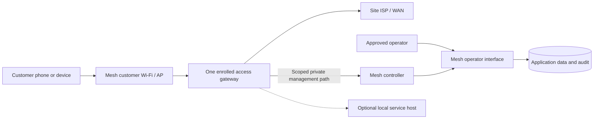

# Mesh field deployment pack

**Audience:** Field lead, network technician, service/operator lead, payment
owner, security/operations reviewer and site custodian  
**Document owner:** Field deployment lead role (individual not yet recorded)  
**Prepared:** 22 October 2026, Africa/Nairobi  
**Evidence checked through:** 22 October 2026  
**Status:** Reusable deployment framework. The proposed deployment is not
commissioned or signed off by this document. Complete the private site
appendix, obtain change approval and pass the go/no-go gates before changing
equipment or admitting customers.

> **Stop condition:** The 22 October field plan says the target router was
> disconnected and the current field inventory, packet-path behavior, capacity
> and provider credentials had not been verified by that planning task. This
> pack therefore contains no live site addresses, serials, credentials or
> ready-to-apply router configuration. It is not authorization to access,
> modify, reboot or migrate a serving router.

## Contents

- [1. Purpose, scope and authority](#1-purpose-scope-and-authority)
- [2. Deployment model and decision gates](#2-deployment-model-and-decision-gates)
- [3. Roles and change control](#3-roles-and-change-control)
- [4. Pre-travel readiness](#4-pre-travel-readiness)
- [5. Site survey and equipment inventory](#5-site-survey-and-equipment-inventory)
- [6. Private records, backups and recovery kit](#6-private-records-backups-and-recovery-kit)
- [7. Network and site-profile worksheet](#7-network-and-site-profile-worksheet)
- [8. Safe commissioning sequence](#8-safe-commissioning-sequence)
- [9. Service acceptance tests](#9-service-acceptance-tests)
- [10. Existing-customer migration boundary](#10-existing-customer-migration-boundary)
- [11. Stop, rollback and recovery](#11-stop-rollback-and-recovery)
- [12. Handover and signoff](#12-handover-and-signoff)
- [Appendix A: printable field checklist](#appendix-a-printable-field-checklist)
- [Appendix B: private site record template](#appendix-b-private-site-record-template)
- [Appendix C: acceptance record template](#appendix-c-acceptance-record-template)
- [13. Source records](#13-source-records)

## 1. Purpose, scope and authority

This pack turns the proposed first-site work into a controlled sequence for a
**single supervised site with one paid-internet gateway**. The intended
approach is to prepare a new isolated Mesh SSID/segment while keeping any
existing customer service under its current billing owner. Reuse existing
equipment only after its actual model, identity, software, interfaces, capacity,
management path and service dependencies are inspected.

The pack is designed to be printable and usable offline. It is not a router
configuration file or a complete command-by-command vendor manual. Use the
current, reviewed, site-specific runbook and approved configuration bundle for
changes; keep that material in the protected operations kit, not in this
general handbook.

### 1.1 What this pack does not authorize

This document alone does not authorize:

- connecting to or changing a router, AP, ISP device, cloud account, payment
  account, production database or controller;
- rebooting, unplugging or moving equipment that carries an existing service;
- creating a new SSID, VLAN, route, firewall rule, payment request, voucher
  batch or customer entitlement;
- enabling paid checkout, opening a payment provider or Bitcoin settlement
  path, or publishing package terms;
- disabling a security control, relaxing identity checks, importing a lab
  configuration, or exposing device management to the internet;
- migrating 3WEST or any existing customer, balance, payment reference,
  voucher stock or device binding; or
- starting the paused laptop-hosted Nostr, Blossom, Jami or other experiments.

All changes require an approved change owner, documented target identity,
reviewed change plan, private recovery evidence and a known rollback path.
Where a step could interrupt an existing service, obtain explicit authorization
from its current service/billing owner and schedule the agreed maintenance
window.

### 1.2 Evidence and version discipline

Every field result must be tied to the site, equipment identity, software
versions, configuration revision, date/time zone, test method and operator.
Mark a result as **observed**, **tested**, **accepted**, **not tested** or
**blocked**. Do not infer that a router is online from a controller heartbeat,
that a payment is active from a receipt, or that a passed home-lab test applies
to a field site.

Keep public/general documentation sanitized. Actual serials, public IPs,
management addresses, Wi-Fi details, SSH fingerprints, credentials, topology
coordinates, customer records, financial evidence and backup file names belong
only in the approved private site record and protected recovery kit.

## 2. Deployment model and decision gates

### 2.1 First-site shape

The proposal is to retain the existing application, database and dedicated
controller service while adapting the actual field router/APs through an
approved, site-specific profile. Customer internet traffic should use the
site's ISP path. The controller coordinates authorized operations; it is not
the customer's internet gateway.

The diagram is conceptual. It does not describe a verified field topology.
Management, customer, transit and optional service networks must be mapped
from actual equipment and physically/technically tested. Do not assume a second
controller or another router can safely operate the same access scope.

### 2.2 Deployment strategies

| Strategy | Use only when | Main safeguards |
| --- | --- | --- |
| New isolated customer segment on existing equipment | Actual AP/router supports isolation and the owner approves the change | Preserve existing management and customer paths; prove the new segment cannot reach them; use an explicit rollback window. |
| Spare or dedicated gateway | The existing router cannot safely isolate the proposed service, or enrollment/policy ownership conflicts | Verify hardware, ISP handoff, power, route/address plan, identity enrollment and one gateway/billing owner. |
| Controlled migration/replacement | Existing service terms, active entitlements and financial ownership have been inventoried and approved for migration | Written cutover and customer plan, exact remaining allowances, single billing owner, customer notice, bounded test and tested rollback. Not the default first-site approach. |

If an isolated segment cannot be delivered safely, stop and use an approved
spare device or reschedule. Do not improvise an open SSID on the existing
customer segment.

### 2.3 Stage gates

| Gate | Work | Required evidence to proceed |
| --- | --- | --- |
| G0 — Authorized preparation | Confirm site, service owner, change window, roles, customer impact and scope | Approved change record, named decision-makers, no unresolved conflict with existing billing/control owner |
| G1 — Ready to travel | Review source/release, product scope, support path, private records, test plan and recovery kit | Correct tested software/config bundle; operators can access secure credentials and recovery without relying on the service being changed |
| G2 — Observe only | Site survey, equipment inventory, read-only software/config inspection, ISP and power checks | Exact equipment and topology confirmed; protected backups are complete and readable; local recovery route demonstrated or risk formally blocked |
| G3 — Isolated setup | Apply approved narrow management/customer overlay to an isolated segment | Router identity/pin matches; management remains available; no guest-to-management access; rollback bundle is ready |
| G4 — Product acceptance | Test welcome, free-service scope, one explicitly authorized test purchase, device binding, revoke and expiry | Only the approved customer journey works; original payment/order references reconcile; no unauthorized paid access |
| G5 — Failure and capacity acceptance | Test WAN/controller/router recovery and bounded representative client load | Results within pre-approved thresholds; no payment duplication, grant resurrection, isolation bypass or loss of management |
| G6 — Limited service handover | Open only approved scope with monitoring and named support | Signed acceptance, published terms, site owner/support contacts, admission envelope, rollback trigger and current version identifiers |
| G7 — Migration/expansion | Separately planned change after initial scope is stable | Customer/financial reconciliation, topology and capacity review, new approvals and test evidence |

Passing a gate does not imply later gates pass. If the observed result does not
match the expected result, stop and record it; do not loosen a guard to make a
check green.

## 3. Roles and change control

Fill in accountable persons before travel. A role listed here is a required
assignment, not evidence that a person is already allocated.

| Role | Required responsibility | Name/contact recorded privately |
| --- | --- | --- |
| Change approver / service owner | Approves scope, customer impact, maintenance window, go/no-go and rollback | ☐ |
| Field lead | Runs checklist, confirms stop conditions, maintains evidence and coordinates handoff | ☐ |
| Network technician | Surveys and inventories router/AP/ISP/power; applies only approved site changes | ☐ |
| Application/controller operator | Verifies deployed release, enrollment, readiness, command status and controller recovery | ☐ |
| Finance/payment owner | Authorizes any live purchase test, reconciles collection/settlement and preserves original references | ☐ |
| Security/recovery reviewer | Reviews management/customer separation, credentials, backup and rollback evidence | ☐ |
| Site custodian | Provides physical access, power/site knowledge and out-of-band recovery route | ☐ |
| Customer support contact | Handles customer questions and payment/access escalation during the test | ☐ |

### 3.1 Change ticket minimum

Before a non-read-only change, record:

- change/ticket reference and approving owner;
- site and exact target equipment identity;
- intended result and explicit out-of-scope systems;
- customer impact, notice and maintenance window;
- prior configuration/release fingerprint and protected backup location;
- reviewed configuration diff and implementation sequence;
- per-step expected result and stop condition;
- local physical recovery route and authorized recovery operator;
- rollback procedure, its expected time and customer effect;
- any live payment/voucher action, its amount, recipient/owner and authorization;
- post-change observation and independent acceptance person.

If the target identity, expected configuration, site owner or rollback path is
uncertain, the change does not proceed.

## 4. Pre-travel readiness

Do not travel with an assumption that the router, WAN, controller or provider
is ready. Confirm readiness with current, authorized evidence.

### 4.1 Scope and product

- [ ] Initial site and customer segment are identified; scope is one site and
  one paid-internet gateway unless separately approved.
- [ ] Existing customer service and billing owner are recorded.
- [ ] Decide whether the test uses a new isolated segment or a spare gateway.
- [ ] Existing customers are explicitly out of scope unless a migration change
  is approved.
- [ ] [Product and service contract](01-product-and-service.md) has current
  approved package terms for the proposed test; unresolved field offers remain
  disabled.
- [ ] Product under test is supported by the actual payment, settlement,
  entitlement and router enforcement path.
- [ ] Free-service list is approved, versioned, narrowly scoped and has an
  unrelated destination that must remain blocked.
- [ ] TV, family, roaming, home-router and unsupported-device offers are
  disabled or excluded from customer messaging.

### 4.2 Software and controller

- [ ] Identify the exact application commit/deployment, database migration
  state, controller release and router adapter/config revision.
- [ ] Verify the target release contains the intended fixes and compatible
  schema/controller/router pieces; do not mix a strict API with an incompatible
  legacy agent.
- [ ] Run the approved local verification and release checks; record
  limitations such as unavailable hosted CI.
- [ ] Confirm the actual enrolled gateway identity is correct and the field
  router is not being accepted by reusing a lab serial, address, SSH pin or
  router ID.
- [ ] Confirm private controller connectivity and pinned management access
  using the approved method; public health alone is insufficient.
- [ ] Confirm native access is the one active owner of the target gateway.
  Keep the laptop access worker disabled while the dedicated controller owns
  the enrolled router.
- [ ] Confirm the admin interface shows evidence-backed current/unknown states,
  not a static “online” indication.
- [ ] Confirm payment backlog and access orders are reconciled before any test;
  a clean read-only check is not proof of a new purchase.

### 4.3 People and supplies

- [ ] Change approval, site access, operator and support coverage confirmed.
- [ ] At least one primary and one recovery operator can authenticate through
  approved passkeys/credentials; keep recovery material protected and separate.
- [ ] Field team has a tested laptop/console cable and any manufacturer-required
  power/PoE equipment, spares and safe mounting/cabling materials.
- [ ] Portable power and lighting suitable for the planned inspection/test are
  available; no mains/PoE assumption is made without checking equipment specs.
- [ ] Secure offline copy of this pack, change plan, sanitized diagrams,
  rollback sheet and relevant runbook is available.
- [ ] Private configuration backup destination and evidence-custodian access
  have been tested.
- [ ] A non-production payment fixture or no-sale test is available for
  rehearsals. Any real payment is separately authorized and deliberately
  bounded.

### 4.4 Do not proceed if

- the current service owner or billing owner cannot be reached;
- the target router/AP identity differs from the approved manifest;
- the site equipment is serving customers and no approved maintenance window or
  isolation exists;
- no local/physical management route is available;
- backups cannot be downloaded, decrypted by the custodian and restored in an
  isolated test where required;
- the correct source/configuration version cannot be established;
- an unresolved payment or access order could be confused with the test;
- provider credentials/readiness are stale, unverified or outside the approved
  package price;
- support, finance reconciliation or recovery responsibility is unassigned; or
- the scope requires a TV/family/multi-gateway capability not implemented and
  accepted for the site.

## 5. Site survey and equipment inventory

Complete the survey before mutation. Record detailed site/security data in the
private site appendix, not in public screenshots or Git.

### 5.1 Site and service context

Record:

- site nickname and protected site ID;
- date/time, field team and current site/service owner;
- whether this is a new isolated service or an existing customer site;
- site permission, physical access, mounting rights and restrictions;
- expected opening use and concurrent client assumptions, marked as estimates
  until measured;
- current customer devices/services that must not be interrupted;
- ISP provider/account owner, handoff type, support contact, plan and any
  service restrictions;
- physical location/coverage observations in the protected survey only;
- nearby radio/interference observations, line of sight, cable route and
  mounting constraints;
- local weather/environmental, water/dust, ventilation and enclosure needs;
- mains/PoE availability, grounding/surge protection and backup-power behavior;
- emergency site access and recovery contact.

Do not publish exact customer, site, coordinate, ISP account or management
details in the general handbook.

### 5.2 Router and AP inventory

For every device, capture privately:

| Field | Record |
| --- | --- |
| Role | Gateway / routing node / AP / service host / ISP handoff / other |
| Manufacturer and model |  |
| Serial and unique device identity | Protected record only |
| Operating system and firmware/package versions |  |
| Interfaces, port names, speed/duplex and current link peer |  |
| Radio band, channel, width, antenna and current association |  |
| VLAN/tagging and bridge capability |  |
| CPU, memory, storage and current utilization |  |
| Power supply/PoE type, voltage/current budget and UPS |  |
| Management service exposure and allowed source path |  |
| Existing customer, transit and ISP dependencies |  |
| Current configuration fingerprint and approved enrollment identity | Protected record only |
| Warranty, physical condition, mounting and cable labels |  |

An AP is not automatically a router or mesh peer. A common SSID name does not
provide routing, roaming, authentication or client isolation. Verify the actual
hardware role and link path. Confirm that PoE voltage, standard and available
power match the device before connecting it.

### 5.3 ISP/backhaul/power inspection

- Identify whether upstream access uses Ethernet, fiber ONT, radio, cellular or
  another handoff; record permitted WAN addressing and router requirements.
- Measure negotiated link rate and confirm cable/port status before comparing
  throughput.
- Test wired and radio backhaul separately when both are part of the accepted
  design. Record measured throughput, latency, loss and recovery under the
  intended path.
- Survey radio placement, alignment, channel use, legal limits and weather
  exposure before commissioning outdoor links.
- Identify the narrowest capacity point: ISP subscription, physical port,
  router forwarding, AP airtime, backhaul or controller dependency.
- Verify power and reboot behavior for router/AP/controller dependencies. A
  controller VM restart test does not establish field router or site power
  recovery.
- Confirm local service hosts (if any) have power, storage, backup, startup and
  named maintenance owners. Experimental laptops are not assumed field
  appliances.

## 6. Private records, backups and recovery kit

### 6.1 Records to capture before changes

Use approved read-only inspection tools and the current device-specific
runbook. Capture:

- router/AP inventory and current firmware;
- sanitized configuration export and protected full/binary backup;
- exact identity and management-key/SSH fingerprint verification;
- current interfaces, bridges, ports, VLANs, routes, DHCP, DNS, NAT, firewall,
  HotSpot, queues, address lists and active access sessions;
- current ISP reachability, controller tunnel, AP reachability and local
  recovery route;
- existing customers, active/paid grants, remaining time/data, deadlines,
  speed/device bindings and payment references where an approved migration
  requires them;
- existing scheduled tasks/workers/agents and any competing access owner;
- current package/free-app policy and a rollback copy of assets;
- payment/provider readiness and unresolved transaction backlog via authorized
  read-only checks; and
- time synchronization/clock state and evidence timestamps.

Never paste sensitive exports or payment payloads into chat, issue trackers,
screenshots or public Markdown. Keep raw evidence encrypted, access-controlled,
retention-limited and separate from Git. The sanitized handbook records only
the outcome and protected evidence reference.

### 6.2 Backup acceptance

A backup is acceptable only if:

1. it came from the exact intended device and its identity was verified;
2. it completed without error and is stored encrypted in the approved private
   destination;
3. the custodian can retrieve it with authorized access;
4. file size, timestamp and cryptographic fingerprint are recorded separately
   from secrets;
5. restoration instructions and compatible software version are known; and
6. restore has been rehearsed in an isolated/spare environment when the change
   risk requires it.

A text export may omit secrets or binary-specific state; a binary backup may
contain secrets and device-bound settings. Preserve both only as policy allows,
and do not confuse “downloaded” with “restorable.”

### 6.3 Recovery kit

Keep a protected, offline copy of:

- approved change plan and scope;
- correct site/device inventory and topology/port labels;
- pre-change and post-change backups, fingerprints and custody record;
- compatible prior application/controller/router versions and integrity
  references;
- private controller/tunnel and router access instructions, not embedded in
  the public pack;
- known local console/cable path, power requirements and site access contact;
- exact rollback diff and the owner authorized to invoke it;
- customer/payment support escalation route; and
- evidence checklist with space for timestamps and outcomes.

The public repository and ignored `artifacts/` directory are not an
authoritative field recovery kit. Artifacts may be absent from developer clones
and can contain sensitive material.

## 7. Network and site-profile worksheet

### 7.1 Site profile required before enrollment

The protected profile should include:

- unique site and router IDs;
- actual board identity/serial and supported firmware;
- verified SSH host-key fingerprint and scoped controller credential reference;
- guest/customer CIDRs and DHCP pools;
- management, customer, service-host and transit interfaces/VLANs;
- WAN interface, ISP gateway/DNS behavior and permitted upstream routes;
- AP names, SSIDs, radio settings, client isolation and management path;
- HotSpot service/interface and captive asset revision;
- DNS and trusted HTTPS/join origin;
- controller tunnel peer/interface and allowed routes;
- approved free-service policy version and rollback marker;
- speed/data/time/expiry semantics for each approved package;
- local time/NTP, reboot and expiry behavior;
- monitoring/observation targets and stale thresholds;
- encrypted backup references and recovery contact;
- desired configuration version, approver, rollout state and rollback version.

Use fictitious examples in public material; actual assignments remain private.

### 7.2 Address and role checks

Before any route or DHCP change:

- check for overlap with the ISP LAN, existing site prefixes, controller/tunnel
  networks, neighboring Mesh sites and management ranges;
- reserve unique router IDs, transit addresses, LAN prefixes and DHCP pools in
  the site plan;
- ensure customer DHCP cannot allocate management or transit addresses;
- confirm no guest interface forms a routing adjacency or exposes private
  management destinations;
- define whether the site has a dedicated port, VLAN or other tested isolation
  mechanism; and
- verify IPv4 and IPv6 behavior explicitly. IPv4 HotSpot policy does not prove
  IPv6 access is restricted.

Do not copy the home lab subnets, aliases, serials, keys, queue names or route
costs as a field allocation. A design transfer needs a reviewed site plan.

### 7.3 Port and link map

Complete from the physical labels and current read-only state:

| Physical/interface label | Connected peer/role | Speed/duplex or radio state | VLAN/untagged role | Before-change state | Approved target |
| --- | --- | --- | --- | --- | --- |
|  | ISP/WAN |  |  |  |  |
|  | Customer AP/segment |  |  |  |  |
|  | Management/recovery |  |  |  |  |
|  | Transit/backhaul |  |  |  |  |
|  | Spare/unused |  |  |  |  |

Label both cable ends. Photograph only if permitted; redact serial labels,
credentials, customer screens and site-sensitive details before any wider
sharing.

## 8. Safe commissioning sequence

Perform one bounded stage at a time. Record expected and actual results. If an
unexpected behavior occurs, stop new mutations and use the approved recovery
path.

### Stage 1 — Confirm target and authority

1. Reconfirm the change ticket, site owner, target serial/identity and scope
   with a second authorized reviewer.
2. Confirm the existing billing/access owner and that no duplicate controller
   or local worker will issue grants to the same gateway.
3. Confirm no active customer operation conflicts with the agreed test window.
4. Verify private management route, trusted SSH identity/pin and local console
   access; do not expose router management publicly.
5. Capture time, version identifiers and read-only baseline.

**Expected:** target equipment exactly matches the approved profile and
recovery works without relying solely on the path being changed.  
**Stop if:** identity, access, owner, active service or configuration is
ambiguous.

### Stage 2 — Preserve and verify baseline

1. Export and back up router/AP configuration using the approved runbook.
2. Confirm backups are complete, retrievable and protected.
3. Capture active clients/sessions, routes, WAN, DNS, firewall/HotSpot/queue
   state and all existing policy owners.
4. Reconcile payments and access orders using read-only checks; do not create a
   payment or reset a ledger as a “health check.”
5. Confirm unaffected existing customer paths from a known test device.

**Expected:** a dated baseline can be restored and compared; current state is
understood.  
**Stop if:** backup failed, restoration is unknown, an unexpected legacy
worker/queue exists, or money/access is unresolved.

### Stage 3 — Establish management and recovery first

1. Enroll the actual router identity and per-site key/pin through the approved
   process.
2. Configure only the scoped private controller/management path and required
   permissions.
3. Verify tunnel, pinned management access, controller-to-router observation
   and a harmless read-only operation.
4. Confirm public WAN access to router/AP management remains denied.
5. Verify local console/recovery remains available after management-path
   changes.

**Expected:** authorized operators can inspect the intended router over the
private path and can recover locally; unauthorized management paths remain
blocked.  
**Stop if:** management is reachable from the customer network/public internet,
the identity pin differs, remote state is stale, or local recovery is lost.

### Stage 4 — Commission isolated customer access

1. Use the approved new SSID/VLAN/dedicated interface/spare gateway plan.
2. Configure customer DHCP/DNS and HotSpot only on the approved customer
   interface.
3. Preserve transit, management, ISP and existing customer interfaces.
4. Apply reviewed client isolation and private-destination controls.
5. Ensure IPv6, FastTrack/hardware-offload and alternate packet paths do not
   bypass the intended access controls.
6. Upload only approved captive assets using a scoped, backed-up deployment
   tool; verify readback against the intended asset revision.
7. Test an unpaid client before enabling any sale or free exception.

**Expected:** unpaid devices can reach the local welcome and approved local
purchase entry but cannot reach general internet, management or other customers
except explicitly approved local services.  
**Stop if:** guest access reaches private networks, management, unrestricted
internet or an existing customer segment.

### Stage 5 — Apply approved free-service policy

1. Confirm the policy owner, revision, service feature, destination/port scope,
   review date and exact customer segment.
2. Preview the policy diff; ensure no broad provider/CDN/store range is added
   to make a single test pass.
3. Apply only through the approved native policy path; read back the exact
   router state and version.
4. Test the named feature on an unpaid device with cellular data off.
5. Test an unrelated destination that must remain blocked.
6. Record shared-IP/IPv6/push limitations and rollback markers.

**Expected:** named feature works within the accepted conditions; unrelated
general browsing remains blocked.  
**Stop if:** policy applies to the wrong router/site, broadens access
unexpectedly, or lacks a verified rollback.

### Stage 6 — Validate products and payment readiness

1. Confirm only approved products are displayed for this site.
2. Compare customer price/terms with backend snapshot, provider request,
   receipt, entitlement and router policy.
3. Confirm the selected provider is ready for that exact amount and settlement
   route. Readiness/quote alone is not an end-to-end pass.
4. Verify unresolved payments/orders are clear before an explicitly authorized
   live test.
5. If using a live purchase, record its amount, device, reference and approved
   operator. Do not repeat the purchase if any response is missing.
6. Wait for provider verification, required settlement, entitlement creation
   and the correct gateway acknowledgement as distinct states.

**Expected:** exactly one authorized test transaction creates one intended
allowance on the correct device/gateway.  
**Stop if:** amount/provider mismatches, a receipt is uncertain, access appears
on the wrong device, duplicate order/collection occurs or the gateway does not
acknowledge. Preserve original references and escalate; do not pay again.

### Stage 7 — Operational and failure acceptance

1. Verify paid and unpaid devices are distinct; the unpaid comparison device
   does not inherit access.
2. Test disconnect separately from entitlement revoke; reconnect behavior must
   match the documented product.
3. Verify expiry against the approved package semantics and local router clock.
4. Test WAN loss: external browsing/payment/app dependencies fail honestly,
   while only accepted local services continue.
5. Test controller interruption/restart without duplicated collection,
   extended deadlines, reset counters or resurrected revocation.
6. Test AP/router power recovery only within the approved window and with
   backups/recovery present.
7. Roll back the isolated test configuration once as a controlled rehearsal if
   required by the gate; confirm the original customer service remains intact.

**Expected:** behavior matches the approved contract and the system recovers
without financial duplication or access escalation.  
**Stop if:** management recovery fails, expiry is wrong, local access expands,
or original financial/access state cannot be reconciled.

### Stage 8 — Bounded capacity observation

Capacity is established by measurement on target equipment and service policy,
not by a router model name, AP count, nominal radio rate or cloud concurrency
test.

Before traffic:

- approve a test profile that does not generate live M-Pesa prompts or
  uncontrolled public API traffic;
- define the expected opening concurrent demand and a conservative stop
  threshold;
- record idle router/AP/backhaul/ISP baseline;
- use consenting test devices on the isolated segment; and
- ensure finance/provider production paths are not used for synthetic load.

The existing pilot plan proposes five clients followed by ten only if the
first stage is stable, with measured 30-minute activity. These are **test
stages, not an established capacity claim or universal acceptance threshold**.
Set actual traffic and thresholds with the field/network owner. Observe
throughput, latency, loss, airtime, router CPU/memory, connection/queue behavior,
customer experience and management responsiveness. Test paid/free policy
behavior at the intended load.

Stop load if packet loss or queue delay rises unexpectedly, the router becomes
unresponsive, management/recovery access degrades, isolation fails, service
behavior diverges from package terms or a payment/provider is unintentionally
triggered. Record the highest fully accepted tested profile and leave
operational headroom. Do not advertise an extrapolated maximum.

### Stage 9 — Limited service opening

Open only when G0–G6 pass for the chosen offer. At minimum:

- the site owner and support contact are reachable;
- customer-visible packages match the accepted terms;
- the approved admission envelope is enforced;
- current network/controller/app versions are recorded;
- monitoring distinguishes controller, router, WAN/AP and client observations;
- unresolved purchases and stalled activations trigger a support process;
- backups and rollback are available to an authorized operator; and
- excluded TV/family/roaming/offline features are not marketed as available.

Start supervised, observe actual behavior, and stop new sales if a payment,
isolation, activation, expiry or support gate fails.

## 9. Service acceptance tests

Use the acceptance record template in Appendix C. Every test must identify
equipment/version, device, expected result, observed result, evidence reference,
tester and acceptor. Keep customer and payment identifiers private.

| Test | Setup | Expected result | Failure response |
| --- | --- | --- | --- |
| Unpaid join | Fresh authorized test device, cellular off, no paid session | Joins the intended Mesh SSID, receives expected network settings and sees the local welcome | Do not enable checkout; inspect AP/DHCP/DNS/portal path using approved read-only diagnostics |
| Management isolation | Unpaid test device on customer segment | Cannot reach router/AP/controller/server management or another customer | Stop test and disable customer admission until isolation is fixed and re-tested |
| General internet denied | Unpaid device, unrelated HTTPS destination | General internet remains blocked; no accidental paid binding/session | Stop; inspect exact policy and packet path; do not use broad bypass |
| Free local service | Unpaid device and named local endpoint | Only the approved local feature works; no WAN assumption is hidden | Mark unavailable and roll back only the approved owned rule if needed |
| Free external app | Unpaid device, required app already installed/logged in, cellular off | Exact accepted feature works; unrelated destination remains blocked | Do not expand the allowlist broadly; capture only necessary metadata and review dependencies |
| Captive close/reopen | Dismiss OS captive window, open normal browser | Local purchase/status page remains reachable; no automatic payment or general access | Keep checkout disabled until the real-device handoff is fixed |
| Approved payment test | One explicitly approved product/device/provider | One verified collection/settlement, one entitlement, correct gateway acknowledgement | Preserve original reference; stop all repeat attempts and escalate to finance/operator |
| Device binding | Paid test device and separate unpaid device | Access is on the intended device only; second device remains blocked | Revoke/contain through approved procedure; stop sales and inspect identity/context |
| Disconnect vs revoke | Authorized test entitlement | Disconnect permits reconnection only if valid; revoke remains denied after reconnect | Stop administrative use if command result is not read back or semantics differ |
| Expiry | Approved test package or safe test deadline | Access ends at the correct original deadline; no counter reset on reconnect | Stop sales; preserve ledger and investigate clock/queue enforcement |
| WAN loss | Approved maintenance/test window | Public sites/payment/external apps fail; accepted local page/services behave as documented | Restore WAN as planned; do not claim offline service beyond the measured result |
| Controller loss/restart | Approved window and recovery operator | New activation pauses honestly; existing limits/revocations remain safe; no duplicate money movement | Roll back controller release or restore service; do not reset the ledger |
| Router/AP reboot/power | Approved window, local recovery ready | Device returns to intended configuration and preserves expiries/access policy | Use physical recovery; stop customer admission until policy and state are revalidated |
| Free-policy rollback | Known approved policy revision | Only Mesh-owned rule/assets are removed; unrelated rules/customer service remain | Stop and restore the protected known-good backup with change owner approval |
| Capacity stage | Approved isolated client/load profile | Measurements remain within pre-approved envelope and customer policy is enforced | Stop load, retain traces privately and lower admission/revise equipment plan |

Do not perform destructive, financial or customer-affecting acceptance without
the explicitly approved test plan and rollback.

## 10. Existing-customer migration boundary

The first-site proposal keeps existing customer service under its present
billing owner until a controlled migration is approved. Prefer a new isolated
Mesh segment so a first Mesh test does not silently alter existing customer
service.

If migration becomes necessary:

1. Record the current serving router identity, software, customer/access model,
   payment owner and all active services.
2. Export an authorized customer/plan snapshot in a protected location.
3. Reconcile each active customer to the exact price, speed, remaining usable
   time/data, validity deadline, device identity, prior payment/receipt and any
   TV/family sponsorship.
4. Identify semantics that cannot be represented in Mesh, including TV plans,
   calendar-month periods, connected-time limits and device transfer.
5. Obtain service-owner, finance and customer-communication approval for how
   each unmatched entitlement will be preserved.
6. Prove that one serving gateway has one active billing/access owner. Do not
   run legacy and native controllers concurrently for the same customer scope.
7. Dry-run a migration manifest and compare totals, exceptions and sample
   records before write access.
8. Schedule a maintenance window with an admission hold and a tested rollback.
9. Migrate in a bounded cohort; reconcile payments, active grants and expiry
   after each cohort before proceeding.
10. Keep the original service and records available until reconciliation and
    rollback conditions are formally closed.

Never silently reset remaining allowances, restart deadlines, change package
rates/prices, convert TV access to phone access, transfer settlement or issue
new payment prompts to repair a migration. If a term cannot be preserved, stop
and obtain a customer/service-owner decision before proceeding.

## 11. Stop, rollback and recovery

### 11.1 Immediate stop triggers

Stop the current change and prevent new customer admission/sales when any of
the following occurs:

- router/AP identity, enrollment key or site profile mismatch;
- loss of local or private management recovery;
- customer access to management, another customer's device or unintended
  private network;
- unpaid device receives general internet or an unapproved grant;
- wrong device, wrong site or wrong package receives paid access;
- duplicate collection, uncertain payment, duplicate settlement or missing
  financial reference;
- a paid/verified customer remains blocked and the approved recovery path is
  unknown;
- grant, expiry, consumed allowance or revocation is reset, extended or
  resurrected unexpectedly;
- free-service exception broadens into unintended internet access;
- wrong interface/VLAN/DHCP/routes affect an existing customer or ISP path;
- router/AP/controller health or capacity crosses the pre-approved threshold;
- a backup is missing, unreadable or cannot be restored as required; or
- the service owner, support contact or rollback approver is unavailable.

Preserve logs and original transaction/command references. Do not retry a
payment, reissue Bitcoin, restore a database over current financial state or
delete a ledger as an immediate troubleshooting shortcut.

### 11.2 Rollback principles

- Roll back only the reviewed Mesh-owned change set: identified rules, assets,
  enrollment, configuration bundle or software release.
- Do not use a blanket reset, global firewall flush, wholesale configuration
  import or unscoped rollback on shared/serving equipment.
- Restore the exact pre-change version/configuration only after confirming its
  device identity and compatibility.
- Preserve payment receipts, settlement records, voucher state, revocations,
  consumed counters and original expiry deadlines.
- Keep existing customer billing/access ownership unchanged unless a separate
  approved migration explicitly says otherwise.
- Verify rollback through router readback and a bounded customer-side test;
  database state or a successful command response alone is insufficient.
- Record what remains unknown, notify the owner/support channel and keep sales
  disabled until acceptance is restored.

### 11.3 Recovery sequence

1. Stop new changes and new payment/sales activity in the affected scope, if
   authorized and necessary to prevent harm.
2. Identify the last known-good configuration/release and the exact failed
   step.
3. Confirm physical/local recovery path and obtain the change approver's
   authorization.
4. Restore only the planned scope using the protected, verified backup or
   prior release.
5. Read back router identity, management path, guest isolation, ISP/WAN,
   customer service, policy revision and active access state.
6. Reconcile outstanding payment/settlement/order states against original
   references; never assume that a timeout means failure.
7. Test unpaid restrictions and one authorized paid/known-good access case
   without generating a new charge unless separately approved.
8. Notify the service/support owner and record customer impact and remedy
   decisions.
9. Retain protected evidence and open a follow-up before restarting any paused
   local experiment or resuming rollout.

## 12. Handover and signoff

The field handover must be usable by an operator who did not perform the
installation. Provide:

- approved site/service scope and customer terms;
- actual installed models/versions and protected inventory location;
- sanitized topology/port map in the handbook and full map in the private kit;
- application, controller, router/AP and policy revision identifiers;
- deployment/backup/rollback references and restore custodian;
- access ownership, enrolled gateway, operator/recovery access and escalation
  contacts;
- accepted capacity envelope and any admission limit;
- accepted paid, unpaid, free-service, expiry and outage cases;
- unresolved failures, exclusions, owner and target review date;
- payment/support reconciliation procedure and current customer status where
  authorized;
- next review/maintenance date and events that require immediate review; and
- signoff by field lead, service owner, operations/network reviewer and
  finance/payment owner for any live-payment scope.

No row may be marked accepted on the basis of a plan, software build,
readiness quote, heartbeat, screenshot or mocked test where physical
acceptance is required.

## Appendix A: printable field checklist

### Before leaving

- [ ] Change approved; target scope and owner confirmed.
- [ ] Current product contract and test package approved.
- [ ] Deployed/source/configuration versions identified.
- [ ] Correct router identity and enrollment path confirmed.
- [ ] Controller/gateway ownership conflict checked.
- [ ] Payment and access backlog reconciled read-only.
- [ ] Roles, support and recovery contacts assigned.
- [ ] Private site record and encrypted recovery kit ready.
- [ ] Backup retrieval and local console path verified.
- [ ] Site access, ISP, power/PoE and maintenance window confirmed.
- [ ] Offline copies of approved runbook, test plan and rollback sheet packed.
- [ ] Paused local computer experiments remain out of scope.

### On arrival — observe and record

- [ ] Confirm site permission and actual customer/service impact.
- [ ] Match manufacturer/model/serial/firmware to approved target identity.
- [ ] Record ISP handoff, AP/router ports, VLANs, radio/backhaul and power.
- [ ] Verify pinned management path and local recovery.
- [ ] Capture read-only configuration, sessions, routes, DHCP/DNS, firewall,
  HotSpot/queues and policy state.
- [ ] Capture protected encrypted backup and verify retrieval.
- [ ] Measure baseline link/health; record date/time zone.
- [ ] Reconcile active customer/payment/access state before changes.
- [ ] Stop if any identity, owner, backup or recovery path is uncertain.

### Isolated commissioning

- [ ] Apply only reviewed site-specific change bundle and diff.
- [ ] Preserve ISP, transit, management and existing service interfaces.
- [ ] Test guest-to-management/private/customer isolation (IPv4 and IPv6).
- [ ] Read back actual firewall/HotSpot/queue/AP/SSID and asset revision.
- [ ] Test unpaid welcome and general-internet denial.
- [ ] Apply approved free-service policy; verify unrelated site remains blocked.
- [ ] Confirm displayed packages match approved contract and provider readiness.
- [ ] Perform one live payment only with explicit approval; never retry an
  uncertain result.
- [ ] Confirm correct device/gateway activation and an unpaid comparison device
  remains restricted.
- [ ] Test revoke, expiry, WAN/controller outage and recovery as approved.
- [ ] Measure only the agreed bounded capacity profile.
- [ ] Roll back if a stop trigger occurs.

### Handover

- [ ] Record tested versions, policy/config revision and observed results.
- [ ] Store protected evidence and backups with named custodian.
- [ ] Record accepted capacity/admission envelope and exclusions.
- [ ] Name site custodian, operator, finance and support/escalation contacts.
- [ ] Confirm rollback and physical recovery remain usable.
- [ ] Sign required role approvals; leave unsigned gates blocked.

## Appendix B: private site record template

Copy this section only into the approved, access-controlled operations system.
Do **not** commit completed site details to the general handbook or public
repository.

### Site/change metadata

| Field | Value |
| --- | --- |
| Change/ticket reference |  |
| Protected site ID / nickname |  |
| Exact address/coordinates (private) |  |
| Service owner / current billing owner |  |
| Field lead / site custodian / support contact |  |
| Approved scope and out-of-scope services |  |
| Maintenance window and customer notice |  |
| Date/time/time zone |  |
| Rollback approver and local contact |  |

### Equipment and deployment identity

| Field | Value |
| --- | --- |
| Gateway model/serial/firmware |  |
| AP models/serials/firmware |  |
| ISP handoff/device/plan reference |  |
| Router/SSH identity fingerprint (private) |  |
| Enrolled site/router ID |  |
| Application commit/deployment |  |
| Controller release/host identity |  |
| Schema/config/policy revisions |  |
| Backup filenames, fingerprints and custody |  |
| Prior known-good release/config |  |

### Network plan (private)

| Role | Interface/VLAN | Prefix/address | DHCP/DNS | Route/policy owner |
| --- | --- | --- | --- | --- |
| ISP/WAN |  |  |  |  |
| Customer/guest |  |  |  |  |
| Management |  |  |  |  |
| Transit/backhaul |  |  |  |  |
| Local service (if approved) |  |  |  |  |
| Controller tunnel |  |  |  |  |

### Change/recovery references

| Field | Value |
| --- | --- |
| Approved diff/config bundle reference |  |
| Pre-change backup reference |  |
| Post-change backup reference |  |
| Local console/cable/power recovery details |  |
| Private credential custodian reference |  |
| Payment/test authorization reference |  |
| Protected evidence folder/reference |  |
| Retention/deletion review date |  |

Do not put secret values in this worksheet; record only an authorized vault or
custodian reference.

## Appendix C: acceptance record template

| Test ID | Test and scope | Equipment/software/config revision | Expected result | Observed result | Evidence reference (private) | Status / tester / acceptor |
| --- | --- | --- | --- | --- | --- | --- |
|  |  |  |  |  |  |  |
|  |  |  |  |  |  |  |
|  |  |  |  |  |  |  |

### Gate decision

| Gate | Pass / blocked / not in scope | Evidence reference | Reviewer and date |
| --- | --- | --- | --- |
| G0 — Authorized preparation |  |  |  |
| G1 — Ready to travel |  |  |  |
| G2 — Observe only |  |  |  |
| G3 — Isolated setup |  |  |  |
| G4 — Product acceptance |  |  |  |
| G5 — Failure/capacity |  |  |  |
| G6 — Limited service handover |  |  |  |
| G7 — Migration/expansion |  |  |  |

### Signoff

| Responsibility | Name/role | Decision | Date |
| --- | --- | --- | --- |
| Field lead |  |  |  |
| Service/change owner |  |  |  |
| Network/operations reviewer |  |  |  |
| Finance/payment owner (if payment tested) |  |  |  |
| Site custodian/support owner |  |  |  |

**Unresolved items / exclusions / launch restrictions:**  
  
  
**Rollback trigger and authorized contact:**  
  
  

## 13. Source records

- [Documentation plan and Volume 02 brief](../mesh-documentation-plan-and-toc.md)
- [Mesh start here and evidence register](00-start-here.md)
- [Product and service contract](01-product-and-service.md)
- [Administration and support](03-administration.md)
- [IP network and hardware](04-ip-network.md)
- [Proposed field deployment and administration plan](../mesh-field-deployment-plan.md)
- [Home-to-field production operations guide](../mesh-production-operations.md)
- [Home pilot decision and acceptance gates](../mesh-pilot-readiness-and-device-plans.md)
- [3WEST catalogue parity and migration evidence](../3west-production-readiness.md)
- [Developer deployment and recovery handoff](../mesh-developer-handoff.md)
- [Local lab pause and recovery boundaries](../mesh-local-lab-pause-2026-10-14.md)
- [Network readiness](../kibera-mesh-network-readiness.md)
- [Guided lab setup and historical results](../kibera-mesh-lab-01-runbook.md)
- [Security release and rollout limits](../mesh-security-release-2026-10-06.md)
- [Native access replay protection and rollout order](../mesh-agent-replay-protection.md)
- [Bitika-first checkout and uncertain-payment recovery](../mesh-bitika-primary.md)
