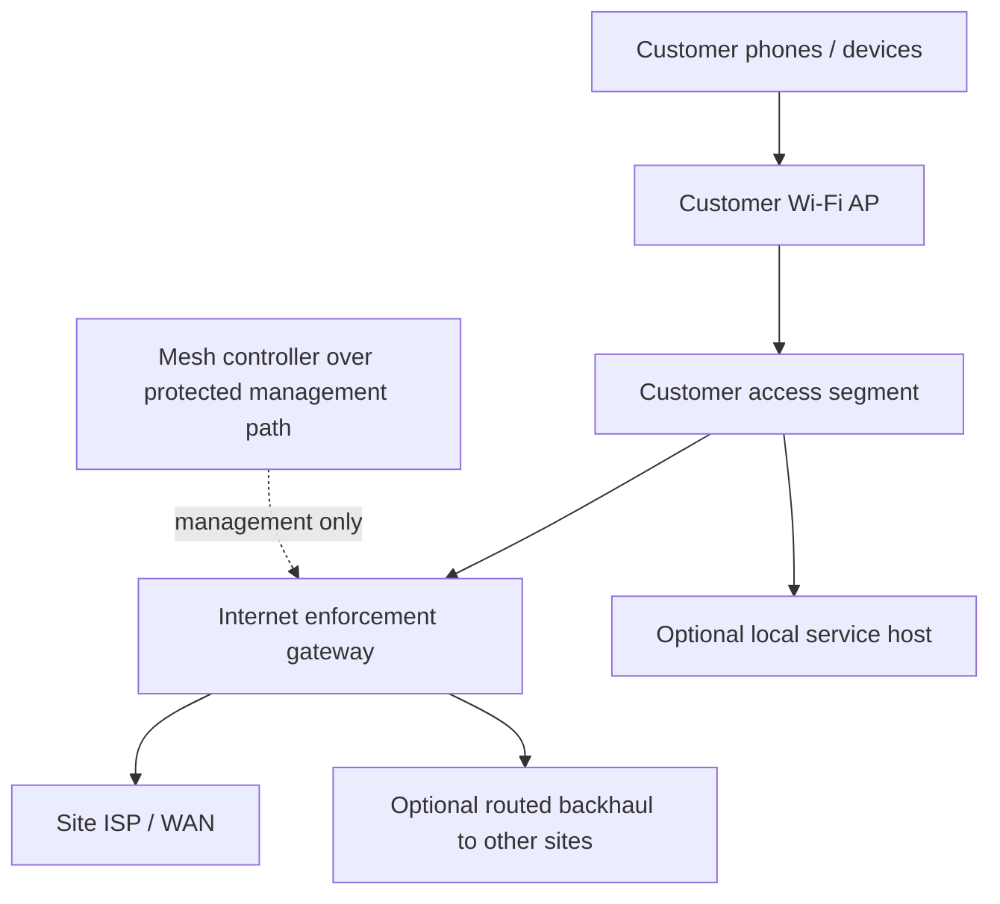

# Mesh IP network and hardware

**Audience:** Network engineers, field technicians, site operators, security
reviewers and equipment planners  
**Document owner:** Network engineering owner role (individual not yet recorded)  
**Prepared:** 22 October 2026, Africa/Nairobi  
**Evidence checked through:** 22 October 2026  
**Status:** Engineering reference for the tested home network and proposed
field design. The home-lab topology is not a field addressing plan, hardware
approval or production acceptance. Complete the private site worksheet and
verify all equipment before deployment.

> **Scope boundary:** The documented lab proves a two-router routed network
> with preferred Ethernet and an alternate radio transit between the same
> routers. It does not prove three-node multi-hop, coverage in Kibera, the
> ability to route around a failed router, or a customer-capacity figure. The
> field site, router identity, addressing, APs, WAN, IPv6 behavior, RF
> conditions and packet-path enforcement require separate verification.

## Contents

- [1. Purpose and network principles](#1-purpose-and-network-principles)
- [2. What is tested and what remains unproven](#2-what-is-tested-and-what-remains-unproven)
- [3. Network roles and topology](#3-network-roles-and-topology)
- [4. IPv4 addressing and site allocation](#4-ipv4-addressing-and-site-allocation)
- [5. IPv6 policy](#5-ipv6-policy)
- [6. Trust zones, VLANs and isolation](#6-trust-zones-vlans-and-isolation)
- [7. DHCP, DNS and local discovery](#7-dhcp-dns-and-local-discovery)
- [8. Routing, transit and failover](#8-routing-transit-and-failover)
- [9. Wi-Fi access and radio backhaul](#9-wi-fi-access-and-radio-backhaul)
- [10. Paid-access enforcement and packet paths](#10-paid-access-enforcement-and-packet-paths)
- [11. Remote management and recovery](#11-remote-management-and-recovery)
- [12. Hardware and compatibility](#12-hardware-and-compatibility)
- [13. Measurement and capacity](#13-measurement-and-capacity)
- [14. Failure-domain matrix](#14-failure-domain-matrix)
- [15. Field acceptance checklist](#15-field-acceptance-checklist)
- [Appendix A: sanitized address-plan example](#appendix-a-sanitized-address-plan-example)
- [Appendix B: per-site network worksheet](#appendix-b-per-site-network-worksheet)
- [16. Source records](#16-source-records)

## 1. Purpose and network principles

Mesh uses Internet Protocol (IP) networking as the shared infrastructure for
customer Wi-Fi, routing between selected sites, optional local services and
internet access through a gateway. IP connectivity is distinct from the
services carried over it:

- Wi-Fi and Ethernet connect devices to the local network.
- Routers forward IP packets between network prefixes.
- A site gateway enforces the customer access policy and forwards authorized
  internet traffic to the ISP.
- The Mesh controller provides a separate management/automation path to an
  enrolled gateway.
- Applications such as Signal, Blink, Jami and locally hosted services have
  their own endpoints, authentication, discovery and availability
  dependencies.

Internet access is a service delivered over the network; it is not the network
itself. A WAN outage may leave local IP routes and local services reachable,
but it cannot make an external application available offline. Conversely, a
local application demonstration does not prove internet access, site coverage
or a production service.

### 1.1 Design rules

1. **Separate roles.** A customer AP, routing node, paid-access gateway,
   controller and local-service host are different roles, even when one
   physical device happens to perform more than one of them.
2. **Use unique site and network identity.** Allocate site IDs, router IDs,
   prefixes and credentials deliberately. Do not clone a lab identity into a
   field router.
3. **Keep customer traffic untrusted.** Customer devices must not reach
   management interfaces, other customers or private upstream networks unless
   an explicitly reviewed local service requires a narrow exception.
4. **Design for both address families.** IPv4 restrictions do not imply IPv6
   restrictions. Enable IPv6 only with a defined route, DNS and enforcement
   policy; otherwise ensure it cannot bypass the intended access boundary.
5. **Make failure visible.** Separate WAN, router/AP, controller, DNS,
   application and payment status. Do not label a site “online” based on a
   single heartbeat.
6. **Test the actual packet path.** A configuration entry, route table, admin
   badge or successful software build does not prove end-to-end enforcement.
7. **Measure the bottleneck.** Capacity is limited by the narrowest ISP,
   router, Ethernet port, wireless link, AP airtime, power or service dependency.
8. **Keep recovery local.** A site must have an out-of-band or physical recovery
   path if a tunnel/firewall/routing change breaks remote management.
9. **Do not imply multi-hop from a brand name.** Ordinary AP expansion and
   parallel links between two routers are not evidence of arbitrary
   multi-hop resilience.

## 2. What is tested and what remains unproven

### 2.1 Home-lab evidence

The 5 October 2026 network-readiness record describes a two-router home
network:

- Each MikroTik router served a separate client subnet through its own UniFi AP.
- OSPF exchanged routes between the two routers over wired and radio transit
  links.
- Ethernet was the preferred path; removing that link selected the radio path,
  and restoring the cable returned preference to wired transit.
- Both protected lab networks reached the public internet through the Primary
  home gateway when the WAN was available.
- Removing only the Primary WAN withdrew the internet default route while
  local peer routes and the tested local board remained reachable.
- Reconnecting the WAN restored internet in the later recorded test.

These are bounded lab results tied to the tested equipment, configuration,
location and procedures. The radio interface rate/quality observations in the
source are not application throughput, outdoor range, customer capacity or
coverage measurements. The source notes that Primary-side failover evidence
was partly retained in the runbook rather than repeated in the later read-only
review.

The Primary test network also has an isolated open Mesh customer segment and a
router-hosted welcome. That customer segment's presence is not equivalent to
complete field acceptance: physical guest isolation/offline and paid/free
enforcement remain separate commissioning gates in the dated records.

### 2.2 Limits

The current evidence does not establish:

- three or more routed sites, arbitrary peer discovery, or a route around a
  failed intermediate router;
- two geographically independent paths or ISP/provider redundancy;
- outdoor link budget, Kibera coverage, lawful final radio settings or
  interference conditions at a proposed field location;
- a supported client count, sustained throughput, latency or availability
  target;
- field router/AP models, firmware, port roles, PoE budget, IPv6 policy or
  site-specific addresses;
- that a common SSID produces roaming or preserves paid sessions across
  gateways;
- that ordinary routed IP carries link-local app discovery across subnets;
- that a local service host is redundant simply because the network has
  alternate routes; or
- field acceptance of customer isolation, HotSpot queues, payment, expiry,
  management security, reboot recovery or IPv6 denial.

### 2.3 Evidence labels for network work

| Label | Meaning in this chapter |
| --- | --- |
| **Observed** | A read-only measurement or state was recorded at a particular time and equipment. |
| **Tested** | A defined stimulus was applied and the result was observed, including failure/recovery behavior. |
| **Accepted** | The accountable reviewer accepted the result for a named gate and scope. |
| **Configured** | A setting exists in a saved/running configuration; this alone is not proof of end-to-end behavior. |
| **Proposed** | A future design or setting without deployment/acceptance evidence. |
| **Unknown** | No current evidence establishes the state. Do not replace with a presumed pass or fail. |

## 3. Network roles and topology

### 3.1 Device roles

| Role | Function | Does not automatically provide |
| --- | --- | --- |
| **Customer device/client** | Phone, laptop, TV or other endpoint using a customer AP or wired customer port. | Routing-node behavior, persistent hosting, a stable human identity or permission to reach other clients. |
| **Customer access point (AP)** | Provides Wi-Fi radio access to a defined customer network and forwards traffic into the designed LAN/VLAN. | Internet access, billing, routed backhaul, customer isolation or roaming merely by advertising an SSID. |
| **Routing node** | Forwards IP packets between assigned prefixes and authorized transit peers. | Wi-Fi for residents, internet uplink, paid-access enforcement or application service hosting unless separately configured and tested. |
| **Internet enforcement gateway** | Connects a site/customer segment to the ISP and applies the commissioned access/HotSpot policy. | Capacity beyond its hardware/path, multi-gateway roaming, perfect device identity or service during power/WAN failure. |
| **Backhaul/transit link** | Carries traffic between routing nodes or between a site and upstream network. | Customer access, independent failure-domain resilience or internet bandwidth beyond the actual link. |
| **Mesh controller** | Coordinates authorized management and access operations over its protected control path. | Customer data-plane forwarding or proof of router/WAN/AP/client health from a cloud heartbeat alone. |
| **Optional local-service host** | Runs a community-selected application or content service on a reachable local address. | Routing, redundancy, persistent power, backup, discovery or service availability unless designed and accepted. |
| **ISP device/upstream** | Provides the site's WAN handoff and upstream connectivity. | Mesh site isolation, customer billing, route security or guaranteed external application availability. |

People ordinarily use their phones as clients. They do not need to purchase a
computer or become a routing node for the network to work.

### 3.2 Layered logical view

The diagram separates the customer data path from the controller path. It is a
role diagram, not a record of an installed site. A site's physical topology,
interfaces, ownership and dependencies belong in its protected site profile.

### 3.3 Physical versus logical topology

The physical drawing should show actual device locations, power source,
mounting, cable route, line of sight, port labels, PoE injectors and recovery
access. The logical diagram should show:

- IP prefixes and routing adjacencies;
- management/customer/transit/service zones;
- AP-to-customer-segment mapping;
- upstream/WAN and NAT points;
- controller tunnel path;
- firewall/HotSpot enforcement gateway;
- DNS/DHCP services; and
- local-service hosts and their dependencies.

Keep the detailed physical map and management coordinates private. Publish
only a sanitized view appropriate to the audience.

### 3.4 Connection types

- **Customer Wi-Fi:** phone to AP; normally access-layer service.
- **AP uplink:** AP to switch/router; may carry one or more explicitly planned
  VLANs.
- **Routed transit:** router-to-router IP path. In the lab, OSPF ran across
  wired and radio transit paths.
- **WAN:** site gateway to ISP/upstream.
- **Control tunnel:** private administrative path between the controller and
  enrolled gateway. It should not be bridged into the customer LAN.
- **Local service path:** customer to approved local endpoint; route, firewall,
  host availability and app behavior must all permit it.

Do not confuse a wireless backhaul with the customer-access radio, or an
application's Bluetooth/Lora network with the Mesh IP routing plane.

## 4. IPv4 addressing and site allocation

### 4.1 Addressing requirements

Every site must have a reviewed address plan before enrollment or configuration
changes. The plan should define:

- site ID and unique router ID;
- customer/guest prefix and DHCP range;
- management prefix and static/reserved addresses;
- each transit link's prefix and endpoint addresses;
- optional service-host range;
- controller tunnel prefix and peer addresses;
- ISP/WAN address mode and upstream gateway/DNS;
- route advertisements and allowed summary/default prefixes; and
- reservation/exclusion policy for infrastructure.

Check all prefixes for overlap with:

- the local ISP LAN, home/office networks likely used by operators;
- current and planned Mesh sites;
- WireGuard/controller tunnel ranges;
- router factory defaults and vendor management ranges;
- AP/controller management subnets; and
- customer devices using private address ranges.

Overlapping ranges complicate routing, VPN access and support. Do not solve
overlap by silently NATing a management network into the customer space.
Reserve addresses centrally in the approved site plan and record the
allocation owner.

### 4.2 DHCP and static allocation

Define one authoritative DHCP service per customer segment. Document:

- pool start/end, gateway, DNS resolvers and lease duration;
- static reservations for infrastructure, if required;
- conflict detection and address exclusions;
- behavior during router/controller outage;
- whether local DNS names resolve without WAN; and
- whether guest devices can access DHCP services outside their own segment.

Do not rely on a customer's manually configured IP as authorization. Do not
assume a device's IP remains stable after reconnect or DHCP renewal. The access
policy must account for observed router context and reconnection safely.

### 4.3 NAT and upstream networks

Record each NAT boundary and its purpose. NAT may be used at the internet
gateway to reach the ISP; it is not a substitute for customer isolation or
entitlement enforcement.

The lab record describes Primary's existing WAN-only NAT and routed
node-to-node traffic without new transit NAT. A narrowly scoped
customer-to-board NAT exception was separately documented for a home test.
These historical rules must not be copied as a field config without a reviewed
topology and packet-path check.

For each site, state whether the ISP supplies:

- public IPv4, private IPv4 behind provider NAT/CGNAT, IPv6, or a combination;
- an address via DHCP, static configuration or PPPoE/other access method;
- inbound filtering or required provider equipment; and
- any prohibition/restriction affecting resale or shared access.

ISP NAT/CGNAT may restrict inbound reachability; it does not make the customer
LAN safe or private from other local clients.

### 4.4 Prefix allocation worksheet

Maintain a private allocation register:

| Site ID | Router ID | Customer prefix | Management prefix | Transit prefix(es) | Tunnel prefix | Status/owner |
| --- | --- | --- | --- | --- | --- | --- |
|  |  |  |  |  |  |  |
|  |  |  |  |  |  |  |

The register should mark prefixes as **reserved**, **active**, **retired** or
**available**. Never recycle a range until routes, DHCP leases, static
reservations, tunnel peers and documentation are verified clear.

## 5. IPv6 policy

IPv6 must have an explicit state on every customer segment:

1. **Enabled and supported:** document prefix delegation/addressing, router
   advertisements, DNS, routing, firewall, paid/unpaid access semantics and
   tests across all relevant packet paths.
2. **Intentionally unavailable/blocked:** document how router advertisements,
   DHCPv6, link-local behavior and upstream routes are handled, and verify that
   customers cannot bypass the IPv4 policy through IPv6.
3. **Unknown:** treat as a launch blocker until observed and tested; do not
   assume the absence of an IPv6 address means no IPv6 route or bypass.

The pilot readiness records say lab guest IPv6 denial exists in configuration,
but field acceptance across real APs, bands, wired ingress and alternate
paths remains required. IPv4 HotSpot policy is not equivalent to IPv6
enforcement.

### IPv6 acceptance cases

- inspect RA/DHCPv6 and assigned addresses on an authorized test client;
- test DNS and public IPv6 reachability from unpaid and paid clients as
  appropriate to the approved policy;
- test private/upstream/management IPv6 destinations remain inaccessible from
  customer devices;
- verify filter/queue/HotSpot behavior on IPv6, not merely IPv4;
- check router offload/FastTrack and AP bridging for alternate paths; and
- test while the external WAN is connected and, where relevant, disconnected.

If IPv6 is not commissioned, ensure user devices do not gain unmetered general
access through an accidental or ISP-provided IPv6 path. Record the intended
fail-closed behavior and verify it rather than relying on interface defaults.

## 6. Trust zones, VLANs and isolation

### 6.1 Minimum zones

| Zone | Typical members | Intended access |
| --- | --- | --- |
| Customer/guest | Unmanaged phones, laptops and customer devices | DHCP/DNS and explicitly authorized local/external services; paid internet only under a valid grant. Deny management, other customers and private upstream destinations by default. |
| Management | Router/AP administration, controller/tunnel endpoints and authorized operator tools | Reachable only from approved management sources through protected paths. Never advertised as a customer service. |
| Transit/backhaul | Router-to-router links and routing adjacencies | Only assigned peer identities and route exchange; no direct customer association or DHCP service. |
| Local services | Approved service hosts and their dependencies | Narrowly reachable from customer zone as intended; host administration remains management-only. |
| WAN/upstream | ISP router/ONT and external networks | Routed/NATed according to site policy; ISP reachability does not replace customer filtering. |

One physical router can implement several zones, but each boundary must be
explicit and tested. A separate SSID is not a trust boundary by itself.

### 6.2 VLAN and port model

For each switch/router/AP port, document:

- tagged VLANs and permitted native/untagged VLAN;
- whether the port is access, trunk, transit or management;
- AP SSID-to-VLAN mapping;
- ingress filtering and whether client tags are trusted;
- management plane restriction; and
- expected behavior if the VLAN tag is missing or unexpected.

If the available AP/router cannot support VLANs, a dedicated customer port or
separate gateway may be an acceptable design only if isolation is still
enforceable and tested. Do not assume a consumer repeater or single shared
bridge creates separate customer/management networks.

### 6.3 Isolation tests

On the actual deployed hardware, test from unpaid and paid customer devices:

- gateway/router/AP management addresses and common management ports;
- another customer's client/device and local printer/NAS devices;
- ISP modem/upstream private networks;
- controller and service-host management ports;
- allowed local-service endpoint(s), separately;
- both Wi-Fi bands/APs and wired customer ingress, if present;
- IPv4 and IPv6; and
- roaming/reassociation between APs if the product depends on it.

Capture only minimal evidence. Any customer-to-management access or
unintended peer reachability is a stop condition; do not open public
management to work around it.

## 7. DHCP, DNS and local discovery

### 7.1 DNS behavior

Document which resolver customers receive and how it behaves during WAN loss.
Separate:

- router/site-local records for local services and purchase entry;
- public DNS forwarding/caching;
- private management names;
- application-specific endpoint resolution; and
- control tunnel/DNS dependencies.

A local page may load from the router while external DNS and internet are
unavailable. A cloud checkout hostname cannot be assumed to resolve or function
without WAN. Do not intercept or forge arbitrary DNS/HTTPS responses to imitate
success.

Encrypted DNS and app-resolver behavior may change which destinations a
customer uses. Any policy dependent on name resolution must be tested with the
actual device/app and should fail safely if its resolver path changes.

### 7.2 Local discovery

Many discovery mechanisms use link-local multicast/broadcast and do not cross
routed subnets automatically. An application may require a reachable static
endpoint, a local relay/bootstrap, mDNS/other discovery proxy or a specific
subnet design.

Do not extend broadcast domains or disable client isolation globally simply to
make one discovery test pass. Document the exact discovery method, scope and
security implications for each local service. The planned app/service matrix
will be consolidated in Volume 10; until then, use the individual
[Jami](../mesh-jami-local-trial.md) and
[Berty](../mesh-berty-local-trial.md) trial records and their stated limits.

### 7.3 Captive and portal names

The router-hosted portal and cloud checkout are separate dependencies. The
local entry can remain available during WAN loss if the router/AP and local
assets are operating. Payment/checkout requires its external services and a
working upstream path.

Use a reviewed trusted HTTPS origin for cloud ownership/session flows. Do not
treat client-supplied IP/MAC/router fields as trusted identity. Operating-system
captive detection is device-controlled; a local page does not guarantee that
the captive window remains open.

## 8. Routing, transit and failover

### 8.1 Current two-router lab topology

The accepted lab network is a two-node routed setup. Each MikroTik served its
own customer/client subnet through a UniFi AP. The routers exchanged routes
using OSPF over:

- a preferred wired Ethernet transit; and
- a protected radio transit as an alternate link between the same routers.

The recorded test selected radio after the cable was physically removed and
returned preference to Ethernet when the cable was restored. Both links
connect the same router pair. If either router itself fails, the other has no
third routing site around it.

The radio transit used an AP/station-style link with routed OSPF interfaces.
It is not evidence of 802.11s, arbitrary radio peer discovery, or an ad hoc
mesh protocol.

### 8.2 OSPF and route policy

OSPF is the tested lab routing protocol. Field use requires an approved
configuration compatible with the installed RouterOS versions and actual site
topology. Document:

- router IDs and authorized peer identities;
- transit interfaces and network type;
- authentication supported by the selected release;
- assigned LAN/transit prefixes and advertisements;
- route metric/cost preference;
- default-route origin and withdrawal conditions;
- allowed route summaries and rejection of unexpected prefixes;
- adjacency, route and convergence observations; and
- loop/partition/duplicate-router-ID handling.

Customer interfaces must not form routing adjacencies. Only intended transit
peers should be able to exchange routes. A default route should be originated
only by the approved internet gateway while its upstream is actually available;
never advertise a stale default merely to make a status view look healthy.

Do not copy lab router IDs, route costs, subnets, aliases or peer keys into a
field design. Do not infer that OSPF moves customer sessions, payment
entitlements, NAT state or application discovery between gateways.

### 8.3 Failure-domain meaning

| Topology | What it can tolerate (if tested) | What it cannot establish |
| --- | --- | --- |
| One router and one transit | No alternate path if router or link fails | Link or node resilience |
| Two routers with two parallel links | Failure of one link between the same routers, if failover works | Loss of either router; geographic/site independence |
| Three routers in a line A–B–C | Reachability A-to-C through B while B works | Survival of B's failure without another path |
| Three routers with independent A–C path | Potential reroute around B if addressing, routing and capacity are correct and tested | Service-host, ISP, power, controller or customer-session redundancy automatically |
| More APs behind one gateway | Additional radio coverage if surveyed | More ISP bandwidth, gateway capacity or independent internet service |

The proposed topology for a future intermediate-router test requires a third
routing site plus a genuinely independent alternate path. First show A–B–C
reachability, then test A-to-C after removing B and verify the expected
recovery. No such third site is recorded as commissioned in the source
evidence.

### 8.4 WAN default and local continuity

In the home record, loss of the Primary WAN withdrew internet defaults while
local peer routes and tested local services remained. This is useful evidence
that local routing is separate from the internet gateway. It does not mean:

- external Signal/Blink/learning services continue offline;
- cloud checkout or new payments function without WAN;
- local service hosts remain powered or their applications always work; or
- paid internet remains usable without an upstream provider.

On WAN loss, customer messaging and admin state must distinguish local
reachability from external internet. Restore/recovery must be tested on the
target site and actual ISP path.

## 9. Wi-Fi access and radio backhaul

### 9.1 Customer access radio

Record for each AP and band:

- model, firmware and management owner;
- radio band, supported channels/channel width and regulatory domain;
- SSID/security/authentication settings;
- SSID-to-VLAN or bridge mapping;
- client isolation and cross-AP behavior;
- channel reuse/co-channel interference and nearby networks;
- transmit power/antenna limits and mounting position;
- DHCP/DNS/roaming behavior;
- PoE type, source, cable length and power budget; and
- actual client distribution and performance at representative locations.

Do not claim coverage from AP data-sheet range, RSSI at one location or a
successful phone join near the router. Survey the intended service area and
test edge locations, barriers, busy hours and concurrent clients.

### 9.2 Backhaul radio

A backhaul radio is engineered separately from client Wi-Fi. Confirm:

- both endpoint models and compatible operating modes;
- frequency/channel legality for Kenya and the precise hardware;
- line of sight, Fresnel clearance where applicable, mounting and alignment;
- interference and channel reuse;
- antenna/cable loss and permitted EIRP;
- link rate plus measured application throughput, latency and loss;
- encryption and peer identity;
- failover preference and return-to-primary behavior;
- outdoor enclosure, weather, grounding and surge protection; and
- whether the link is shared with customer-access airtime.

The existing close-range indoor radio observations do not establish an
outdoor link budget or community coverage. Verify current Communications
Authority requirements and device-specific regional settings before selecting
frequency, power or antenna.

### 9.3 Wi-Fi roaming

Using the same SSID on multiple APs does not itself configure roaming,
consistent security, client isolation or continuity of a paid session. If
roaming is in scope, test supported client devices, AP controller behavior,
DHCP/session continuity, device identity and gateway visibility while moving.
Do not promise seamless roaming until this is accepted on the intended AP
hardware and software.

## 10. Paid-access enforcement and packet paths

### 10.1 Enforcement boundary

The current home automatic-access design uses a MikroTik HotSpot/native access
lane with router-observed client context, a signed controller workflow,
per-device session limits and router-local expiry. This is a specific tested
implementation, not a generic capability of every IP router.

The field plan states that:

- only the Primary lab gateway is enrolled in the documented automatic paid
  lane;
- Node2's role as a transit router does not make it a second paid customer
  gateway;
- another router/vendor needs its own identity, adapter and acceptance;
- legacy grant/bypass jobs are not equivalent to native local deadlines; and
- the old generic gateway job path and hostname-only whitelist sync must not
  be treated as the field policy publisher.

Use the currently accepted controller/gateway pair only. Inventory any
pre-existing worker, bypass binding or queue before commissioning.

### 10.2 Packet-path checks

The approved site test must follow customer packets through the actual
interface/bridge/VLAN, HotSpot, filter, NAT, queue and WAN path. Check:

- unpaid traffic is denied before any general-internet route;
- paid traffic receives the approved device/product limits;
- selected free exceptions work only for their intended scope;
- management/private destinations remain denied from guest;
- IPv6 does not bypass the IPv4 policy;
- FastTrack/hardware offload or alternate bridge paths do not bypass
  accounting/enforcement;
- return traffic and DNS follow the intended path;
- reconnects do not reset counters or expiry; and
- router reboot/clock loss does not grant indefinite access.

Exact rule order and hardware behavior vary by RouterOS release and topology.
Use the approved configuration diff and current vendor reference; this chapter
does not prescribe universal firewall commands.

### 10.3 Time, rate and counters

Before selling a product, verify that the router supports the exact approved
meaning of:

- usable connected time versus elapsed time;
- fixed validity window and start event;
- speed cap direction and whether it is per-device or shared;
- data cap or unlimited policy; and
- expiry after reconnect, clock correction and reboot.

The documented lab's 50 Mbps/elapsed model is not equivalent to the historical
3 Mbps symmetric 3WEST reference and its separate validity/uptime semantics.
Do not change the package contract to fit a router default.

Verify that byte/session counters behave through reconnect, router restart,
queue changes and counter wrap/reset. Missing/stale counters mean **unknown**,
not zero consumption. Do not use unverified telemetry to sell data-capped
packages or generate a customer invoice.

## 11. Remote management and recovery

### 11.1 Management path

The documented lab uses a dedicated controller, private WireGuard path, pinned
SSH identity and scoped router adapters. Field deployment must establish:

- correct actual router identity and host-key pin;
- per-site credential/key scope and protected secret storage;
- approved private tunnel prefixes and allowed routes;
- router services restricted to approved management sources;
- SSH/WinBox/API not exposed to customer networks or public internet;
- controller and router version compatibility;
- a last-successful-router observation distinct from cloud process health; and
- a local physical/console recovery route if tunnel or firewall configuration
  fails.

Do not copy the lab serial, pin, key, tunnel range or interface assumptions to a
different device. Do not run multiple workers for the same paid-access owner.
Keep customer data plane separate from the management tunnel.

### 11.2 Failure and recovery

When remote management fails:

1. distinguish controller process/cloud contact, tunnel state and successful
   router contact;
2. stop additional remote writes;
3. contact the site custodian and use the pre-recorded local recovery route;
4. inspect the router identity and current state before restoring anything;
5. restore only the approved Mesh-owned change set or verified prior
   configuration;
6. preserve the payment/access ledger, revocations and original deadlines; and
7. verify customer isolation, WAN and access state before re-opening service.

Never solve a management-path failure by opening router management to the
public internet, broadening customer access or resetting the access ledger.

## 12. Hardware and compatibility

### 12.1 Compatibility is role-specific

Router support for OSPF does not prove that it can enforce the Mesh access
contract. Likewise, a Wi-Fi AP that can broadcast an SSID is not necessarily a
routed node, secure guest gateway or controller-managed device.

Record and test these capabilities independently:

| Capability | Evidence needed |
| --- | --- |
| IP forwarding/routing | Supported firmware, routes, forwarding capacity and tested failover |
| OSPF or other routing | Compatible version, peer auth/filters, assigned prefixes and failure tests |
| VLAN/customer isolation | Correct switch/AP tagging, ingress behavior and cross-band/cross-AP tests |
| HotSpot/access enforcement | Exact interface path, user/session behavior, expiry and packet-path acceptance |
| Rate/data policy | Queue/limit behavior under load and correct direction/shared semantics |
| IPv6 | Addressing, route, DNS, firewall and unpaid/paid policy tests |
| Management/controller | Supported agent/adapter, identity pin, private path, local recovery and rollback |
| Wi-Fi | Client density, coverage, security, roaming (if promised), channel and airtime tests |
| PoE/power | Voltage, standard, current budget, cable loss, surge/UPS and restart behavior |
| Physical environment | Enclosure, weather, mounting, ventilation, grounding and access protection |

### 12.2 Documented lab hardware

The original lab concept records a pair of MikroTik RB951-series routers,
UniFi UAP-AC-M customer APs, a NanoStation loco5AC radio/backhaul component,
Ethernet and existing household internet equipment. Later readiness records
describe the MikroTik internal radios as the alternate transit path in the
two-router topology. Hardware availability and role/configuration must be
confirmed against the actual records and current equipment; the inventory list
does not prove all listed radios are currently installed or field-ready.

The production-operations guide notes that the RB951Ui-2HnD has five 10/100
ports, a 600 MHz CPU and 128 MB RAM. The port speed is a physical ceiling for
that path, not an expected customer goodput figure; processing, radio airtime,
encryption, queues and shared demand can reduce performance further. It is
recorded as suitable for a small lab/pilot scope, not as a blanket procurement
recommendation.

### 12.3 Procurement guardrails

- Prefer Gigabit Ethernet for new shared backhaul/gateway purchases when the
  intended ISP service is 100 Mbps or more.
- Choose equipment by the full tested feature set and expected packet path,
  not CPU/RAM numbers, advertised wireless PHY rate or OSPF support alone.
- Confirm current firmware support and security maintenance lifecycle.
- Match AP/router PoE voltage, mode, standard and current requirements; do not
  assume injectors are interchangeable.
- Budget separately for router, AP, radio, service host, switch and ISP power
  continuity.
- Prefer separable customer-access and backhaul roles where operationally
  appropriate, reducing competition for the same radio airtime.
- Do not purchase LoRa hardware as a substitute for Wi-Fi/IP community access.
  LoRa is a separate optional radio/service direction and requires its own
  regulatory, device, protocol and customer-use design.

## 13. Measurement and capacity

### 13.1 Baseline

Record an idle baseline with the intended configuration enabled:

- ISP link speed/duplex and upstream test;
- local wired transit throughput in both directions;
- radio/backhaul throughput, latency, loss, signal/quality observations and
  recovery time;
- AP airtime/channel utilization and client distribution;
- router CPU, memory, connection table, queues and interface errors;
- controller/tunnel health and observation freshness;
- local service response time where in scope; and
- power and temperature where equipment exposes reliable metrics.

Distinguish local backhaul tests from internet speed tests; otherwise the ISP
can hide a local wireless bottleneck or vice versa.

### 13.2 Loaded measurements

Use an isolated, authorized field-test segment and consenting test devices.
Define expected opening demand and acceptance limits before generating traffic.
Measure:

- aggregate and per-device throughput in both directions;
- latency and packet loss under idle and load;
- AP airtime/retries and radio link quality;
- router CPU/memory/connection state and queue behavior;
- customer join, captive, catalogue and activation timing where relevant;
- paid/unpaid policy enforcement while the link is busy;
- management responsiveness and recovery path; and
- behavior after one tested transit link is interrupted.

The pilot notes propose five devices followed by ten if the first stage passes,
with a 30-minute observation. These are proposed test stages, not a validated
maximum, not an SLA and not a substitute for testing the expected site demand.
Do not send synthetic load through live M-Pesa/provider flows.

Stop if the router becomes unresponsive, isolation fails, management/recovery
degrades, loss/queue delay exceeds pre-approved thresholds, policy diverges or
a real financial request is triggered. Record the highest fully accepted
profile and any headroom assumptions. Do not extrapolate a larger supported
client count from a small sample.

### 13.3 Capacity envelope

The signed handover should state:

- exact hardware/software/configuration under test;
- number/type of clients and traffic profile;
- duration and time/location conditions;
- measured throughput, latency, loss, CPU/memory, airtime and error rates;
- tested failover and recovery time;
- policy behavior under load;
- known bottleneck and operating headroom; and
- maximum *tested and accepted* admission envelope, with explicit
  non-guarantee language.

Adding APs can add radio coverage and demand, but does not create ISP bandwidth
or gateway capacity. A nominal rate divided by the package speed cap is not a
customer-count guarantee.

## 14. Failure-domain matrix

Use this matrix to scope tests and operator messaging. “Local service may
continue” is conditional on powered hosts, routes and service dependencies.

| Failure | Likely network/service effect | Required observation/test | Recovery boundary |
| --- | --- | --- | --- |
| ISP/WAN loss | External websites, external free apps and new cloud purchase paths unavailable; local routing may continue | Observe default-route withdrawal, public HTTPS failure, local route/service reachability and recovery after WAN restoration | ISP/site owner restores upstream. Do not claim external apps work offline. |
| DNS resolver/upstream loss | Names fail even if raw IP/local routing works; captive cloud links may fail | Test local hostname, expected resolver and external DNS separately; do not treat one browser error as total router failure | Restore the intended DNS service; do not forge DNS answers or intercept HTTPS. |
| One transit link | Traffic should select alternate only if an independent path and route policy exist | Remove/disable one approved link during a maintenance window; record route, packet loss and reconvergence | In two-router lab, the parallel alternate link connects the same pair; no node-loss tolerance. |
| Router/node loss | Attached AP/client gateway or transit paths may fail; routes withdraw if configured | Test only with authorization and service impact plan; verify route withdrawal and unaffected segments | Two-node lab cannot route around loss of either router. |
| AP failure | Clients attached to that AP lose Wi-Fi; other APs help only if coverage, VLAN and gateway path support them | Test actual client association on remaining AP and user path | Do not assume seamless roaming or preserved gateway session. |
| Customer VLAN/tag/bridge error | Guest traffic can be dropped, leak into management or reach the wrong gateway | Verify tagging at each hop and isolation from customer test devices | Roll back scoped owned config; stop admission if separation is uncertain. |
| Controller/cloud loss | New activation/admin work may pause; router-local expiry may continue | Separate process health, tunnel, router observations, pending orders and local deadlines | Restore controller; preserve ledger/orders; never reset entitlements or issue duplicate payment. |
| Site power loss | Router/AP/backhaul/local services may stop; cloud VM may remain healthy | Observe UPS/runtime and full reboot recovery with clock, routes, expiry and policy checks | Site custodian/power owner restores physical service. |
| Router clock/NTP failure | Validity, logs and expiry may be wrong if time assumptions are violated | Observe time before/after reboot and WAN loss; test expiry with approved safe case | Prevent sales until clock and expiry behavior are verified. |
| Local-service host loss | That application/content may be unavailable while IP routing works | Probe host separately; record startup/backup/replica state | Router redundancy does not restore the host or its data. |
| Gateway/WAN NAT loss | No external internet for attached customer network | Confirm local page vs WAN, route, NAT, ISP and firewall state | Restore gateway path; do not create a second uncontrolled NAT or bypass. |
| Management tunnel/firewall error | Remote operator may lose router access | Check last router contact and local recovery path | Stop remote changes; use pre-authorized physical recovery. Never expose public management. |

## 15. Field acceptance checklist

Complete this only against the actual target site, with the
[field-deployment pack](02-field-deployment.md), approved change plan and
authorized operators present. Record failed and not-tested results as such.

### Physical and equipment

- [ ] Site access/permission and existing service owner confirmed.
- [ ] Every router/AP/switch/radio/ISP device model, serial and firmware
  verified against protected inventory.
- [ ] Port/peer map matches actual cabling and labels.
- [ ] PoE/power/grounding/enclosures and backup runtime are suitable.
- [ ] RF line of sight/channel/environment observed; legal settings verified.
- [ ] Out-of-band/local recovery tested and custodian present or reachable.

### Logical network

- [ ] Address allocations do not overlap ISP, other sites, tunnel or management.
- [ ] DHCP/DNS, gateway, local portal and approved DNS behavior work.
- [ ] Customer, management, transit and service zones match the site plan.
- [ ] IPv4 and IPv6 behavior is explicitly tested and documented.
- [ ] Customer devices cannot reach management, other clients or private
  upstream destinations outside approved exceptions.
- [ ] Only approved routing peers form adjacencies; prefixes/default route
  originate from correct source.
- [ ] WAN, route withdrawal, local continuity and restoration behave as
  documented.

### Enforcement and operations

- [ ] Intended gateway identity, controller release and adapter are verified.
- [ ] No competing legacy worker/bypass path owns the same gateway.
- [ ] Unpaid general internet is blocked; approved exceptions are scoped and
  read back.
- [ ] Paid access is limited to intended device and exact approved package.
- [ ] Disconnect/revoke, reconnection, expiry, router reboot and local clock
  behavior pass required cases.
- [ ] A real payment is performed only if explicitly approved; uncertain
  result is never repeated.
- [ ] Capacity profile and stop thresholds are measured and agreed.
- [ ] Backup, rollback and service-owner/customer-support escalation are ready.

### Documentation and signoff

- [ ] Logical/physical diagrams, inventory, version/config IDs and test results
  are recorded in approved locations.
- [ ] Public/sanitized documentation excludes sensitive site identifiers and
  recovery material.
- [ ] Known limits, failures, exclusions and next owners are documented.
- [ ] Network/operations, site owner, service owner and finance/payment owner
  sign the parts relevant to their responsibility.
- [ ] No customer sale/migration begins until the required gates are accepted.

## Appendix A: sanitized address-plan example

The following is a **documentation-only example** using RFC 5737
TEST-NET addresses. It is not a deployable public or private site plan and must
not be copied into an actual router.

| Role | Example prefix/address | Notes |
| --- | --- | --- |
| Site A customer network | `192.0.2.0/24` | Documentation example only |
| Site B customer network | `198.51.100.0/24` | Documentation example only |
| Inter-router transit | `203.0.113.0/30` | Documentation example only |
| Controller tunnel | `203.0.113.4/30` | Documentation example only; real tunnel allocations must be separate and non-overlapping |

For a real deployment, use an approved private addressing plan based on the
actual ISP, sites and controller tunnel. Check overlap and document the owner
of every prefix before activation.

## Appendix B: per-site network worksheet

Use the protected site record and the fuller template in
[Volume 02](02-field-deployment.md#appendix-b-private-site-record-template).
This worksheet is a sanitized summary; never add actual private management
addresses, public IPs, router serials, keys or exact customer/site coordinates
to the general handbook.

| Item | Planned value | Observed value | Evidence / owner |
| --- | --- | --- | --- |
| Site ID / service owner |  |  |  |
| Gateway role/model/software |  |  |  |
| AP model(s), band and firmware |  |  |  |
| ISP handoff and upstream type |  |  |  |
| Customer access zone and prefix |  |  |  |
| Management zone and permitted source |  |  |  |
| Transit peers/prefixes and routing protocol |  |  |  |
| Controller tunnel and enrolled identity |  |  |  |
| IPv6 enabled/blocked/unknown and policy |  |  |  |
| DHCP/DNS/local portal behavior |  |  |  |
| HotSpot/enforcement interface and policy |  |  |  |
| AP SSID/VLAN mapping and isolation |  |  |  |
| WAN route/NAT/default origin |  |  |  |
| Power/PoE/UPS and recovery route |  |  |  |
| Backup/release/config revisions |  |  |  |
| Survey and capacity evidence |  |  |  |
| Accepted failure tests and limitations |  |  |  |

## 16. Source records

- [Documentation plan and Volume 04 brief](../mesh-documentation-plan-and-toc.md)
- [Mesh start here and evidence register](00-start-here.md)
- [Field deployment pack](02-field-deployment.md)
- [Administration and support](03-administration.md)
- [Network readiness review](../kibera-mesh-network-readiness.md)
- [Original lab concept and equipment notes](../kibera-mesh-lab-01-concept.md)
- [Guided lab runbook and historical tests](../kibera-mesh-lab-01-runbook.md)
- [IP and optional LoRa direction](../mesh-ip-and-lora-direction.md)
- [Production operations, hardware and failure domains](../mesh-production-operations.md)
- [Pilot security and device limits](../mesh-pilot-readiness-and-device-plans.md)
- [Proposed field deployment and site-profile requirements](../mesh-field-deployment-plan.md)
- [Field acceptance and rollback gates](../3west-production-readiness.md)
