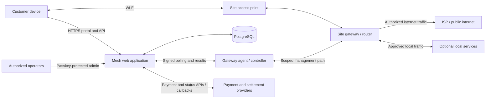
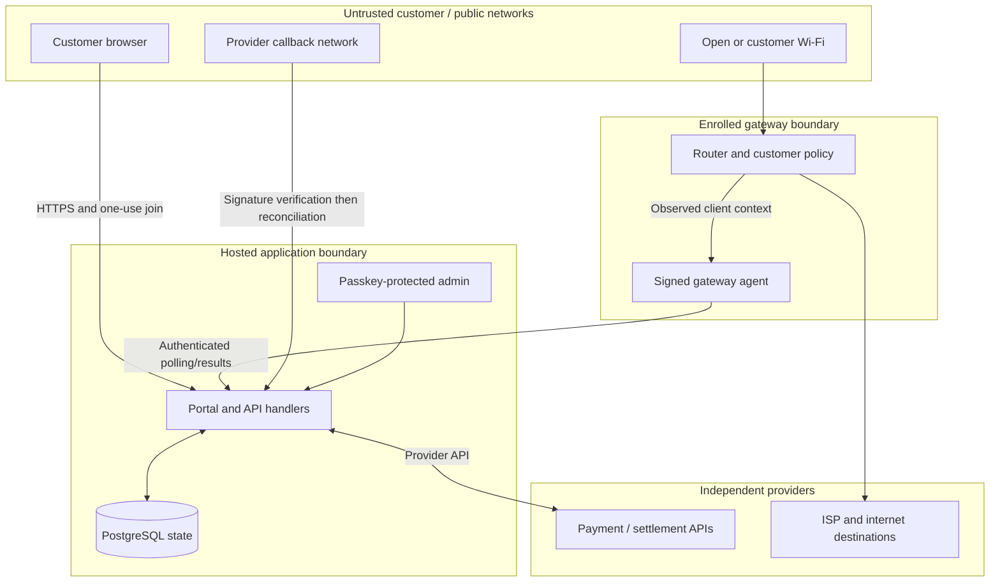

# Mesh architecture and dependencies

**Audience:** Developers, site operators, service owners, reviewers and
maintainers  
**Document owner:** Mesh technical/service owner role (individual not yet
recorded)  
**Prepared:** 22 October 2026, Africa/Nairobi  
**Evidence checked through:** 22 October 2026  
**Status:** Architecture description of the checked-in application and dated
home-lab records. It is not a deployment inventory, field design approval,
service-level commitment or proof that every checked-in component is deployed.
Verify the current release, hosts, credentials and router state before
operational use.

> **Important boundary:** The repository contains both an older general
> router-job path and a newer isolated Mesh native-access lane. A code path
> being present, enabled by an environment flag, or represented in an admin
> screen does not prove it is the deployed or commissioned path. The dated
> records identify a dedicated cloud controller and a home gateway, but the
> current deployment and field ownership require fresh verification.

## Contents

- [1. Purpose, scope and evidence](#1-purpose-scope-and-evidence)
- [2. System context](#2-system-context)
- [3. Component architecture](#3-component-architecture)
- [4. Trust boundaries and identity](#4-trust-boundaries-and-identity)
- [5. Core customer and operator workflows](#5-core-customer-and-operator-workflows)
- [6. Data ownership and durable records](#6-data-ownership-and-durable-records)
- [7. Availability and failure domains](#7-availability-and-failure-domains)
- [8. Dependency register](#8-dependency-register)
- [9. Runtime, build and compatibility boundaries](#9-runtime-build-and-compatibility-boundaries)
- [10. Secret and operational ownership register](#10-secret-and-operational-ownership-register)
- [11. Architecture decisions and open questions](#11-architecture-decisions-and-open-questions)
- [12. Change and release review checklist](#12-change-and-release-review-checklist)
- [13. Source records](#13-source-records)

## 1. Purpose, scope and evidence

This chapter describes the main application, data, payment and gateway
components, how their responsibilities connect, and what can fail separately.
It is intended to make the architecture understandable before changing a
service or planning a field deployment.

The source basis is the checked-out application code, database schema,
package manifest and Mesh records available on 22 October 2026. The checkout
and the dated operations records are different evidence types:

- **Source-observed** means the named behavior or component is present in the
  repository at the evidence date.
- **Recorded home-lab operation** means a dated record reports a bounded
  operation on identified home-lab infrastructure.
- **Proposed** means a plan or intended future design; it is not implemented
  or accepted merely because it is documented here.
- **Unknown / verify** means the source set does not establish current
  deployment, ownership, recovery, legal terms or field acceptance.

Do not use this chapter alone to issue a payment, change a router, operate a
controller, migrate an existing service, or assert that a site is ready. Use
[Volume 02 — Field deployment](02-field-deployment.md) for deployment gates,
[Volume 03 — Administration](03-administration.md) for operator state
interpretation and [Volume 04 — IP network](04-ip-network.md) for network
boundaries.

### 1.1 Architecture in one paragraph

Mesh is implemented in this repository as a web application with customer
portal and admin surfaces, API handlers, provider adapters and a PostgreSQL
data layer. In the native access design, the enrolled gateway proves its
identity to cloud endpoints, reports the observed Wi-Fi client context, polls
for work, applies a bounded access order to the router and reports the
resulting session identity. Payment and voucher records are stored separately
from the gateway's router state. The internet path itself remains through the
site gateway and its ISP; the hosted application/controller coordinates the
service but is not the forwarding path for normal customer internet traffic.
Optional local applications and experiments are separate components and are
not automatically part of the access controller.

### 1.2 What this chapter does not claim

This chapter does not establish:

- that the current cloud release matches the checked-out source;
- that the gateway/controller are presently reachable or healthy;
- that the documented home router and cloud VM are an accepted field design;
- a multi-site enrollment or router-fleet management capability;
- automatic consistency between every payment, grant, router session and
  customer browsing result;
- a transactional outbox, disaster-recovery objective, backup restore target
  or service-level agreement;
- approval of a provider, hardware model, software license or data-retention
  period; or
- that optional local services are operating after the recorded lab pause.

## 2. System context

Mesh has several actors and services with distinct responsibilities:

| Actor or system | Responsibility | Boundary / evidence note |
| --- | --- | --- |
| Customer device | Connects to a customer Wi-Fi network, opens the welcome/catalogue, selects a service, pays or redeems a voucher, and uses the permitted network. | The browser may provide display choices and an HTTP session; in native mode it must not be trusted to choose its own router-observed identity. |
| Wi-Fi access point (AP) | Provides the radio connection between customer devices and the site network. | Association is not internet authorization. AP model, isolation and roaming require site verification. |
| Site gateway/router | Provides local network services and applies site routing, firewall and paid-access policy. | It is a customer traffic forwarding device; it is not the cloud controller. Actual rules and readback are site-specific. |
| ISP/upstream | Provides external internet connectivity to the gateway. | Failure is distinct from Mesh application or gateway failure. |
| Mesh web application | Serves portal/admin experience and API routes; coordinates payment, voucher, access and readiness workflows. | The repository uses Next.js and Node.js routes. A hosted build is not proof of its exact deployment state. |
| PostgreSQL service | Persists application state including catalogue, portal sessions, payments, access grants, voucher records, audit events and native-agent state. | The repository connects through Neon serverless and Drizzle ORM. Current backup, restore and region ownership are not established here. |
| Native gateway agent/controller | Authenticates gateway requests, observes/enrolls a client, polls for orders and applies them to the enrolled router. | The repository includes agent code and the records describe a dedicated controller VM; current process ownership and version must be verified. |
| Payment / settlement providers | Collect or report payment and, depending on path, enable or report Bitcoin delivery/settlement. | A provider callback or collection alone does not prove settlement, entitlement, router activation or browsing. |
| Optional local service host | Can serve a local catalogue or optional applications/content. | It is not required to route packets and may fail independently. Laptop-hosted experiments were paused in the 14 October record. |
| Operator / finance / custodian | Approves service policy and performs authorized support, payment reconciliation, recovery and physical site care. | Accountable individuals and several custody roles have not been recorded in the reviewed source set. |

### 2.1 System context diagram



The controller relationship is a management/control path, not an internet
data-plane tunnel for customer browsing. The exact physical and network
implementation must be verified for each deployment. The dated home-lab notes
describe customer internet exiting the local Primary WAN while a dedicated
cloud VM manages the router over a private WireGuard path.

### 2.2 Control plane and data plane

- **Data plane:** customer packets pass through the AP and the site
  router/gateway, then to the ISP or an explicitly approved local service.
  Router policy determines whether a device is allowed.
- **Control plane:** the web application and agent exchange observed client
  context, payment/voucher-derived access orders, heartbeats and activation
  results.
- **Business/financial plane:** payment collection, settlement/delivery,
  entitlement and reconciliation records determine whether an access order
  may be created.
- **Operator plane:** administrators inspect status and perform approved
  maintenance using separately authenticated interfaces.

These planes interact, but a healthy state in one does not establish health in
another. For example, the public web application can respond while the router
is unreachable; a router can forward local traffic during a cloud outage; and
a settled payment can remain unactivated pending gateway reconciliation.

## 3. Component architecture

### 3.1 Web application and API

The repository root contains a Next.js application using React. The app
surface includes:

- customer-facing portal, payment and connection-completion pages;
- protected admin pages for overview, network, payments, packages, vouchers,
  whitelist and passkey-device management;
- route handlers for checkout, payment progress, webhooks, voucher redemption,
  gateway operations, join context, access status and readiness; and
- shared modules for authentication, database access, payment adapters,
  voucher security, native access validation and readiness evaluation.

Next.js route handlers run in Node.js where specified. Individual routes
declare runtime/duration requirements; do not assume every serverless
execution has an always-running process, shared memory or a local durable
filesystem.

### 3.2 Application database

The source uses `lib/db/index.ts` to create a Neon serverless SQL client from
`DATABASE_URL`, then passes the schema to Drizzle. The checked-in schema is
defined in `lib/db/schema.ts`. Its major record groups include:

| Record group | Representative records | Role |
| --- | --- | --- |
| Catalogue | `packages` | Available package price and access limits. |
| Customer session | `portal_sessions` | Portal/client session context used by application flows. |
| Financial collection | `payments` | Provider, reference, status, amount and metadata used for reconciliation. |
| Entitlement | `access_grants` | Intended access relationship, device and limits, distinct from confirmed router state. |
| Legacy work queue | `router_jobs` | Older generic router-job queue. Do not conflate it with Mesh native orders. |
| Voucher inventory | `voucher_batches`, `vouchers`, `voucher_redemption_limits` | Batch terms, protected code representation, redemption and attempt controls. |
| Operator accountability | `audit_logs`, `admin_passkeys`, `admin_enrollment_codes` | Audit events and operator-device authentication/enrollment state. |
| Native gateway | `mesh_agent_requests`, `mesh_agent_heartbeat`, `mesh_access_contexts`, `mesh_access_orders` | Replay control, heartbeat, router-attested browser context and encrypted access-order lifecycle. |
| Checkout reservation | `mesh_checkout_reservations` | Avoids concurrent pending purchase prompts for the same enrolled device/router. |

This table is a conceptual inventory, not an exhaustive data dictionary. See
[Volume 06 — API and data contracts](06-api-and-data.md) for the route
inventory, state contracts and schema caveats. Production data is not to be
copied into this handbook.

### 3.3 Native access lane

The native lane is implemented across `lib/mesh-access/`, API routes under
`app/api/mesh/`, payment/voucher modules and the `gateway-agent/` runtime. The
code includes:

- configuration gates and a fixed router/server identity in
  `lib/mesh-access/config.ts`;
- strict schemas for observed hosts, access packages and orders in
  `lib/mesh-access/model.ts`;
- signed machine requests and replay protection in
  `lib/mesh-access/security.ts` and `agent-replay.ts`;
- encrypted order storage, claim/lease, heartbeat and completion checks in
  `lib/mesh-access/service.ts`;
- customer checkout and voucher paths that use trusted enrolled context when
  native automatic access is enabled; and
- API endpoints for gateway context, readiness, job claim/completion,
  customer join and customer access status.

The native lane is intentionally distinct in schema and queue behavior from
the general `router_jobs` lane. The existence of this isolation in code does
not prove a specific release has been deployed or that no legacy worker is
running. Confirm release identity and process state through the approved
commissioning procedure before enabling service.

The currently checked-in configuration type accepts the enrolled identity
`KM-LAB-001` / `KM-MESH-001`; it is not a general multi-site identity registry.
The readiness route reports multi-site enrollment as unavailable. This is a
specific implementation constraint, not a future scaling commitment.

### 3.4 Gateway agent and router

The gateway agent is a separate runtime from the Next.js web application. It
uses a scoped machine credential to sign requests, polls the cloud for work,
and connects to the router through the configured management path. The
commissioning and controller records describe a dedicated VM, private
WireGuard reachability and pinned SSH access to a home router. The repository
also contains prior Windows-hosted controller artifacts and legacy helpers;
historical files are not evidence that those older workers remain active.

The expected responsibilities are:

1. obtain an observed client identity from the enrolled router, not a
   browser-supplied MAC/IP field;
2. create a short-lived join capability and bind it to the observed client;
3. poll with signed requests for a small number of eligible orders;
4. apply the order to the matching router client using its original access
   limit and expiry;
5. read back the active session and return its router-observed identity; and
6. preserve existing payment/entitlement state when a result is uncertain.

The protocol's exact installed version, current router model, RouterOS version,
agent service manager, restart policy and management credentials are private
operational inventory and must be checked in the commissioned site record.

### 3.5 Payment and settlement adapters

The repository contains payment/provider modules for Bitika, Paystack and
BTCPay-related integration, plus an Insats Engine client and reconciliation
helpers. Their roles differ:

- **Bitika path:** the code matches a payment to a provider transaction and
  verifies the current transaction state/settlement evidence before it creates
  native access.
- **Paystack path:** collection is reconciled separately from the Engine
  receipt/Bitcoin settlement evidence; access is not issued merely because
  collection was reported.
- **BTCPay integration:** payment/provider code exists in the repository, but
  the native Mesh readiness/payment selection behavior must be checked for the
  release in question; presence in source is not current offer approval.
- **Insats Engine:** a separate service role in the Paystack settlement path.
  Its endpoint, account, keys, treasury and operational owner are not
  published here.
- **Blink/Lightning:** a receiving or wallet identity appears in dated
  commissioning records; it is not an access controller or payment provider
  itself.

Provider selection and financial roles are time-sensitive. The customer-facing
offer, provider configuration, collection readiness and settlement status
must be confirmed against the current payment record and the planned Volume 07
payments/vouchers contract when drafted.

### 3.6 Optional local services

Local catalogue, learning content, Nostr/Blossom/media and experimental
communication services may run on a local computer or server. They are not
components of the core payment-to-access transaction unless a specific
integration has been implemented and accepted. Each optional service needs
its own host, network exposure, owner, persistence, backup, updates and
acceptance record.

The 14 October local-lab pause record says selected laptop tasks and local
containers were stopped or disabled; it did not re-audit every remote service.
Treat each service as **unknown until freshly checked**. Do not describe
optional services as a redundant or always-available part of Mesh merely
because the network can route to a host.

## 4. Trust boundaries and identity

### 4.1 Trust-boundary map



The diagram omits private network details and secrets. It is a logical
boundary map, not a firewall policy. The site-specific network access matrix
belongs in protected deployment records.

### 4.2 Identity types are not interchangeable

Architecture and support records must distinguish:

- **Customer browser session:** an HTTP-only, secure customer cookie tied to a
  browser token hash and an enrolled Mesh access context.
- **Observed client identity:** router-observed MAC/IP and server identity
  used to bind an access order to a device; it is not user identity or
  guaranteed persistent device identity.
- **Gateway identity:** configured router ID and a shared machine credential
  used to authenticate agent requests.
- **Router session identity:** router-side username/session and expiry read
  back by the agent.
- **Payment identity:** Mesh payment UUID plus provider transaction/invoice
  references; these are records of collection/reconciliation, not router
  identity.
- **Operator identity:** approved admin device/passkey session and its
  recorded actor; never reuse a customer or gateway credential for admin work.
- **Site/network identity:** approved site, router and address assignment;
  lab IDs and addresses are not field identities.

A private/randomized Wi-Fi MAC may change. A router-observed MAC is useful for
the current access binding but does not prove a person's identity, prevent
sharing under every scenario, or guarantee that a client remains on one AP or
gateway.

### 4.3 Browser and router attestation

In native automatic access mode, checkout and voucher code obtains the trusted
context from the Mesh session cookie and its server-side record. The payment
API overwrites browser-provided MAC/IP/router/login values with the trusted
context; voucher redemption likewise ignores those browser identity fields
when a native context exists. The secure join record documents HTTPS transport
and a one-use ticket exchange, with router-observed IP/MAC binding before the
browser context is created.

These protections are source-observed contracts for the code path. They do
not eliminate the need to verify TLS, exact public routing, router observation,
cookie behavior, secure release configuration and end-to-end operation in the
current deployed environment.

### 4.4 Machine request authentication

The current source signs bounded POST request content with HMAC-SHA256 and
checks router identity and a short timestamp window. The newer request format
binds a nonce into a second signature; a durable PostgreSQL replay-key table
prevents an accepted nonce from being reused across serverless workers. A
legacy signature mode is allowed only when a narrowly bounded environment
deadline is configured.

Do not enable the legacy mode as a general fallback. Partial or malformed
new-format headers must not downgrade to legacy authentication. Key rotation,
enrollment, revocation, clock synchronization, failure alerting and
multi-gateway scoping require release-specific operational procedures.

### 4.5 Payment callbacks

Webhook handlers bound the request body, verify a provider signature against
the original body, parse a limited event shape and reconcile with the provider
or settlement record. A callback is a signal to perform verification; it is
not itself authority to mark access active. Avoid placing complete callback
bodies, payer details, secrets or wallet data in logs or this handbook.

## 5. Core customer and operator workflows

### 5.1 Enroll/join the customer browser

1. The customer joins the Mesh Wi-Fi and opens the welcome page.
2. The enrolled router/agent observes the current client and submits the
   identity through its authenticated control path.
3. The application creates a short-lived join ticket and a browser token
   bound to the observed router, server, MAC and IP.
4. The browser exchanges the one-use ticket over the reviewed HTTPS path.
   The application stores token hashes, marks the context joined and sets an
   HTTP-only, Secure, SameSite cookie.
5. Later checkout or voucher requests use this server-side context rather
   than trusting browser-supplied network identity.

This sequence reflects the code and secure-join records; the current public
TLS path and physical-phone acceptance remain release/site-specific gates.

### 5.2 Paid purchase to router-confirmed access

```mermaid
sequenceDiagram
    participant C as Customer browser
    participant A as Mesh application
    participant DB as PostgreSQL
    participant P as Payment / settlement provider
    participant G as Enrolled gateway agent
    participant R as Site router
    C->>A: Select package (trusted joined context)
    A->>DB: Create/reuse payment reference and reserve device
    A->>P: Start or resume collection
    P-->>A: Callback/status (notification, not final authority)
    A->>P: Reconcile collection and required settlement
    P-->>A: Verified transaction/settlement result
    A->>DB: Store settled payment, pending grant and encrypted order
    G->>A: Signed poll / heartbeat
    A->>DB: Claim bounded eligible order
    A-->>G: Order and claim token
    G->>R: Apply order to the observed device
    R-->>G: Router session readback
    G->>A: Signed activation result
    A->>DB: Validate claim and identity; mark order/grant active
    A-->>C: Return current purchase/access status
```

The documented native code keeps payment, grant and order records distinct.
The access-order creation path uses a database statement to settle the
eligible payment, insert a pending grant and insert the native order as one
database operation. This is not a claim that every provider side effect and
database operation is one distributed transaction. Provider requests,
webhooks, retries and router operations can fail between steps and require
reconciliation.

### 5.3 Payment uncertainty

If a collection, settlement or activation result is uncertain:

1. preserve the original payment/provider reference;
2. do not issue a second payment prompt, Bitcoin send, voucher redemption or
   access allowance;
3. query the provider/settlement source using the approved reconciliation
   path;
4. check the database payment, grant and order independently;
5. check the gateway heartbeat and router readback independently; and
6. mark the result unknown/review-required until evidence resolves it.

This is a correctness and customer-safety boundary, not an assumption that
automated recovery will always complete.

### 5.4 Voucher redemption

The voucher flow validates a bounded request, applies a durable rate/attempt
limit, resolves the protected voucher hash and checks batch validity and
redemption limits. When a trusted native context is present, it records the
voucher-derived grant and encrypted order using the router-observed context.
The same voucher/context pair returns the prior order rather than consuming a
second access allowance. The legacy/non-native branch uses a different access
queue and must be treated separately.

Voucher issuance, printed stock custody, batch export and customer
reconciliation belong to the planned Volume 07 payments/vouchers contract and
protected operational records.

### 5.5 Activation, expiry and revocation

The agent claims queued or stale claimed orders using a bounded lease and
database row locking. It sends a claim token with the order. The completion
handler checks the order, token hash, router identity fields and exact user
and expiry before it marks the native order and grant active. Expiry is
represented in the order/grant and must also be enforced by the router.

The repository contains operator revoke and router access procedures; the
full current deployed revoke state machine, expiry reconciliation behavior,
offline revocation semantics and audit completeness must be verified against
the release and [Volume 03](03-administration.md). Do not infer successful
revocation solely from an admin action response.

### 5.6 Free services and policy changes

Selected external applications and locally hosted services are governed by
separate network policy. A free-site hostname entry is not proof that all
features of an app will work, that policy is narrow, or that users cannot
reach unrelated destinations. A policy change must record its intended
service, scope, site/router, approver, applied state, expiry/review date and
negative test. The present admin surface has legacy mechanisms; native field
policy administration requires release-specific validation.

## 6. Data ownership and durable records

### 6.1 Record authority

| Question | Best evidence to consult | Do not substitute |
| --- | --- | --- |
| Was money collected? | Provider transaction status tied to the Mesh payment and exact amount/reference. | Browser return URL, queued payment row or signed callback alone. |
| Was required settlement/delivery completed? | Independently verified settlement/provider receipt for the exact payment. | Collection status, an unverified metadata field or a different payment's receipt. |
| Is the customer entitled? | The matching package, payment/voucher, grant and approved terms. | Router session without a valid purchase or a stale dashboard count. |
| Did the gateway receive work? | Order status, claim token/lease and recent agent heartbeat. | Cloud API health or a public application health check. |
| Did the router apply access? | Agent completion matched to router-observed MAC/IP/server/user/expiry, plus fresh router readback. | Payment settled, grant active, command queued or HTTP success alone. |
| Can the customer use the service? | A controlled end-to-end test from the intended device and network. | Router session record or AP association alone. |

### 6.2 Durability and idempotency in source

Source-observed measures include:

- persistent payment and order identifiers;
- unique payment-to-native-order linkage and unique voucher/context linkage;
- hashed join/browser tokens, claim tokens and replay keys rather than raw
  values in the corresponding database fields;
- encrypted access-order payload storage using AES-256-GCM and an
  environment-provided encryption key;
- provider-specific matching/reconciliation before access creation;
- idempotent return of a prior payment/voucher order where one already
  exists;
- database locking/conditional updates around payment, voucher and order
  eligibility; and
- bounded order claim batches with stale-claim recovery.

These are implementation controls, not a backup plan or proof of complete
durability. Key loss may make encrypted outstanding orders unreadable.
Database restoration, key custody, schema rollback, payment-provider
reconciliation after restore and router state reconciliation require tested
procedures.

### 6.3 Gaps to resolve before relying on recovery

The reviewed material does not define or evidence:

- an approved database backup cadence, retention period, restore test or
  recovery-time/recovery-point objective;
- a complete transactional outbox for every provider or router side effect;
- a single cross-system ledger export with finance approval and routine
  reconciliation ownership;
- an end-to-end retention/deletion schedule for MAC/IP, payment, voucher,
  audit and agent records;
- a reviewed rotation/re-encryption procedure for order-encryption keys;
- one canonical desired-versus-applied router policy version for all network
  configuration; or
- a complete, deployment-specific restore test covering database, controller,
  router and customer state together.

Treat these as open engineering/operations decisions, not assumptions.

## 7. Availability and failure domains

### 7.1 Component failure matrix

| Failure | Likely effect | What may continue | Required response boundary |
| --- | --- | --- | --- |
| Customer device / browser | One user cannot join, check out or view progress. | Other devices and router forwarding may continue. | Recheck the device's current Wi-Fi identity and context; do not recreate a payment blindly. |
| AP or local power | Affected clients lose Wi-Fi; wired or other AP clients may or may not continue. | Other powered network segments could remain reachable. | Verify physical/site scope before changing router or payment records. |
| Site gateway/router | Customer access policy and routing at that site may stop. | Hosted app and payment providers may remain available; other independent sites might continue. | Local recovery and site runbook; a cloud heartbeat is not a substitute for router recovery. |
| ISP/WAN | General external internet, provider APIs and remote control may be unavailable. | Some local routes or local services may remain reachable. | Do not label all services down/up from a single probe; no external app is promised offline. |
| Controller agent / VM | New join context, order polling or router commands may stop. | Existing router-enforced access may continue until expiry/policy changes; local forwarding may continue. | Confirm current router state and preserve pending purchase references. |
| Web application / host | Portal/admin/API and cloud coordination may be unavailable. | Existing router rules and local services may continue. | Do not assume a paid entitlement can be newly reconciled offline. |
| PostgreSQL | Persistent portal/payment/order operations may fail or be stale. | Existing router sessions may remain active under router policy. | Stop new financial/access actions until persistent state is healthy and reconciled. |
| Payment/settlement provider | New collection or settlement verification may fail or remain uncertain. | Existing access may remain until its recorded expiry. | Preserve reference; do not initiate a duplicate charge or settlement. |
| DNS/TLS/certificate | Customer onboarding, provider calls or controller endpoints may fail. | Existing router forwarding and local IP services might work. | Use approved certificate/DNS recovery; never bypass browser or agent identity checks. |
| Optional local service host/storage | Only dependent local content/app functions fail or become stale. | Routing, paid internet and unrelated local services may continue. | Mark that app unavailable; do not represent network reachability as service availability. |
| Operator credential/device | Admin action or recovery may be unavailable or compromised. | Customer forwarding may continue. | Revoke/contain through approved account procedure and preserve audit evidence. |

These are architectural expectations, not tested guarantees. Exact failover,
cache behavior, request timeouts, queue recovery and router expiry behavior
must be validated in each release/site acceptance plan.

### 7.2 WAN-loss boundary

The home-lab records describe local router routes remaining usable during a
tested WAN loss. This does not make public payment APIs, external messaging,
Blink refresh, cloud-hosted portal functions or arbitrary websites available.
An existing router grant may continue according to its router configuration
and expiry, but its behavior during every controller or provider outage is not
established here.

### 7.3 Controller/database boundary

The controller depends on cloud API reachability, authenticated transport,
database persistence and its own router-management path. Loss of any one may
stop new access changes while customer traffic is still routed locally.
Recovery must avoid starting a second agent or re-running a commissioning
mutation while the original process/state is uncertain.

## 8. Dependency register

The table records architectural dependencies and known boundaries. It is not
a vendor approval, current service inventory or software bill of materials.
Exact owner, contract, supported version, region and renewal status should be
confirmed in a protected operations register.

| Dependency | Purpose | Failure / change impact | Owner and required evidence |
| --- | --- | --- | --- |
| Next.js / React / Node.js | Web UI and route handlers. Package manifest records Next.js `16.3.8`, React `19.2.8`; verify lockfile and deployed version at release. | Framework/runtime behavior or build incompatibility can affect portal, APIs and admin. | Application release owner; current lockfile, supported runtime and deployed artifact. |
| Vercel hosting (historically recorded) | Hosts the application deployment in the dated records. | Deployment, environment, build or hosting outage affects cloud portal/API. | Account owner, current project/team access, deployment identity and rollback route must be verified. |
| Neon serverless PostgreSQL | Persistent application records via `DATABASE_URL`. | Database outage or incompatible schema blocks persisted workflows. | Database/account owner, region, backup/restore test, migration plan and credential custody. |
| Drizzle ORM / schema | Typed SQL mapping and schema definition. Manifest records Drizzle ORM `0.45.2`; verify lockfile. | Schema/code drift or unsafe migration can break payment/access workflows. | Release owner; migration compatibility tests and current schema fingerprint. |
| Bitika | M-Pesa/collection and related Lightning delivery path described in dated records. | Collection, status or settlement uncertainty must block new entitlement. | Finance/provider owner, live/sandbox mode, callback secret, verified recipient and reconciliation evidence. |
| Paystack | Alternative collection path in code and records. | Collection may succeed while settlement or access remains pending. | Finance owner, account/configuration, approved provider role and provider reconciliation. |
| Insats Engine | Settlement/receipt service for the Paystack-to-Bitcoin route. | Missing, delayed or conflicting receipt blocks access issuance. | Treasury/service owner, funded balance, API credential, receipt matching and disable procedure. |
| BTCPay Server integration | Payment-provider code path. | Misconfiguration or stale offer can expose an unavailable payment method. | Finance/release owner; verify whether the current product/release enables it. |
| Blink wallet/Lightning address | Receiving identity and/or wallet access in dated settlement records. | Wrong recipient or unavailable wallet compromises financial reconciliation. | Named finance custodian, approved receiving identity, key custody and independent receipt evidence. |
| Dedicated Mesh controller VM | Runs the remote agent/controller path in dated commissioning records. | VM/network/process failure blocks remote joins, polling and router control. | VM/account owner, installed release, access policy, recovery/backup and single-worker proof. |
| WireGuard | Private controller-to-router management transport in dated records. | Tunnel/peer failure can remove remote management while WAN may still work. | Network owner, peer/key inventory, endpoint/DNS and tested local recovery. |
| Caddy and public DNS/TLS | HTTPS endpoint and scoped secure customer/controller transport. | DNS/certificate/route errors block onboarding or create unsafe fallbacks. | Domain/DNS and certificate owner, expiry monitoring, current routing and HTTPS acceptance. |
| Python and SSH tooling | Commissioning, remote administration and helper scripts. | Version/library/host mismatch can prevent safe inspection or release; scripts may mutate state. | Operations owner; pinned dependencies, reviewed scripts, pinned host/router identity, backup and rollback evidence. |
| MikroTik RouterOS / UniFi APs | Local routing/enforcement and Wi-Fi access in tested home-lab records. | Firmware, hardware, rule order, capacity or AP behavior changes the packet path. | Site network owner; actual model/version/config backup, port/radio inventory and field acceptance. |
| Optional service software/storage | Local catalogue, learning, media or communication experiments. | Host/storage failure removes that service, not necessarily routing or paid access. | Per-service owner, data policy, license/provenance, backup and service-specific acceptance. |

### 8.1 Provider role and disablement

For any provider route, the current operator must be able to answer:

1. Which exact provider and environment (live or sandbox) is selected?
2. Which component can initiate a collection or settlement?
3. What independent record confirms amount, currency, reference and recipient?
4. Who is authorized to resolve ambiguous or duplicated state?
5. How is the provider path disabled without erasing pending records?
6. What customer-facing behavior appears when the provider is unavailable?

If any answer is unknown, do not advertise or enable that payment path based
only on code presence.

## 9. Runtime, build and compatibility boundaries

### 9.1 Repository/runtime split

The project is a mixed-runtime repository:

- **Web application:** TypeScript/TSX, Next.js and Node.js.
- **Database access:** Drizzle ORM and Neon serverless PostgreSQL client.
- **Gateway/controller:** separate `gateway-agent/` code and Node/Python
  commissioning/support tools.
- **Router behavior:** RouterOS configuration and router-side state, which are
  not represented solely by the Next.js build.
- **Optional service experiments:** separate scripts, containers and
  configuration; not necessarily deployed with the web app.

The root package scripts include separate typecheck, lint, production build,
security/payment/access test selectors, schema and commissioning commands.
Running a successful application build does not test a live provider, router,
wireless link, certificate, cloud environment, payment receipt or field
acceptance.

### 9.2 Change ordering

For a change touching database schema, application API and gateway agent,
review a compatibility sequence before release:

1. identify the exact current app, database schema and agent versions;
2. define whether old and new versions can coexist during rollout;
3. make additive schema changes where needed and verify rollback constraints;
4. deploy the server/API in a mode that safely accepts the intended agent
   version;
5. deploy or activate one enrolled agent using its reviewed commissioning
   process;
6. verify signature/replay behavior, read-only heartbeat and router identity;
7. perform a controlled non-financial test or explicitly approved test case;
8. verify router readback and database state independently; and
9. remove compatibility paths only after the new path is proven and the
   rollback/recovery decision is recorded.

The secure-join and nonce rollout records include a specific release order
and legacy-auth deadline. They do not authorize applying that procedure to a
different environment or release without review.

### 9.3 Router and AP compatibility

Compatibility depends on actual router model, firmware, HotSpot behavior,
firewall rule ordering, address plan, AP VLAN/client isolation, radio
capabilities and the installed agent's supported API. A RouterOS command
accepted by one model/version may not establish identical enforcement on
another. Capture read-only inventory first; verify each production action and
its inverse on the target platform before field use.

### 9.4 Third-party software and rights

The package manifest identifies direct JavaScript dependencies but is not a
complete legal notice, software bill of materials or rights register. Python,
OS packages, containers, fonts, marks, hosted APIs and vendored/downloaded
assets also require review. Volume 12 and the internal IP dossier are the
intended sources for ownership, license and provenance conclusions. No license
or trademark conclusion is made here.

## 10. Secret and operational ownership register

No secret values belong in this document. The register below identifies
classes of secrets and decisions that require an accountable owner.

| Secret / privileged resource | Intended use | Minimum ownership question |
| --- | --- | --- |
| `DATABASE_URL` / database credentials | Web/controller persistence access. | Which workload has access, who rotates it, and how are restored environments isolated? |
| Gateway service HMAC key | Authenticate the enrolled agent. | Who provisions, stores, rotates and revokes it without enabling another router? |
| Access-order encryption key | Protect encrypted order data at rest. | Who holds recovery material, how is rotation/re-encryption tested and what is the loss response? |
| Payment provider credentials and webhook secrets | Initiate/query provider actions and verify callbacks. | Which role may issue payment requests, who receives alerts, and how is live/sandbox separation proven? |
| Settlement/treasury and wallet credentials | Verify or execute the required Bitcoin settlement/delivery path. | Who authorizes movement, who independently verifies the receipt and how are limits monitored? |
| WireGuard and router administration credentials/keys | Reach and administer the enrolled gateway. | Where are the encrypted backup and recovery method, and who may use them? |
| TLS private key / DNS account | Provide trusted service endpoints. | Who owns expiry, renewal, DNS changes and emergency rollback? |
| Admin passkeys / enrollment codes | Authenticate human administrators. | Who approves device slots, revokes lost devices and restores access? |
| Voucher export/decryption material | Recover and distribute issued voucher stock. | Who is the custodian, how is custody recorded and how are exposed batches revoked? |

The reviewed source does not establish one fully populated owner/custodian
matrix. Assign accountable roles and authorized individuals through the
protected operations process before production use. Do not copy secret values,
full wallet identifiers or private router addresses into this register.

## 11. Architecture decisions and open questions

### 11.1 Decisions reflected in source or dated records

| Decision / constraint | Evidence in current source | Implication |
| --- | --- | --- |
| Separate customer data plane from cloud controller path. | Dated commissioning notes state customer internet exits the local WAN while the cloud VM manages the router over a private path. | Cloud/controller loss should not automatically be described as customer packet-path loss; test both independently. |
| Keep native orders separate from legacy router jobs. | Separate `mesh_access_orders` and agent replay/heartbeat/context records; comments and readiness code identify the native lane. | Do not run or reconcile both workers against the same access request. |
| Treat payment and access confirmation as distinct states. | Payment, grant, order, provider receipt and router-session records are separate. | Customer support and financial reporting need explicit reconciliation across the states. |
| Use a router-attested client context for native checkout. | Join/context code and checkout/voucher handlers bind identity to the enrolled router session. | Browser fields cannot select a different device in the native flow; private-address changes can still affect the binding. |
| Do not infer multi-site readiness. | Native config is constrained to one enrolled router/server identity and readiness says multi-site enrollment unavailable. | Fleet support needs an explicit identity, tenant, credential and policy design before it is claimed. |
| Keep lab/local service experiments separate from core access. | Separate hosts and dated pause record; optional app records. | Local services need individual ownership and acceptance, and cannot be assumed always on. |

### 11.2 Open decisions

These items need an accountable decision, evidence and review date before the
architecture is treated as an operational service design:

- Who owns the end-to-end Mesh service, cloud account, DNS, database, VM,
  payment accounts, treasury/wallet, physical router and customer-support
  obligations?
- What is the canonical service deployment inventory and release identifier
  for each environment?
- Is the Bitika-first or another payment path currently approved and enabled,
  and who can disable it without losing pending reconciliation state?
- Which lifecycle transition is authoritative for expiry, revocation and
  router session cleanup when the agent or WAN is offline?
- What is the tested backup/restore and key-recovery design for database,
  controller, router config, payment ledger and voucher stock?
- What customer data is retained, for what purpose, for how long, and who
  handles access/deletion requests?
- What is the intended policy-management control path, and how is desired
  policy compared to actual router readback?
- What service hours and recovery objectives apply to a pilot, if any?
- What hardware, firmware and AP/router configurations are supported?
- What process keeps direct/transitive dependencies and external service
  contracts, licenses and versions current?
- Under what acceptance evidence would multiple sites, RADIUS/fleet
  management, a local edge controller or alternate settlement provider be
  considered?

### 11.3 Explicitly not decided here

This chapter does not select a new cloud vendor, move payment custody, propose
an unreviewed RADIUS/fleet product, promise autonomous multi-hop service,
require a local controller, assign a legal owner or authorize migration from
3WEST. Those decisions affect security, cost, service responsibility and
customer terms and require accountable review.

## 12. Change and release review checklist

Before merging or commissioning an architecture-affecting change, record:

- [ ] The affected component, environment, site and current release identity.
- [ ] The data/control/financial plane(s) changed and downstream callers.
- [ ] The trust boundary, identity source and authorization decision.
- [ ] Database schema, lock/uniqueness/idempotency and old/new compatibility.
- [ ] Payment uncertainty behavior; no duplicate charge, settlement or grant.
- [ ] Gateway claim/retry/expiry/revoke semantics and router readback proof.
- [ ] Failure behavior when the app, database, provider, tunnel, router, WAN or
      local service is unavailable.
- [ ] Secret owner, credential scope, rotation/revocation and safe logging.
- [ ] Customer privacy, retention, audit and support implications.
- [ ] Unit/integration checks relevant to the component, with clear limits on
      what mocks or source tests prove.
- [ ] A bounded rollout, stop condition, rollback path and data compatibility
      constraints.
- [ ] A corresponding update to the field/admin/API/payment/security/operations
      chapter where the changed behavior affects its readers.
- [ ] Deployment and physical acceptance evidence kept separate from code
      review/build evidence.

For live router, provider or settlement changes, follow the current
authorization and commissioning procedure. This checklist is not a command
sequence or permission to perform the change.

## 13. Source records

### Repository implementation

- [`package.json`](../../../package.json) — scripts and direct package
  dependencies.
- [`lib/db/index.ts`](../../../lib/db/index.ts) and
  [`lib/db/schema.ts`](../../../lib/db/schema.ts) — database connection and
  application schema.
- [`lib/mesh-access/config.ts`](../../../lib/mesh-access/config.ts),
  [`model.ts`](../../../lib/mesh-access/model.ts),
  [`security.ts`](../../../lib/mesh-access/security.ts),
  [`agent-replay.ts`](../../../lib/mesh-access/agent-replay.ts) and
  [`service.ts`](../../../lib/mesh-access/service.ts) — native access
  configuration, contracts, authentication, replay storage and order flow.
- [`app/api/mesh/`](../../../app/api/mesh/) — native gateway, join and access
  endpoints.
- [`app/api/payments/route.ts`](../../../app/api/payments/route.ts),
  [`app/api/webhooks/`](../../../app/api/webhooks/) and
  [`app/api/vouchers/redeem/route.ts`](../../../app/api/vouchers/redeem/route.ts)
  — customer collection, callback and voucher entry points.
- [`app/api/admin/v1/readiness/route.ts`](../../../app/api/admin/v1/readiness/route.ts)
  — authenticated readiness response; not field acceptance.

### Dated Mesh records

- [Start here and evidence register](00-start-here.md) — current evidence
  boundaries and version caveats.
- [Field deployment pack](02-field-deployment.md) — site authorization,
  commissioning and acceptance.
- [Administration and support](03-administration.md) — state interpretation
  and legacy/native operational boundaries.
- [IP network and hardware](04-ip-network.md) — data-plane topology,
  isolation and network verification.
- [API and data contracts](06-api-and-data.md) — route inventory, caller
  boundaries, state contracts and schema caveats.
- [Controller connectivity investigation](../mesh-controller-connectivity-2026-10-06.md)
  — dated controller/tunnel incident and recovery.
- [Secure join and HTTPS onboarding](../mesh-secure-join.md) — bounded
  transport and activation procedure.
- [Native automatic access commissioning](../mesh-native-automatic-access.md)
  — dated payment, settlement and router-activation evidence.
- [Node and local storage architecture](../kibera-mesh-node-and-storage-architecture.md)
  — optional local service roles and limits.
- [Local-lab pause and recovery notes](../mesh-local-lab-pause-2026-10-14.md)
  — local experiment pause; not a re-audit of remote services.
- [Field implementation plan](../mesh-field-deployment-plan.md) — proposed
  first-site scope and current assessment, not field acceptance.
