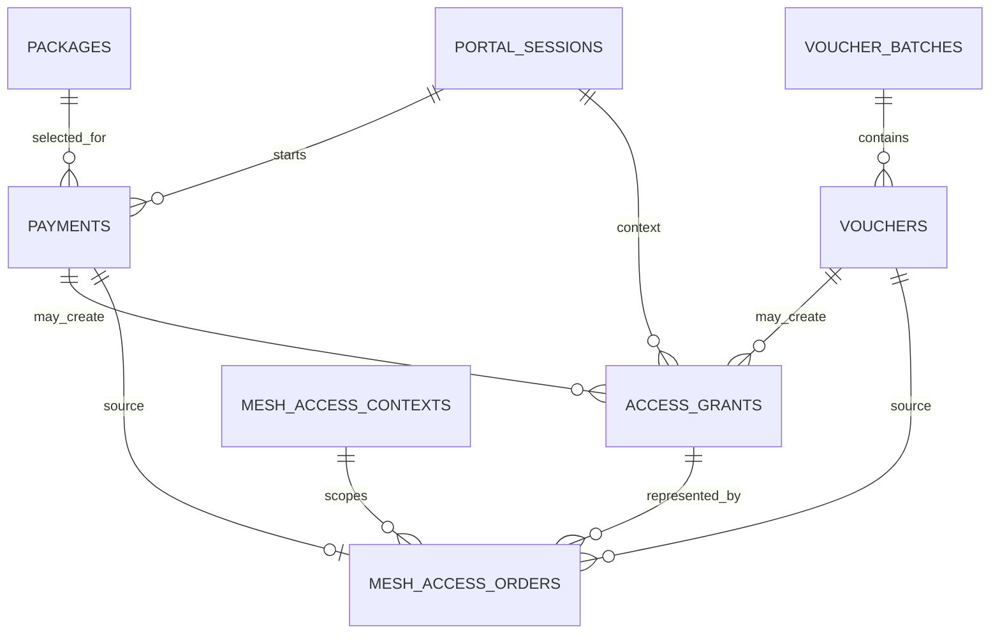

# Mesh API and data contracts

**Audience:** Application developers, gateway integrators, database maintainers,
payment reviewers and test engineers  
**Document owner:** Mesh application/API owner role (individual not yet
recorded)  
**Prepared:** 22 October 2026, Africa/Nairobi  
**Evidence checked through:** 22 October 2026  
**Status:** Source-derived reference to the checked-out route handlers and
Drizzle schema. It is not a published API guarantee, OpenAPI specification,
field deployment instruction or proof that every route is enabled in a
deployed release. Confirm the running release and configuration before
integration.

> **Contract warning:** This repository contains customer-facing routes, signed
> native gateway routes, passkey routes, provider webhooks, readiness
> endpoints and a legacy gateway queue. They have different callers and
> authority. Do not treat all `/api` routes as public, all successful HTTP
> responses as completed business operations, or the legacy queue as the
> native Mesh order protocol.

## Contents

- [1. Purpose and contract conventions](#1-purpose-and-contract-conventions)
- [2. Contract status and compatibility](#2-contract-status-and-compatibility)
- [3. API catalogue](#3-api-catalogue)
- [4. Caller authentication and data boundaries](#4-caller-authentication-and-data-boundaries)
- [5. Native gateway protocol](#5-native-gateway-protocol)
- [6. Customer API request and response contracts](#6-customer-api-request-and-response-contracts)
- [7. Provider webhook contracts](#7-provider-webhook-contracts)
- [8. Data model and relationships](#8-data-model-and-relationships)
- [9. State machines and idempotency](#9-state-machines-and-idempotency)
- [10. Validation, errors, privacy and caching](#10-validation-errors-privacy-and-caching)
- [11. Database migration and compatibility](#11-database-migration-and-compatibility)
- [12. Contract test requirements](#12-contract-test-requirements)
- [13. Known gaps and decisions](#13-known-gaps-and-decisions)
- [14. Source records](#14-source-records)

## 1. Purpose and contract conventions

This chapter is a navigable description of the implemented API surface and
principal data records observed in the repository on 22 October 2026. It helps
developers identify the route, caller identity, source of truth and completion
condition before changing an integration.

It is not a promise that an API is public, stable, deployed, suitable for
third-party use, or enabled in every environment. No generated OpenAPI
document or versioned external API contract was found in the reviewed source
set. Consumers should not rely on undocumented fields or internal database
columns as a public integration.

### 1.1 Evidence labels

- **Implemented in source:** present in checked-in route/schema code.
- **Recorded operation:** a dated Mesh record describes a bounded test or
  deployment event.
- **Legacy:** a distinct older mechanism that may be disabled, gated or
  incompatible with the native lane.
- **Not a contract:** inferred behavior, planned endpoint, deployment
  configuration or unreviewed customer-facing guarantee.

The API catalogue identifies the route handler as checked-in source. It does
not represent a fresh call against production.

### 1.2 General conventions observed

- Route handlers are Next.js App Router handlers under `app/api/`.
- JSON request bodies are parsed and validated per route. Selected financial,
  voucher and webhook bodies use bounded readers.
- Native gateway operations use signed POST requests with a bounded timestamp
  window; the newer signature format also includes a nonce claimed in
  PostgreSQL.
- Admin WebAuthn verification checks trusted origin, challenge, relying-party
  ID and user verification. Authenticated admin readiness is separate from
  gateway authentication.
- Customer payment-status and access-status responses use private/no-store
  cache directives where defined.
- UUIDs are used for many internal payment, package, grant and order IDs;
  provider references and voucher codes have separate formats.
- Timestamps are ISO-8601 strings at HTTP boundaries where represented as
  strings, and timezone-aware timestamps in the database schema.
- The source does not define one universal error envelope, pagination
  convention, API versioning policy, request correlation header or generated
  schema registry.

## 2. Contract status and compatibility

### 2.1 How to read the route catalogue

The catalogue is an implementation inventory, not a recommended third-party
API. Request fields shown below are only those confirmed by the route
validation or handler. Provider-specific checkout fields and WebAuthn option
objects are omitted where their exact shapes are owned by an external SDK or
provider contract.

| Surface | Intended caller | Authentication/authority | Contract status |
| --- | --- | --- | --- |
| Portal payment, status and voucher | Customer browser | Trusted native context when native mode is enabled; legacy input paths exist separately. | Implemented source; environment/release-dependent. |
| Native gateway | Enrolled agent | HMAC-signed body/path/time/router identity, nonce/replay claim for v2. | Implemented source; fixed enrolled lab identity in current config. |
| Webhooks | Payment provider | Provider signature over bounded raw body, then provider-side reconciliation. | Implemented source; not a standalone settlement or access instruction. |
| Admin readiness | Approved admin | Passkey-backed admin session. | Implemented source; readiness snapshot is not physical acceptance. |
| Admin passkeys | Device being enrolled / approved admin flow | Trusted origin, WebAuthn challenge and one-time enrollment code for registration. | Implemented source. |
| Legacy gateway queue | Older gateway worker | Legacy gateway credential; rejected while automatic Mesh access is enabled. | Legacy and isolated from native orders. |
| Health | Monitoring/client | No application admin authentication in the handler. | Basic liveness/database probe only. |

### 2.2 Native versus legacy compatibility

The native lane uses `mesh_access_contexts`, `mesh_access_orders`,
`mesh_agent_requests` and `mesh_agent_heartbeat`. The older queue uses
`router_jobs` with general job payloads. They have different authentication,
identity scope, claim/completion rules and failure semantics.

The legacy claim route checks whether automatic Mesh access is enabled and
returns `409` if so. This is an isolation guard, not a migration mechanism.
Do not point both workers at a site or copy records between queues without a
reviewed transition, preserved payment/expiry state and router readback.

### 2.3 Versioning and compatibility policy

There is no general version negotiation for the customer API. The native
agent reports an explicit protocol version only through signed-header shape
(v2 versus time-bounded legacy authentication); order payload fields are
strictly validated and bound to the current configured router/server identity.
Treat changes to these details as a coordinated application-agent release.

Before changing a route or data contract:

1. locate every customer, provider, agent and admin caller;
2. record current request/response fields, state transitions and status codes;
3. decide whether old and new application/agent versions can overlap;
4. add schema compatibly before code requires it, where practical;
5. test duplicate, concurrent, stale, malformed and partially completed
   requests;
6. preserve pending money/access records and original deadlines;
7. deploy in the documented order and verify readback; and
8. remove deprecated acceptance only after the release's migration window and
   rollback decision are complete.

## 3. API catalogue

The following methods and paths are source-observed. The bracketed `[id]`
segment is a path parameter. Every route must be rechecked against the actual
deployed release before use.

### 3.1 Customer and portal endpoints

| Method and path | Caller | Purpose | Principal result |
| --- | --- | --- | --- |
| `POST /api/payments` | Portal | Create or resume a payment request for an active package and device context. | `paymentId`, `checkoutUrl`; a pending initiation may return `202` with `paymentPending`. |
| `GET /api/payments/{id}` | Portal | Retrieve customer-visible payment and native-access progress; may attempt provider reconciliation for Bitika/Paystack. | Payment/provider status, collection/settlement indicators, reconciliation availability and native-access state. |
| `POST /api/vouchers/redeem` | Portal | Validate and redeem a voucher against the current device context. | `accessGrantId` on accepted redemption. |
| `GET /api/mesh/access/status?payment={uuid}` or `?grant={uuid}` | Portal | Read native access status for the current trusted browser context. Exactly one selector is required. | `pending`, `active`, `expired` or `failed`, optionally with `expiresAt`. |
| `GET /api/mesh/join?ticket=…&session=…` | Customer browser after router/agent bootstrap | Consume a one-use join ticket, set the browser context cookie and redirect to the portal view. | `303` redirect on success; `403` if not ready or invalid/consumed. |

### 3.2 Native gateway endpoints

| Method and path | Caller | Purpose | Principal result |
| --- | --- | --- | --- |
| `POST /api/mesh/gateway/context` | Enrolled agent | Submit router-observed client identity to create a short-lived join ticket/context. | `{ joinUrl }` or generic enrollment failure. |
| `POST /api/mesh/gateway/readiness` | Enrolled agent | Inspect provider/access checkout readiness without initiating a payment. | Preferred provider and bounded readiness fields. |
| `POST /api/mesh/gateway/jobs/claim` | Enrolled agent | Record heartbeat, perform bounded recovery reconciliation of eligible pending collections, then claim native orders. | `{ jobs: [...] }`; can be empty. |
| `POST /api/mesh/gateway/jobs/{id}/complete` | Enrolled agent | Report successful router readback for a claimed order. | `{ activated: true }` only when the result matches the stored order and claim. |
| `GET /api/mesh/access/status` | Customer browser | See the customer endpoint above; not a gateway endpoint despite the `mesh` prefix. | Customer-scoped status. |

The native agent routes authenticate the complete request body and request
path. Gateway request details are not customer API documentation and must not
be exposed as a public onboarding integration.

### 3.3 Provider webhook endpoints

| Method and path | Provider / purpose | Signature header | Important behavior |
| --- | --- | --- | --- |
| `POST /api/webhooks/bitika` | Bitika transaction notification. | `x-bitika-signature` | Verifies raw-body signature, validates a limited event shape and reconciles against Bitika's current transaction record. |
| `POST /api/webhooks/paystack` | Paystack collection notification. | `x-paystack-signature` | Verifies raw-body signature; for a relevant charge event it queries/reconciles the provider and checks stored reference and transaction details. The handler comment identifies forwarding to the settlement Engine as optional/future, not evidenced here. |
| `POST /api/webhooks/btcpay` | BTCPay invoice notification. | `btcpay-sig` (`sha256=` HMAC form) | Verifies signature, looks up the invoice and maps status. This is a separate/legacy payment path; native Mesh offer status must be checked. |

A provider callback is a trigger to verify state, not the sole source of
financial truth. Webhook handlers intentionally acknowledge some unknown
references after signature/shape checks without creating a grant.

### 3.4 Admin and monitoring endpoints

| Method and path | Caller | Purpose | Boundary |
| --- | --- | --- | --- |
| `GET /api/admin/v1/readiness` | Passkey-authenticated admin | Inspect a database/runtime/payment/catalogue/gateway readiness snapshot. | Unauthenticated requests receive `401`; result is not field acceptance. |
| `GET /api/admin/passkeys/authentication/options` | Admin device | Begin WebAuthn authentication challenge. | No registered device returns `409`; challenge is server-held. |
| `POST /api/admin/passkeys/authentication/verify` | Admin device | Verify WebAuthn assertion, update counter and establish admin session. | Trusted origin and challenge required; bounded request. |
| `POST /api/admin/passkeys/registration/options` | Device with enrollment code | Begin registration challenge. | Trusted origin, valid unused unexpired code, free admin slot required. |
| `POST /api/admin/passkeys/registration/verify` | Enrolling admin device | Verify registration, consume enrollment code, persist passkey and establish admin session. | Challenge/code/slot and trusted origin required. |
| `GET /api/health` | Health monitor | Check app handler and database query availability. | Returns service/database status; no router, payment, AP or customer test. |

Admin page actions are also implemented as server actions and are not all
standalone `/api` routes. Inspect the current admin source and authorization
before treating a screen control as a stable integration.

### 3.5 Legacy gateway endpoints

| Method and path | Caller | Purpose | Status |
| --- | --- | --- | --- |
| `POST /api/gateway/jobs/claim` | Older gateway worker | Claim a job from the shared `router_jobs` queue and enqueue expiry revocations. | Legacy; returns `409` while automatic Mesh access is enabled. |
| `POST /api/gateway/jobs/{id}/complete` | Older gateway worker | Report success/failure for a shared queue job. | Legacy; completion semantics are not the native strict readback contract. |

Do not interpret the route's existence as authorization for a worker to run.
The older completion handler accepts a general result object and updates
grant/job state; it does not implement the native order's full identity and
claim-token match.

## 4. Caller authentication and data boundaries

### 4.1 Customer browser

In native mode, the browser's authority derives from a server-side
`mesh_access_contexts` record matched using the `mesh_session` HTTP-only
cookie. The cookie holds an opaque context ID plus a random browser token; the
database stores the token hash. The context must be joined, unexpired and
bound to the configured router/server.

The browser is not trusted to choose the MAC/IP/router identity for a native
purchase or voucher. Other fields, such as requested package or view, remain
customer input and require server validation. Do not rely on browser UI
validation for price, package limits, payment status, access deadlines or
router identity.

### 4.2 Gateway agent

The source-level machine request uses:

- method `POST`;
- header `x-mesh-router` matching the configured router ID;
- `x-mesh-time` as a Unix-seconds timestamp within 60 seconds of server time;
- `x-mesh-auth` as HMAC-SHA256 over timestamp, method, request path and exact
  body;
- v2 `x-mesh-nonce` plus `x-mesh-auth-v2`, binding router ID, timestamp,
  method, path, nonce and exact body; and
- a request body limit of 16 KiB before JSON parsing.

The v2 replay key is hashed and inserted under a database primary key so only
one concurrent request can claim a nonce. A stored key is retained beyond the
maximum accepted timestamp window. Legacy authentication is accepted only
when the explicit expiry environment value is valid, in the future and no
more than 24 hours away. Partial v2 headers must fail; they must not fall
back to legacy.

The exact request header names are implementation details for the enrolled
agent, not credentials. Never publish the HMAC key, replay material or full
signed request containing customer or financial data.

### 4.3 Payment providers

Each provider webhook signs the raw bounded request body using its provider
mechanism and configured secret. The handler verifies before parsing, then
uses a matched local reference and provider-side reconciliation. Provider
secrets are server-side only. A caller cannot set `settled`, verified Bitcoin
delivery, payment hash or access state merely by submitting JSON to a
customer endpoint.

### 4.4 Admin passkeys

Registration and authentication require a trusted request origin and
server-held WebAuthn challenge. Authentication checks approved, non-revoked
credential, origin, RP ID, user verification and credential counter. Device
registration also requires a valid one-time enrollment code/slot and respects
the configured device limit. Successful events are recorded in `audit_logs`.

Admin authentication does not automatically authorize an unsafe operation:
each server action must still enforce the required operator role/conditions.
The repository's current admin model and action-specific limits are described
in [Volume 03](03-administration.md).

## 5. Native gateway protocol

### 5.1 Request validation sequence

For a native gateway POST, the route:

1. reads the body with a 16 KiB maximum before buffering unbounded input;
2. authenticates method, router ID, timestamp and signature against the exact
   path/body;
3. validates v2 nonce/signature when either v2 header is present;
4. atomically claims the hashed replay key in PostgreSQL;
5. parses JSON and applies route-specific strict schemas; and
6. performs the route's bounded database/provider/router-related operation.

At present `readAgentBody` converts invalid signature, duplicate replay key
and unreadable request into the same unauthorized outcome. Operators should
consult safe server-side diagnostics, not request secrets, to distinguish
configuration errors.

### 5.2 Join context

`POST /api/mesh/gateway/context` accepts a strict object with:

| Field | Contract in source |
| --- | --- |
| `macAddress` | Uppercase colon-separated unicast MAC; zero and multicast values rejected. |
| `ipAddress` | Current source schema restricts it to the configured lab customer pool (`10.30.0.2` through `10.30.0.254`). This is a code constraint, not a field address plan. |
| `server` | Literal enrolled server ID `KM-MESH-001`. |

The route creates a context record containing router/server identity, observed
MAC/IP, token hashes, a two-minute join-ticket expiry, browser-context expiry
and join timestamp. The browser receives a join URL containing the one-use
ticket and browser token envelope. The GET join route consumes the ticket
once, sets a secure cookie and redirects. Ticket query strings are sensitive
brief capabilities: do not log them, include them in analytics, or preserve
them in referrers.

### 5.3 Readiness

`POST /api/mesh/gateway/readiness` is authenticated and intended to inspect
provider/access gates. It returns the preferred provider plus bounded Bitika
and Paystack readiness properties, including booleans/blocker state from the
underlying readiness helpers. It does not initiate checkout or return provider
credentials.

The exact readiness object can change with provider adapter evolution. Treat
missing or unknown values as not ready; do not interpret readiness as a
payment, settlement or successful customer test.

### 5.4 Claim orders

`POST /api/mesh/gateway/jobs/claim` accepts an authenticated request body. The
handler records a heartbeat, considers at most one eligible pending provider
payment for reconciliation on that call, then claims up to five eligible
native orders.

Each returned item has an `id`, a claim token and a decrypted order payload.
The order data includes:

| Field | Meaning |
| --- | --- |
| `id` | Unique access order ID; also used to derive the router-side user name. |
| `routerId`, `server` | Enrolled router and HotSpot/server identity. |
| `macAddress`, `ipAddress` | Router-observed client binding. |
| `user`, `password` | Generated router-side credential pair for this order. |
| `expiresAt` | Fixed order expiry; the router must use the same deadline. |
| `durationMinutes`, `dataLimitMb`, `speedLimitKbps` | Access limits from validated package/batch. |
| `paymentId` or `voucherId` | Exactly one source reference is required. |

The current schema bounds duration to 1–44,640 minutes, optional data to
1–2,097,151 MiB (or null), and speed to 1–100,000 Kbps (default 2,000 Kbps
when omitted/null). Orders require a future expiry no later than the permitted
duration plus a small tolerance.

An order is eligible while unexpired and queued, claimed with a stale claim
time, or active with a stale claim time (for retry/refresh). Claims use a
bounded batch and database row locking. The claim token hash is stored in the
database; a fresh token is returned to the agent. Treat the returned order and
token as secrets; never write them to normal logs.

### 5.5 Completion

`POST /api/mesh/gateway/jobs/{id}/complete` accepts a strict body:

```json
{
  "claimToken": "<opaque claim token>",
  "active": true,
  "macAddress": "02:00:00:00:00:01",
  "ipAddress": "10.30.0.25",
  "server": "KM-MESH-001",
  "user": "ma-<32 lowercase hex characters>",
  "expiresAt": "2030-01-01T12:00:00.000Z"
}
```

The example values are illustrative only; in particular, the documentation
address and identity must not be applied to a router. The server verifies the
order belongs to the configured router, the claim token hash matches, the
order has not expired, and the reported active session matches the stored
MAC/IP/server/user/exact expiry. The order and grant become `active` only
after this match succeeds.

The route currently returns `409` with a generic activation-unconfirmed error
for schema errors and failed completion checks alike. The agent should not
repeat a router mutation simply because the HTTP response is ambiguous; obtain
readback and follow reconciliation guidance.

## 6. Customer API request and response contracts

### 6.1 Create or resume payment

`POST /api/payments` accepts JSON with:

| Field | Required | Notes |
| --- | --- | --- |
| `packageId` | Yes | UUID for an active catalogue package. |
| `provider` | No | Provider enum; defaults to `btcpay` in the handler. Available/approved options are environment/release dependent. |
| `requestId` | No | UUID for retrying the same request. Reuse only for the same request fingerprint. |
| `macAddress` | No | Defaults to `"unknown"` but must become valid via trusted native context or legacy validation. |
| `ipAddress`, `routerId` | No | Accepted as request fields on legacy path; overwritten from trusted native context when available. |
| `loginUrl`, `originalUrl` | No | Optional URL fields for legacy portal behavior; native flow uses trusted context and removes original URL. |
| `phone` | Provider-dependent | Bounded string; normalized for applicable mobile-money collection. Never log plaintext. |

The request body is limited to 8 KiB. The handler verifies active package,
validates native access limits, calculates a fingerprint, binds the request ID
to the same request and context, reuses the same payment record on safe retry,
and checks checkout readiness and device reservation as appropriate.

Typical response shapes visible in the handler:

```json
{ "paymentId": "<uuid>", "checkoutUrl": "<provider or local URL>" }
```

An initiation that may already have prompted the customer can return `202`:

```json
{ "paymentId": "<uuid>", "checkoutUrl": "/pay/<uuid>", "paymentPending": true }
```

Do not treat `201`, `200` or `202` as a settled payment or router activation.
The same request ID must be reused to resolve ambiguous initiation; a request
with a different fingerprint receives a conflict. Do not automatically switch
providers after an uncertain collection request.

### 6.2 Read payment progress

`GET /api/payments/{id}` returns a customer-safe summary:

```json
{
  "status": "processing",
  "provider": "bitika",
  "providerStatus": "processing",
  "resolutionRequired": false,
  "collectionConfirmed": false,
  "settlementStatus": null,
  "reconciliationUnavailable": false,
  "nativeAccess": { "status": "pending", "expiresAt": null }
}
```

This is an illustrative shape, not a fixed sample response. For a payment
with a native context, the caller must present the matching trusted browser
context; otherwise the endpoint returns `404` to avoid revealing another
context's payment. Provider lookups can be attempted during the request.
`reconciliationUnavailable` means the lookup could not be completed, not that
the payment failed or succeeded. Responses are private/no-store.

### 6.3 Read access status

`GET /api/mesh/access/status` requires exactly one of `payment` or `grant`,
each a UUID, and a trusted browser context. If the record is not visible in
that context, the endpoint responds `404`. Database/service failure can
return `503`.

The status object is:

```json
{ "status": "pending", "expiresAt": "2030-01-01T12:00:00.000Z" }
```

The native status helper reports `active` only when the stored order is active
and its last update is sufficiently recent; otherwise an unfinished
nonterminal order is presented as pending. This is a user-facing progress
view, not a fresh router query or a browsing test.

### 6.4 Redeem voucher

`POST /api/vouchers/redeem` accepts a JSON body limited to 4 KiB:

| Field | Required | Notes |
| --- | --- | --- |
| `code` | Yes | 6–64 characters before normalization. |
| `macAddress`, `ipAddress`, `routerId` | No | Legacy identity hints only; ignored in favor of trusted context in native mode. |
| `loginUrl`, `originalUrl` | No | Optional legacy portal URL fields. |

The handler rate-limits attempts, performs protected voucher lookup, checks
disabled/validity/redemption limits and then consumes redemption and queues
access. Native mode requires the browser to reconnect to Mesh and uses the
trusted context. Success is `201` with `{ "accessGrantId": "<uuid>" }`; this
is an accepted grant/order result, not by itself confirmed router activation.

### 6.5 Health and admin readiness are not service APIs

`GET /api/health` checks a database `select 1` and returns app/database
connected or degraded. It does not check the gateway, AP, WAN, payment
provider, customer reachability or field site.

`GET /api/admin/v1/readiness` requires an authenticated administrator and
returns a current computed snapshot of schema/runtime, payment readiness,
catalogue and gateway/order-related fields, blockers and a timestamp. It is
not anonymous, not a public monitoring contract and not proof of physical
acceptance. A readiness failure can return a generic `503`.

## 7. Provider webhook contracts

### 7.1 Common rules

All three checked-in webhook handlers read at most 64 KiB of raw body, verify
the signature before JSON parsing, and query/reconcile the matched provider
record. Oversized or malformed payloads are rejected. Do not log full callback
bodies, secrets, payer identifiers or payment credentials.

Webhook delivery can be retried. Reconciliation must be idempotent against the
provider reference and the same Mesh payment. A callback for an unknown
reference may receive an acknowledgement after signature/shape validation;
it must not create an entitlement by itself.

See [Volume 07 — Payments, Bitcoin and vouchers](07-payments-and-vouchers.md)
for collection-versus-settlement distinctions, financial evidence and
exception handling.

### 7.2 Bitika

The Bitika handler verifies `x-bitika-signature`, validates event ID/name and
transaction code, ignores the designated sandbox reference prefix without
touching live records, and finds a payment using provider plus invoice
reference. It then fetches/reconciles the provider transaction to match amount,
destination/delivery evidence and payment state. On reconciliation failure it
returns `503` so delivery can retry.

A valid signature and event name do not prove collection or Lightning
delivery. The provider transaction snapshot and matching payment metadata
determine whether the payment can proceed to native access creation.

### 7.3 Paystack

The Paystack handler verifies the raw body using `x-paystack-signature`.
Events other than the supported success event, malformed references and
unmatched payments are ignored/acknowledged as appropriate. For a matched
charge, `reconcilePaystackCollection` must verify provider-side details such
as the stored reference, amount, channel and environment. The route's source
comment explicitly says the optional future Engine forwarding receiver is
not evidence that such forwarding exists.

Paystack collection does not establish the separate settlement/delivery
requirement. The native payment-to-access path additionally requires
verified Engine receipt details before queuing access.

### 7.4 BTCPay

The BTCPay handler verifies a `sha256=` HMAC in `btcpay-sig`, extracts an
optional invoice ID, fetches the invoice and maps provider status. In the
legacy flow it can update payment status and enqueue the older access grant
path. This route must not be represented as the native Bitika/Paystack access
contract without an explicitly reviewed implementation/release decision.

## 8. Data model and relationships

### 8.1 Core entities

| Entity/table | Key fields / relationships | Meaning and cautions |
| --- | --- | --- |
| `packages` | UUID, KES/sats price, duration, optional data/speed limits, active/order fields. | Catalogue definition. Sold order terms should be treated as immutable snapshots, not silently re-read from a package later. |
| `portal_sessions` | UUID, MAC, optional IP/router/URLs/user-agent, timestamps. | Legacy/general portal session record. Do not treat as verified person identity or native device proof. |
| `payments` | UUID, provider/reference/status/amount, optional session/package links, JSON metadata, settled time. | Collection/reconciliation record. Metadata is provider- and flow-specific; it is not a normalized public contract. |
| `access_grants` | UUID, optional session/payment, optional voucher ID, MAC, status, starts/expiry and limits/purpose. | Entitlement/access intent. Status does not necessarily equal observed router session state. |
| `router_jobs` | UUID, type/status, JSON payload, attempt/availability/claim/completion/error data. | Legacy general work queue. Not the native order queue. |
| `voucher_batches` | UUID, package/quantity/sale amount/terms/validity/redemption cap/prefix/creator. | Batch-level issuance terms and custody reference. |
| `vouchers` | UUID, batch, code hash/ciphertext/last four, redemption count/disabled state. | Protected voucher record. Plaintext code should not be exposed except through an approved controlled export. |
| `whitelisted_sites` | Hostname, subdomain switch, enabled/category/notes/actor/time. | Desired/admin policy record; does not prove router application or narrow traffic behavior. |
| `audit_logs` | Actor, action, entity type/ID, JSON details, timestamp. | Audit evidence where a handler/action writes it; not every consequential action is necessarily covered. |
| `mesh_agent_requests` | Hashed replay key primary key, router ID, expiry. | Durable duplicate-request protection for signed gateway calls. |
| `mesh_agent_heartbeat` | Router ID primary key and last-seen timestamp. | Last agent poll/heartbeat, not router health, AP health or customer service. |
| `mesh_access_contexts` | UUID, router/server, MAC/IP, join/browser token hashes, expiry, joined time. | Attested browser context used to scope native customer calls. |
| `mesh_access_orders` | UUID, context/router/payment or voucher, grant, encrypted order, status/claim/expiry/error. | Native command/order lifecycle and sensitive encrypted payload. |
| `mesh_checkout_reservations` | Router/MAC primary key, unique payment ID, timestamps. | Prevents competing purchase initiation for the same native device/router. |
| `voucher_redemption_limits` | Scope key, window start, attempt count. | Durable attempt-limiting state. |
| `admin_passkeys` | Credential ID, slot, public key/counter/transports/device metadata/revocation. | Administrator authenticator record; public key is not a secret but is sensitive security metadata. |
| `admin_enrollment_codes` | Code hash, slot, device name, creator, expiry/use time. | One-time admin enrollment state; plaintext enrollment code is not stored here. |

### 8.2 Relationship sketch



The diagram is conceptual. Some columns in the Drizzle schema intentionally
do not have declared foreign-key constraints (for example `access_grants.voucher_id`).
Do not infer database-enforced integrity where a relation is only application
convention.

### 8.3 Key constraints and indexes

Source-observed database constraints include primary IDs, a unique provider
invoice reference, unique voucher code hash, unique native order per payment,
unique native voucher/context pairing, unique replay key, unique active admin
passkey slot, and the device/router checkout reservation key. These
constraints reduce duplicate work but do not alone prove all business
invariants. Validate nullability, partial indexes and migration state against
the actual deployed schema.

### 8.4 Sensitive and derived data

- Voucher plaintext is not the normal lookup key; the schema stores a hash,
  encrypted code and last four characters.
- Browser, join, claim and replay tokens are stored as hashes in their
  relevant tables; their raw values still require safe transport and log
  exclusion.
- Native access orders are encrypted at rest by the application before
  persistence. Database operators without the decryption key cannot normally
  read the order payload, but key custody remains critical.
- Payment metadata is JSON and can contain flow-specific fields. Restrict
  access, avoid assuming a fixed schema, and never dump production metadata in
  a public document or routine log.
- MAC/IP, user-agent, phone and provider references can identify or relate to
  a customer. Apply minimization, access control and an approved retention
  policy.

## 9. State machines and idempotency

### 9.1 Payment status

The database enum defines:

| Status | General meaning |
| --- | --- |
| `new` | Local payment record exists; collection may not have begun. |
| `processing` | Provider request/collection/reconciliation is in progress or uncertain. |
| `settled` | The applicable flow has marked the payment settled after its checks. Verify flow-specific evidence and do not generalize this to router activation. |
| `expired` | Payment/request expired under the applicable provider logic. |
| `invalid` | Request/provider outcome was rejected or closed; inspect its flow and references. |
| `refunded` | Refund state recorded where supported. It does not itself describe router revocation. |

This enum is shared by paths with different financial meanings. Use provider
metadata plus the transaction/receipt evidence; do not compare status alone
across providers.

### 9.2 Access grant status

The database enum defines `pending`, `active`, `expired`, `revoked` and
`failed`. It is an application-side grant record. Native order state is stored
separately as a text field and the router has its own session/access state.
Keep all three layers distinct:

```text
payment / voucher evidence -> grant entitlement -> native order/command
                          -> router readback -> customer experience
```

No edge in this chain is proof of all later edges.

### 9.3 Native order lifecycle

The schema's native `status` is text rather than a database enum. Source
behavior uses `queued`, `claimed`, `active`, and failure/revocation
terminations in service and admin paths. Treat this as an implementation
state machine requiring consistency checks, not a strongly constrained
database enum.

Conceptually:

```text
eligible verified purchase or voucher
              |
              v
           queued
              |
              v
           claimed ---- stale lease / retry ----+
              |                                  |
      exact router readback                      |
              v                                  |
           active <-------------------------------+
              |
        revoke / expiry
              v
        terminal state
```

The code shown here does not establish a complete, independently verified
expiry/revocation terminal transition for every native order. Keep that
behavior in the open register until the exact release and router procedure
have been checked. Do not mark an order `active` from payment success alone.

### 9.4 Idempotency and concurrency controls

Source-observed controls include:

- payment request UUID plus a fingerprint to prevent reusing one request ID
  for different package/device/provider details;
- retention of provider references and charge-start markers for uncertain
  collection attempts;
- a device/router reservation and rate limit before applicable payment
  prompts;
- unique order linkage for a payment and for a voucher/context pair;
- atomic eligibility checks/updates when creating grants and native orders;
- atomic voucher redemption count increment under its redemption ceiling;
- database row locking and `SKIP LOCKED` for native claim batches;
- per-claim opaque token with stored hash and matching completion checks; and
- durable replay-key uniqueness for v2 gateway requests.

These controls make selected requests safe to retry; they do not make every
external side effect transactional. Any changed provider request, RouterOS
mutation or schema transition needs its own idempotency and reconciliation
analysis.

## 10. Validation, errors, privacy and caching

### 10.1 Bounded request bodies

`readBoundedText` enforces byte limits while reading, not just the optional
`Content-Length`. Current source limits include:

| Request class | Limit observed |
| --- | ---: |
| Native gateway signed body | 16 KiB |
| Payment create JSON | 8 KiB |
| Voucher redemption JSON | 4 KiB |
| Provider webhook raw body | 64 KiB |
| Passkey registration/authentication JSON | 64 KiB |
| Passkey registration-options JSON | 4 KiB |

These are implementation limits, not recommended maxima for a future API.
Preserve bounded parsing when adding new request handlers.

### 10.2 Schema strictness

Native order and observed-host Zod schemas are strict and reject extra keys.
Other endpoints have different validation patterns. Some handlers convert
multiple internal causes into one generic response to avoid leaking details.
Do not assume one global validation library, normalization rule or error
shape.

### 10.3 Status code meanings

Status code meanings are route-specific. Common observed categories include:

- `400` malformed or invalid request;
- `401` unauthenticated browser/admin or missing trusted context, as applicable;
- `403` invalid native-agent authentication or join/enrollment denial;
- `404` missing record or deliberately hidden out-of-context record;
- `409` conflicting request, unavailable package/voucher, duplicate or
  unconfirmed transition;
- `413` oversized body;
- `429` rate limit, often with `Retry-After`;
- `503` temporary dependency/readiness/reconciliation failure; and
- `202` payment initiation outcome may be uncertain and remains pending.

Callers must inspect the route's body and workflow state. A `2xx` response does
not uniformly mean money settled, access active or customer browsing verified.

### 10.4 Caching and referrers

Customer payment/access state, native agent responses and admin readiness use
no-store/private cache headers in the relevant routes. The join endpoint
returns a one-use capability in its request URL, so logs, analytics,
monitoring, browser history and referrer handling must be reviewed and
minimized. Preserve `Referrer-Policy: no-referrer` where the native private
headers are applied; do not add third-party resources to capability-bearing
pages without reviewing leakage paths.

### 10.5 Safe examples and logs

All request examples in this chapter use placeholders or documentation-only
addresses. Never place live provider signatures, API keys, phone numbers,
voucher codes, browser tokens, claim tokens, payment payloads or private
customer identifiers into fixtures, logs or public examples.

Prefer stable error codes and correlation IDs for future diagnostics, but do
not expose provider response bodies or secrets in customer-visible messages.
The present route set does not have one documented standard correlation-ID
contract.

## 11. Database migration and compatibility

### 11.1 Schema source and rollout

The Drizzle schema in `lib/db/schema.ts` is the source-level model. The
repository includes Drizzle Kit scripts and standalone SQL/commissioning
scripts for selected Mesh schema changes. A migration file existing in the
repository does not prove it was run in a specific database.

Before release, capture the actual database migration/schema state through
the approved read-only procedure. Do not run `db:push`, a generated migration
or a commissioning script against production solely because this chapter
mentions it.

### 11.2 Compatibility rules

For additive fields/tables:

- deploy schema support before code requires the new field;
- keep old readers/writers safe during the overlap window;
- avoid making a new field mandatory until all producers populate it;
- constrain new unique indexes only after duplicate data has been inspected;
- validate rollback behavior when new writes cannot be read by older code; and
- retain original payment, voucher, grant and expiry references.

For removals or state reinterpretation:

- identify application, controller, worker, admin and reporting consumers;
- drain or disable the old writer using the approved procedure;
- reconcile outstanding rows and router state before transforming data;
- retain a recoverable, access-controlled backup and evidence;
- document key/format compatibility, especially encrypted order payloads; and
- do not reset an allowance, settlement or customer deadline to simplify
  migration.

### 11.3 Data-model caveats

- `payments.metadata` and several queue/order payloads are JSON. Their
  runtime shape is provider/path dependent and not fully enforced by the
  relational schema.
- `mesh_access_orders.status` is free text rather than a PostgreSQL enum.
- Some logical relationships are not foreign keys in the current schema.
- The schema contains legacy and native records side by side.
- Audit rows record only actions that explicitly write them; a schema table
  alone does not establish comprehensive audit coverage.
- The current native router/server constraints prevent treating the data
  model as a ready multi-site tenant schema.

These are design facts to consider in the API/data review, not immediate
instructions to change schema.

## 12. Contract test requirements

Every contract-changing pull request should add or update focused tests for
the behavior it changes. Select relevant cases from this checklist:

### 12.1 Request and authentication tests

- body at the exact byte limit and one byte above;
- malformed UTF-8/JSON, unexpected keys and invalid nested values;
- missing, stale, future and malformed agent timestamp;
- body/path/method/router mismatch under HMAC;
- v2 nonce accepted once, rejected on exact replay and rejected on concurrent
  replay across independent request handlers;
- partial v2 headers cannot downgrade to legacy;
- legacy mode denied without a bounded explicit expiry;
- provider webhook signature checked against exact raw bytes before parsing;
- trusted-origin/challenge/RP-ID/user-verification enforcement for passkeys.

### 12.2 Workflow and state tests

- payment request retry with same ID and same fingerprint returns the same
  purchase, while changed request data conflicts;
- ambiguous provider initiation retains its original reference and does not
  start a second provider prompt;
- provider callback alone cannot settle/activate without independent
  reconciliation;
- settlement mismatch in amount, reference, recipient, mode or payment hash
  blocks access;
- concurrent payment/order creation results in one linked native order;
- voucher redemption respects disabled, validity, attempt and max-redemption
  controls under concurrent requests;
- native order claim is bounded and only one worker owns a fresh claim;
- stale claim can be retried without changing original deadline or limits;
- completion with wrong token, router, server, device, username or expiry is
  rejected;
- router success followed by response timeout can be reconciled without a
  duplicate allowance;
- legacy worker is rejected while native automatic access is enabled; and
- customer status lookup cannot reveal another browser context's records.

### 12.3 What test results prove

Unit tests and mocked provider/router fixtures establish code behavior for
those fixtures. Database integration tests establish behavior for their test
database and schema. Neither proves the deployed secrets, provider account,
router firmware, physical AP isolation, WAN path, field acceptance, customer
browsing or legal compliance. Record each evidence boundary explicitly.

The root package manifest includes focused scripts for security, payments,
native access and production guards. Run the smallest suite relevant to the
change, then the project-required broader checks. Do not interpret historical
test results in dated notes as current CI or deployment evidence.

## 13. Known gaps and decisions

The reviewed implementation does not yet provide this chapter with evidence
for:

- a generated OpenAPI document or stable external-client versioning policy;
- a single shared error schema, request ID/correlation contract or global
  pagination convention;
- a normalized provider/payment event ledger independent of JSON metadata;
- a formally enforced native order status enum and complete terminal
  transition set;
- a single explicit contract for native expiry/revoke reconciliation and
  offline behavior;
- complete role-based authorization semantics documented for every admin
  action;
- a multi-site router identity, authorization and enrollment model;
- a formal schema ownership, migration approval and backward-compatibility
  matrix for all writers;
- complete audit coverage and approved data retention/deletion requirements;
- production backup/restore tests or recovery objectives; or
- independent evidence that source routes and schema match each deployed
  environment.

Do not infer these features from the presence of related database tables,
route names, status fields or planning documents. Assign owners and update
this chapter when a decision is implemented and accepted.

## 14. Source records

### Application routes

- [`POST /api/payments`](../../../app/api/payments/route.ts)
- [`GET /api/payments/[id]`](../../../app/api/payments/[id]/route.ts)
- [`POST /api/vouchers/redeem`](../../../app/api/vouchers/redeem/route.ts)
- [`GET /api/mesh/join`](../../../app/api/mesh/join/route.ts)
- [`POST /api/mesh/gateway/context`](../../../app/api/mesh/gateway/context/route.ts)
- [`POST /api/mesh/gateway/readiness`](../../../app/api/mesh/gateway/readiness/route.ts)
- [`POST /api/mesh/gateway/jobs/claim`](../../../app/api/mesh/gateway/jobs/claim/route.ts)
- [`POST /api/mesh/gateway/jobs/[id]/complete`](../../../app/api/mesh/gateway/jobs/[id]/complete/route.ts)
- [`GET /api/mesh/access/status`](../../../app/api/mesh/access/status/route.ts)
- [`POST /api/webhooks/bitika`](../../../app/api/webhooks/bitika/route.ts)
- [`POST /api/webhooks/paystack`](../../../app/api/webhooks/paystack/route.ts)
- [`POST /api/webhooks/btcpay`](../../../app/api/webhooks/btcpay/route.ts)
- [`GET /api/admin/v1/readiness`](../../../app/api/admin/v1/readiness/route.ts)
- [`GET /api/health`](../../../app/api/health/route.ts)

### Shared schemas and security

- [`lib/db/schema.ts`](../../../lib/db/schema.ts) — enums, entities,
  relationships and indexes.
- [`lib/mesh-access/model.ts`](../../../lib/mesh-access/model.ts) — strict
  access package, observed-host, order and active-result schemas.
- [`lib/mesh-access/security.ts`](../../../lib/mesh-access/security.ts) —
  token hashing/encryption and signed-agent request authentication.
- [`lib/mesh-access/agent-replay.ts`](../../../lib/mesh-access/agent-replay.ts)
  — durable replay-key claim.
- [`lib/mesh-access/service.ts`](../../../lib/mesh-access/service.ts) —
  join context, payment/voucher order creation, claims, heartbeat and
  activation result validation.
- [`lib/request-body.ts`](../../../lib/request-body.ts) — bounded byte-counted
  request parsing.

### Handbook and operational records

- [Volume 03 — Administration and support](03-administration.md)
- [Volume 05 — Architecture and dependencies](05-architecture.md)
- [Volume 02 — Field deployment](02-field-deployment.md)
- [Volume 00 — Evidence register](00-start-here.md)
- [Secure join and HTTPS onboarding](../mesh-secure-join.md)
- [Agent replay protection and release order](../mesh-agent-replay-protection.md)
- [Native automatic access commissioning](../mesh-native-automatic-access.md)
- [Field implementation plan](../mesh-field-deployment-plan.md)
