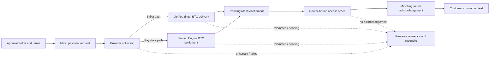

# Mesh payments, Bitcoin and vouchers

**Audience:** Finance and settlement reviewers, support staff, application
developers, voucher custodians and authorized operators  
**Document owner:** Mesh finance/payment owner role (individual not yet
recorded)  
**Prepared:** 22 October 2026, Africa/Nairobi  
**Evidence checked through:** 22 October 2026  
**Status:** Source-derived and record-based operating reference. It is not
financial, tax, regulatory or legal advice; it is not a current approved
tariff; and it does not authorize a payment, Bitcoin transfer, voucher issue,
print run or field launch. Verify current provider mode, service owner,
destination, pricing and deployed release before any financial operation.

> **Financial safety rule:** Keep these states separate: customer request,
> provider collection, Bitcoin delivery/settlement, Mesh entitlement, gateway
> command, router acknowledgement and customer browsing. A later state must
> not be inferred from an earlier one. If an initiated collection or transfer
> is uncertain, preserve and reconcile the original reference; do not prompt
> the customer again, switch providers automatically, send Bitcoin again, or
> issue a second allowance.

## Contents

- [1. Scope, evidence and financial control](#1-scope-evidence-and-financial-control)
- [2. Money and access roles](#2-money-and-access-roles)
- [3. End-to-end state model](#3-end-to-end-state-model)
- [4. Bitika collection and delivery path](#4-bitika-collection-and-delivery-path)
- [5. Paystack collection and Engine settlement path](#5-paystack-collection-and-engine-settlement-path)
- [6. Provider selection, uncertainty and reconciliation](#6-provider-selection-uncertainty-and-reconciliation)
- [7. Pricing, quotes, fees and customer terms](#7-pricing-quotes-fees-and-customer-terms)
- [8. Voucher product and lifecycle](#8-voucher-product-and-lifecycle)
- [9. Voucher generation, storage and lookup](#9-voucher-generation-storage-and-lookup)
- [10. Redemption controls and router handoff](#10-redemption-controls-and-router-handoff)
- [11. Physical voucher production and custody](#11-physical-voucher-production-and-custody)
- [12. Finance reconciliation and exception handling](#12-finance-reconciliation-and-exception-handling)
- [13. Privacy, audit and access controls](#13-privacy-audit-and-access-controls)
- [14. Acceptance and control checklist](#14-acceptance-and-control-checklist)
- [15. Open decisions](#15-open-decisions)
- [16. Source records](#16-source-records)

## 1. Scope, evidence and financial control

This chapter describes payment, Bitcoin settlement and voucher behavior based
on the application source and dated Mesh records checked on 22 October 2026.
The implementation includes multiple provider adapters and both native and
legacy access paths. The records include supervised home-pilot transactions,
settlement integration work and voucher experiments. They do not establish
that any payment method or voucher tariff is currently approved for customers.

Evidence labels:

- **Source-observed:** code/schema exists in the checked-out repository.
- **Recorded transaction/test:** a dated record reports a bounded operation;
  only that reference, amount, environment and test are evidenced.
- **Historical proposal/reference:** a package, provider ceiling, voucher
  design or target from a dated record; not automatically current.
- **Unknown / approval required:** current owner, authorization, live
  configuration, accounting, terms or field acceptance are not established.

Use [Volume 01 — Product and service](01-product-and-service.md) for customer
offer language, [Volume 03 — Administration](03-administration.md) for
support procedures, [Volume 06 — API and data contracts](06-api-and-data.md)
for route/schema details, and [Volume 02 — Field deployment](02-field-deployment.md)
for site authorization and commissioning. This chapter is not a replacement
for an approved finance policy or protected transaction ledger.

### 1.1 Do not infer current approval from old evidence

The dated payment records describe specific home-lab events and successive
implementation checkpoints. Later records can supersede earlier readiness
settings; a checked-in adapter can remain unused; and a successful old receipt
does not establish today's provider mode, recipient, fee, price, treasury
balance or service availability.

Before accepting money, an accountable finance/operator pair must verify:

1. the current release and environment;
2. the customer-visible price and exact package terms;
3. the selected provider and live/test mode;
4. the collection account, settlement mechanism and authorized recipient;
5. current provider/Engine readiness and any caps or funded-balance limits;
6. the original-reference recovery procedure and escalation owner;
7. the access activation path and how router acknowledgement will be proven;
   and
8. approved customer receipt, support, refund and dispute wording.

If any of these is unknown, do not enable a live customer collection.

## 2. Money and access roles

### 2.1 Actors and responsibilities

| Actor/system | Responsibility | Must not be confused with |
| --- | --- | --- |
| Customer/payer | Selects an approved offer and authorizes a collection using the presented method. | Mesh entitlement or router identity. |
| Collection provider | Initiates/records the KES collection and reports a provider transaction. | Bitcoin delivery, Mesh grant or router activation. |
| Settlement/transfer service | Verifies or executes the applicable Bitcoin delivery/settlement and produces a matching receipt. | M-Pesa collection or an access command. |
| Finance owner/custodian | Reconciles the collection, fees, settlement, receiving destination, treasury obligations and exceptions. | Sole technical proof of customer browsing. |
| Mesh application | Persists payment, provider metadata, package context and (after eligible evidence) an entitlement/order handoff. | Provider account, Bitcoin wallet or router enforcement. |
| Voucher custodian/retailer | Maintains authorized batch issue/export, sealed stock, sales and inventory reconciliation. | A payment provider or customer identity authority. |
| Site gateway/router | Enforces an eligible access order for the observed device. | Proof that a payment was correctly collected or settled. |
| Customer support | Communicates state, gathers a safe reference and escalates to finance/operations. | Authority to repeat a charge, send funds or mint an allowance. |

### 2.2 Segregation of duties

No individual/role matrix is fully recorded in the reviewed sources. Before
field use, assign at least named accountable roles for:

- catalogue/price approval;
- provider account and credential custody;
- Bitcoin receiving identity and treasury/source wallet;
- independent settlement and collection reconciliation;
- voucher batch creation and export;
- physical stock receipt, retailer custody and sales reconciliation;
- customer support and disputes;
- router access issuance, revoke and incident recovery; and
- release/configuration changes that enable or disable live checkout.

Where staffing cannot separate roles, record a compensating review (for
example, independent second-person verification of a settlement or batch
export). Do not imply that an audit row or provider credential automatically
provides separation of duties.

## 3. End-to-end state model

### 3.1 Financial and service states



Each arrow has a distinct condition. An HTTP success from a checkout endpoint
means a request was accepted/created; it does not mean a provider collected
money. A provider's “success” callback is a notification; it does not alone
prove collection or settlement. A settled payment does not itself create
working router access. A router acknowledgement does not prove browsing to
every destination or that the offer terms were correct.

### 3.2 Application record states

The checked-in database defines the payment enum:

| Status | General interpretation |
| --- | --- |
| `new` | Mesh has created a request; a provider action may not have started. |
| `processing` | Collection/reconciliation is pending, underway or uncertain. |
| `settled` | The applicable flow recorded its settlement condition. Verify the exact provider/receipt evidence and linked order. |
| `expired` | The applicable payment request is no longer valid. |
| `invalid` | The request is closed/rejected under the flow; inspect the reason/reference before any new request. |
| `refunded` | Refund state recorded where supported; check access revocation separately. |

The access-grant enum is `pending`, `active`, `expired`, `revoked` or
`failed`. Native order status is stored as text and has its own claim/active
lifecycle. A router also has its own user/session/enforcement state. None of
these fields should be treated as a normalized cash ledger.

### 3.3 Who may move a state

| Transition | Expected evidence/authority |
| --- | --- |
| Offer → request | Active package, approved price/terms, valid device/session context and current checkout readiness. |
| Request → provider prompt/collection | A single owned request ID and provider reference; provider call may have an ambiguous outcome. |
| Collection → settled financial record | Provider lookup/callback reconciliation with exact reference, amount, mode and required settlement evidence for that payment path. |
| Settled → pending grant/order | Eligible context plus immutable selected limits; atomic application records and unique linkage. |
| Order → claimed | Authenticated enrolled agent; bounded lease and one-time claim token. |
| Claimed → active | Agent reports a router-observed session matching the order's router, server, device, user and expiry. |
| Active → expired/revoked | Approved lifecycle procedure and router-side action/readback. Payment refund and access revoke are separate. |
| Voucher stock → redeemed | Valid batch/code, eligible current device context, attempt controls and atomic redemption-count limit. |

Any contradictory or missing evidence means **unknown / review required**.

## 4. Bitika collection and delivery path

### 4.1 Source behavior

The repository's Bitika adapter:

- requires an API key prefix matching configured test/live mode and a valid
  Lightning address format;
- normalizes a Kenyan mobile number before initiating applicable collection;
- limits the provider amount to its configured supported KES range;
- uses the Mesh payment UUID as the provider idempotency key;
- makes a server-to-server collection request and treats `PENDING` as a
  pending acknowledgement, not a completed collection;
- looks up a transaction by its opaque provider transaction code; and
- validates the returned transaction code, KES amount, stored destination,
  environment, fulfilled state, positive sats and payment hash before mapping
  fulfilled delivery to the settlement condition.

The adapter disables redirects, avoids automatic retries of an ambiguous
money request and uses a bounded provider timeout. Failures deliberately tell
the customer to retain the current payment rather than create a new one.

### 4.2 Required matching

For a native Mesh payment, reconciliation must match the provider transaction
to the original Mesh payment and stored purchase context. The checked-in
service verifies the transaction code, exact expected KES amount, configured
Lightning destination, live mode and delivery evidence. A fulfilled record
without a valid sats amount or payment hash is not accepted as verified
delivery.

The callback signature is checked over bounded raw bytes; after that, the
handler retrieves/reconciles the provider's current transaction. A callback
event name or signed payload alone does not authorize an access grant.

### 4.3 Lost acknowledgement recovery

The dated incident record reports a real KES 10 home-pilot collection whose
provider acknowledgement was `PENDING` and initially did not attach the
transaction code in Mesh. The original request was recovered using the same
payment UUID/idempotency key and exact retained payload. Provider lookup later
verified the transaction and delivery. No second prompt or Bitcoin transfer
was made.

The implementation retains the original collection request encrypted for the
eligible guarded flow, uses a persistent recovery lease and retries only with
the same idempotency identity and payload. This recovery is not permission to
replay arbitrary old records. Older payment rows without a qualifying retained
request need the approved manual reconciliation process.

### 4.4 Recorded transaction boundary

A dated 6 October home-lab record reports a KES 10 Bitika collection and
delivery of 86 sats to the configured receiving address, later followed by
router acknowledgement and operator-reported browsing retry. Another dated
checkpoint reports 86 sats after recovering an acknowledgement. This is
bounded historical evidence for the documented purchase; it is not a current
price, rate, field sale approval, customer-volume result or guarantee of the
current provider configuration.

## 5. Paystack collection and Engine settlement path

### 5.1 Separate financial legs

Paystack collection and Bitcoin settlement are separate operations:

1. Mesh creates a payment reference and the Paystack adapter requests a KES
   mobile-money collection.
2. Paystack verification reconciles the exact reference, amount in KES
   subunits, channel, Mesh metadata and live/test mode.
3. A successful KES collection is stored as collection-confirmed but does not
   alone authorize Bitcoin settlement or internet access.
4. The Insats Engine verifies the payment record, pricing and settlement
   readiness, then uses its own funded treasury to create/settle a Lightning
   payment when authorized.
5. Mesh fetches and validates a receipt matching the same payment ID,
   reference, amount, destination, status and Bitcoin delivery evidence.
6. Only the verified settlement receipt can enter the eligible native
   payment-to-access handoff.

Paystack's KES balance does not automatically convert into the Bitcoin used
by the Engine. Treasury funding, provider settlement in fiat and subsequent
treasury rebalancing are separate accounting/custody obligations.

### 5.2 Engine API boundary

The Mesh client is configured for the fixed Engine origin in source and signs
requests with a scoped service key over timestamp, HTTP method, path and exact
body. The destination comes from server-side configuration, not customer
input. The client validates receipt identity and rejects a claimed verified
delivery unless the settlement status, payment hash, source transaction and
settlement timestamp are coherent.

The Engine owns its treasury/pricing/sending internals. Mesh stores/reconciles
the returned receipt and owns the router-bound access handoff. Do not expose
the Engine service key or treasury credentials to the customer app, gateway
agent or this handbook.

### 5.3 Historical policy snapshots

The Engine settlement record includes successive settings: an earlier
one-purchase pilot limit and a later dated statement authorizing higher
per-purchase ceiling and removing a cumulative pilot cap, while retaining
payout and routing-fee limits. The document also retains an older section
with superseded values. These are historical settings, not a canonical current
financial authorization. Verify the Engine's actual current configuration,
owner approval, funded balance, fees and risk limits before use.

### 5.4 Recorded Paystack result

A dated 5 October record reports a KES 10 Paystack collection followed by a
separate verified 85-sat settlement to the receiving wallet. The initial
Paystack collection-only record explicitly had no access grant. Later Engine
integration records describe a different stage of implementation. None of
these records is evidence that a new Paystack sale is currently enabled or
that Paystack is the current primary customer method.

## 6. Provider selection, uncertainty and reconciliation

### 6.1 No automatic failover after initiation

The dated Bitika-first design selects a fallback for a **new** purchase only
when the preferred provider is unavailable before an external money request
has started. Once a collection may have been initiated, a timeout, lost
acknowledgement or pending provider state is ambiguous. The same purchase
reference must be reconciled; it must not silently move to a different
provider and produce a second prompt.

The native checkout path reserves a device/router against competing prompts.
This reservation reduces duplicate starts but does not prove provider
collection, settlement or access.

### 6.2 Reconciliation order

For a customer who reports payment but no internet:

1. retain the original Mesh payment UUID and provider reference;
2. identify the exact provider, environment, selected package and amount;
3. verify provider collection through authenticated lookup;
4. verify the required Bitcoin delivery/Engine receipt separately;
5. inspect the Mesh payment and access grant without changing them;
6. inspect the native order, claim and last agent observation;
7. read back the matching router session and exact expiry;
8. test the intended device and approved destination only after state is
   understood; and
9. record resolution, remaining uncertainty and assigned follow-up owner.

If results conflict, stop before performing another money or access action.
Do not overwrite the original reference, settlement evidence or deadline.

### 6.3 Exception matrix

| Situation | Safe interpretation | Do not |
| --- | --- | --- |
| Prompt sent; no definitive callback/lookup | Collection outcome unknown. | Send a second prompt or switch provider. |
| Provider says collection succeeded; settlement pending | Customer fiat leg may be complete; financial settlement remains unresolved. | Mint access if the selected contract requires settlement first. |
| Settlement receipt exists; no order/grant | Handoff needs reconciliation; preserve receipt and payment. | Set payment/grant fields manually without approved transaction procedure. |
| Order queued/claimed; no router acknowledgement | Access is not confirmed; gateway/router path needs investigation. | Repeat the payment, create another order or claim browsing works. |
| Router shows access; customer cannot browse | Investigate WAN, DNS, device/AP and packet policy separately. | Extend time/data or bypass firewall before diagnosis. |
| Refund is reported | Financial reversal and router revoke are separate checks. | Assume the router session ended automatically. |
| Provider callback repeats | Duplicate delivery is expected; reconcile same reference idempotently. | Treat it as a second sale or second settlement authorization. |

### 6.4 Customer communication principles

- Tell the customer the observed state plainly: waiting, confirmed collection,
  settlement checking, activation pending, active, expired, or needs review.
- If uncertain, explicitly say not to pay again while the original payment is
  checked.
- Do not expose internal provider names, wallet IDs, provider payloads or
  settlement secrets unless approved customer copy requires them.
- Do not describe a router acknowledgement as universal internet quality,
  coverage or a service guarantee.
- A refund eligibility rule, time-to-resolution promise and complaint route
  require business/operator approval; this draft does not invent them.

## 7. Pricing, quotes, fees and customer terms

### 7.1 Source fields versus approved offer

The application catalogue contains KES price, sats reference, duration,
optional data and speed limits, activation flag and order. Provider adapters
may also calculate an exchange quote or settlement amount. Those values have
different meanings:

| Value | Meaning | Customer/finance control |
| --- | --- | --- |
| Approved KES price | Amount the customer is told and asked to approve. | Must match current approved package terms and provider request. |
| Package sats field | Stored catalogue value used by selected code paths. | Do not assume it is the actual current Bitcoin delivery amount or a live quote. |
| Provider quote | Time-specific conversion estimate/fee output. | Record timestamp and quote basis; not a fixed exchange rate. |
| Delivered sats | Actual verified transaction/receipt amount. | Match to exact payment and destination; keep separate from quoted amount. |
| Engine settlement amount | Amount fixed by the settlement flow when it processes an eligible collection. | Reconcile actual receipt, pricing method, source wallet and fee limits. |
| Retail voucher sale amount | Customer price/custody entry for printed stock. | Must match approved package terms and batch sales accounting. |

Do not display a historical quote, sats figure, fee, duration or Engine
ceiling as the current price or policy without owner approval.

### 7.2 Historical catalogue and voucher references

The code/docs contain multiple catalogue snapshots, including historical
3WEST references and wildlife voucher artwork examples. Examples such as
KES 30 daily, KES 140 weekly and KES 450 monthly are design/reference values
from dated material, not an approved Mesh tariff. Other records describe
different package counts and durations. Verify the current catalogue,
package-to-voucher mapping and customer-facing terms before print or sale.

The customer contract must unambiguously define whether validity means
connected time or a fixed deadline, when it begins, what happens on
disconnect/reconnect, included speed/data/device limits, expiry, support and
refund handling. The database's `durationMinutes` and `expiresAt` do not by
themselves settle all those product/legal questions.

### 7.3 Fees and accounting

The reviewed sources do not establish one approved public accounting policy
for:

- payment-provider charges, taxes or customer-paid fees;
- conversion spread and rate timestamp;
- Lightning routing fees and who bears them;
- KES settlement timing to a bank or mobile-money account;
- treasury replenishment and reconciliation;
- refunds, reversals, chargebacks and associated access revoke; or
- financial reporting period, ledger export and authorized signoff.

Finance must define and approve these matters. Do not infer that an
engineering settlement receipt is a full accounting ledger or tax record.

## 8. Voucher product and lifecycle

### 8.1 Voucher is a package-bound pass, not stored value

A voucher represents redemption of configured access terms from a batch. It
is not a reusable wallet balance, a payment identity or a general-purpose
customer account. The batch can specify package linkage, sale amount,
duration, data/speed limits, validity window and maximum redemptions. Match
each real batch to an approved package and customer terms before issuance.

Current product policy for physical tickets, validity semantics, replacement
of lost tickets and retailer commission is not fully approved in the reviewed
records. A code alone does not define the customer contract.

### 8.2 Lifecycle stages

```text
Approved terms
      |
      v
Batch created + audit entry + unique protected codes
      |
      v
Authorized export / controlled print proof
      |
      v
Custody transfer -> retailer issue/sale ledger
      |
      v
Customer enters code on an eligible Mesh device
      |
      v
Rate-limit + code/batch/validity checks
      |
      v
Atomic redemption count + one grant/order
      |
      v
Router acknowledgement + customer connection test
```

Physical printing, retailer handover, sale reconciliation and customer
redemption are separate events. Batch creation is not proof that stock was
printed, delivered to a retailer, sold, redeemed or activated.

### 8.3 Existing formats and batch controls

The source supports new six-digit numeric vouchers, including leading zeroes.
The dated implementation notes say existing prefixed formats were retained
for compatibility and keep their original export format. The schema records
batch quantity, package/terms, validity window and maximum redemptions;
individual voucher rows record disabled state and redemption count.

The voucher issuance helper bounds one batch to 1–1,000 codes, generates
uniformly sampled six-digit codes using a cryptographic random integer
function, checks current and historic hash collisions, and retries a batch
transaction when a unique-index collision occurs. The admin issue flow should
insert the batch, codes and audit row atomically. Verify current route/action
behavior before relying on these helper-level properties for a release.

### 8.4 Six digits are not strong identity

Uniformly generated six-digit codes have one million possible values. They
are bearer secrets with limited online search space, not identity credentials.
Short stock lifetime, single redemption, durable throttling, protected export,
small batch size and incident/reissue rules are necessary controls. Hashing a
code does not increase its entropy or prevent online guessing.

The source record estimates the probability of guessing at least one valid
code within 100 attempts as approximately 9.5% for a pool of 1,000 and 63%
for 10,000 uniformly distributed valid codes. These are illustrative
probabilities under the record's assumptions, not a security guarantee.

## 9. Voucher generation, storage and lookup

### 9.1 At-rest representation

The current voucher code utilities:

- generate six-digit numeric codes with leading zeroes preserved;
- normalize input before lookup;
- compute an HMAC-SHA256 lookup hash with a separate lookup key;
- derive the default lookup key from the voucher encryption key using a
  versioned HKDF-SHA256 context, unless a separate canonical 32-byte
  `VOUCHER_LOOKUP_KEY` is configured;
- encrypt exportable plaintext using AES-256-GCM and a random IV;
- retain a last-four display value for old/non-numeric records, while new
  numeric codes do not expose four digits in the database; and
- retain bounded legacy SHA-256 lookup support only when explicitly
  configured with a valid issuance cutoff and expiry.

New numeric rows use the full HMAC digest prefix
`hmac-sha256-v1:` in the `codeHash` field. Existing legacy hashes are a
separate compatibility case. The current keyed record is authoritative; if
it exists but is disabled or exhausted, lookup must not fall through to an
older colliding legacy row.

### 9.2 Key separation and rotation

The lookup key and export-encryption key serve distinct purposes. If lookup
hashes are derived from the encryption key, changing that encryption key also
changes the derived lookup key. Rotating either key without a planned
rehash/re-encryption migration can make existing vouchers undiscoverable or
unexportable.

Before key rotation:

1. pause batch issuance and redemption as approved;
2. take and verify a protected database backup;
3. identify the exact current formats and key lineage without exporting codes;
4. prepare a bounded migration and rollback compatible with the installed
   application;
5. migrate hashes/ciphertexts and audit the operation transactionally;
6. deploy the matching application and key set; and
7. test with isolated fixtures and controlled owner-authorized stock.

Do not use a production customer's voucher as a test fixture or print key
material in a migration log.

### 9.3 Legacy migration

The dated lookup-hardening record describes an additive migration from
plain SHA-256 legacy hashes to keyed HMAC, clearing numeric last-four leakage
while preserving old physical code values, expiry, redemption count and
disabled state. New issuance checks legacy hashes to avoid recycling old
physical codes. Application rollback after data rehash requires a paired
database/application plan; reverting code alone can make migrated stock
unusable.

Legacy lookup compatibility is off by default. When deliberately configured,
it requires both a past issuance cutoff and an expiry no more than 32 days
after the cutoff. Such a window retains offline-dictionary exposure for
legacy SHA records until migration or retirement. Do not extend it
indefinitely.

### 9.4 Export boundary

Voucher export decrypts full codes for authorized batch handling; this is a
high-risk operation. Export only the approved batch and minimum necessary
fields, deliver through the approved protected channel, record custodian and
count, and remove uncontrolled temporary copies. Do not send code lists in
email/chat, commit them, attach them to a ticket or paste them into this
handbook.

## 10. Redemption controls and router handoff

### 10.1 Request and lookup

The redemption route accepts a bounded request and validates the code length.
It resolves the code through the protected lookup, then checks the voucher's
disabled state, batch start/end validity and redemption cap. Both valid and
invalid attempts count toward the configured distributed limits.

The six-digit voucher implementation record lists default 15-minute windows:

| Scope | Recorded default attempts per window |
| --- | ---: |
| Device/MAC | 5 |
| Trusted source | 30 |
| Global pilot limit | 100 |

The source setting allows a configured range of 1–10,000. The source-address
limit only trusts the platform-provided forwarding header on the applicable
hosting platform; arbitrary proxy headers are ignored. The global ceiling
exists to limit attempts across invented MACs. Confirm the environment values,
database migration and deployed code before relying on these defaults.

### 10.2 Native versus legacy redemption

When native automatic Mesh access is enabled:

- an invalid/incomplete native configuration fails closed;
- the browser needs a valid trusted Mesh context;
- browser-supplied MAC/IP/router/login fields cannot override that context;
- the voucher must match its batch limits and validity;
- voucher count increment, grant and native order are linked through the
  service's atomic eligibility path; and
- repeat redemption for the same voucher/context returns the existing grant
  instead of creating a second allowance.

When native mode is disabled, the handler retains a legacy route for
compatible codes. This is a separate behavior with different identity
authority and router-job semantics. The source explicitly prevents new
six-digit numeric stock from entering the legacy path. Do not disable native
mode as a troubleshooting workaround.

### 10.3 Redemption outcome

An HTTP `201` with an access grant identifier means the application accepted
the redemption and queued/created its associated access state. It does not
prove the router applied the pass or the customer can browse. Check the
native order state, router readback and intended-device result as separate
steps.

### 10.4 Lost or exposed stock

The reviewed product records do not establish a complete customer
replacement/refund policy for lost or exposed paper tickets. Until approved:

- do not publish a full voucher code in an unprotected support channel;
- do not issue a replacement until the original is checked and disabled or
  otherwise resolved under policy;
- if a batch is exposed, identify the affected batch, stop further
  distribution, assess redemptions, disable/revoke safely and inform the
  accountable custodian; and
- preserve the batch/custody/audit references and keep the incident
  communication privacy-minimized.

## 11. Physical voucher production and custody

### 11.1 Design samples are not approved stock

The physical voucher record contains sample artwork directions, wildlife
illustrations and print specifications. The documented sample PDFs and codes
are review proofs, not saleable stock. Several design pages explicitly say
they contain dummy codes, and a dummy numeric code is not guaranteed unused
in the production namespace. Never print or redeem a sample code as real
inventory.

The artwork record mentions a 50 × 40 mm trim size, 3 mm bleed, opaque
scratch area, type and printer proofing requirements. These describe design
handoff details, not a production approval. Any real run requires current
batch data, approved package terms, a physical opacity test, actual-size
proof and printer acceptance. RGB artwork and a simulated silver panel are
not colour-certified press masters.

### 11.2 Pre-print controls

Before printing a real batch, the authorized owner should verify:

- approved amount, package mapping, duration and expiry wording;
- exact batch ID, generated quantity and unique code count;
- front/reverse master revision and brand asset approval;
- code placement, font/readability and that the scratch finish fully conceals
  the digits under strong light;
- trim, bleed, safe area, substrate and printer proof;
- the export recipient, handoff channel, custody count and secure deletion of
  production files;
- whether retailer pricing/commission and returns are approved; and
- a documented stop/recall route if a proof reveals exposed or duplicate
  codes.

Do not include the code export in the artwork repository. Keep press masters
with dummy data distinct from production variable-data print files.

### 11.3 Stock reconciliation worksheet

Use a protected ledger, not this public handbook:

| Control | Count/reference |
| --- | --- |
| Batch ID / approved package revision | |
| Codes generated / database records committed | |
| Codes exported / export custodian and time | |
| Copies sent to printer / secure transfer reference | |
| Cards printed / rejected / destroyed | |
| Cards sealed and transferred / sender and recipient | |
| Retailer opening stock / returns / damaged or lost | |
| Sold, redeemed, disabled and remaining counts | |
| Difference / incident reference / approver | |

Record counts and protected references; do not copy secret codes into this
worksheet or a broadly accessible report.

### 11.4 Reprint and disposal

A reprint can duplicate valid bearer secrets. Reprint only after deciding
whether the first run was destroyed/contained and whether codes must be
disabled and replaced. Record waste destruction and count witness. Never
assume that an unchanged batch ID with a fresh print file is harmless.

## 12. Finance reconciliation and exception handling

### 12.1 Per-purchase reconciliation record

For each financial purchase, retain a protected record sufficient to match:

- Mesh payment UUID and creation/request time;
- provider and live/test mode;
- exact KES amount and currency;
- provider invoice/transaction reference;
- provider collection result and authenticated lookup evidence;
- required Bitcoin/Engine delivery receipt, sats and destination match;
- any rate/fee evidence required by the approved accounting policy;
- package/terms snapshot or version sold;
- linked access-grant and native-order IDs;
- router acknowledgement and expiry/readback evidence;
- refund/reversal/chargeback state, if any; and
- reviewer, exception decision and final reconciliation status.

Minimize payer/contact data and protect the ledger. Do not use a source-control
metadata dump as the finance record.

### 12.2 Daily/periodic reconciliation control

An approved finance procedure should compare, for the same accounting period:

1. Mesh payment records by provider/reference/status/amount;
2. provider transaction export or authenticated transaction lookup;
3. Engine settlement receipt ledger (for applicable Paystack path);
4. receiving-wallet evidence for the exact destination/transaction when
   required by policy;
5. provider fees, conversion amount and any treasury replenishment;
6. access grants/orders issued only for eligible transactions;
7. refunds, reversals, failed collections and unresolved items; and
8. physical voucher opening/closing stock, sales, redemptions and disabled
   records.

The person preparing the reconciliation and the person approving exceptions
should be recorded. A successful SQL query or provider dashboard is not by
itself a signed accounting close.

### 12.3 Exception decision table

| Evidence mismatch | Immediate disposition | Escalation |
| --- | --- | --- |
| Amount/currency/reference mismatch | Hold entitlement; preserve all records. | Finance owner and provider support via approved channel. |
| Collection confirmed, required delivery absent/pending | Keep the purchase unresolved; no access order if settlement is a prerequisite. | Settlement/treasury owner. |
| Delivery receipt mismatch or unknown destination | Stop settlement/access processing. | Independent finance reviewer; investigate before any retry. |
| Duplicate callback or repeated poll | Reconcile the same payment idempotently. | Escalate only if a second financial side effect is observed. |
| Database says settled, provider lookup disagrees | Treat as conflict, not success; do not manually overwrite. | Finance and application release owner. |
| Provider says paid, Mesh has no matched payment | Do not create an unrelated grant. Preserve provider reference and investigate exact request. | Finance/support and application owner. |
| Grant/order exists twice or terms differ | Stop further access mutation; preserve both identifiers and router readback. | Operations/application owner; finance if money is affected. |
| Voucher stock count differs from database | Pause distribution/redemption as policy requires; secure the batch. | Voucher custodian and independent reviewer. |
| Refund/reversal with active router session | Verify provider refund and separately revoke/read back access under policy. | Finance plus network operator. |

Do not execute a manual update, repeated payout or second allowance as a
shortcut to clear a discrepancy.

## 13. Privacy, audit and access controls

### 13.1 Data classes

| Data | Examples | Handling |
| --- | --- | --- |
| Financial reference | Mesh UUID, provider reference, amount, payment/settlement status. | Protected finance/support access; minimize retention and exports. |
| Payer contact | Normalized phone, provider receipt/contact details. | Restrict to roles with a collection/support purpose; never include in source examples or ordinary logs. |
| Wallet/settlement data | Lightning destination, payment hash, source/receiving transaction IDs, treasury reference. | Highly restricted finance/treasury evidence; omit secrets and unnecessary identifiers from public records. |
| Voucher secret | Full code or decrypted export. | Treat as bearer credential; controlled export/custody only, never log or commit. |
| Device/network context | MAC, IP, router/server IDs and user agent. | Treat as potentially identifying; use minimum data needed for support and apply an approved retention policy. |
| Provider/authentication secret | API key, webhook secret, HMAC key, wallet key. | Secret manager/environment custody; never store in this handbook, issue tracker or client bundle. |

### 13.2 Audit limitations

The schema has an `audit_logs` table, and reviewed admin flows write events
for some operations. This does not establish complete audit coverage for every
provider side effect, export, settlement, router mutation, refund, print
handoff or manual intervention. Before launch, define and test which roles
can read/export financial or voucher data and which actions must produce
auditable records.

### 13.3 Retention and deletion

The reviewed materials do not establish a complete approved retention
schedule for financial metadata, phone/contact data, MAC/IP, voucher history,
audit events or encrypted order payloads. A retention/deletion policy must
account for financial, security, support and legal obligations and must not
destroy evidence needed to resolve an uncertain transaction. Assign an owner
and review it with the appropriate legal/privacy adviser; this draft is not
legal advice.

## 14. Acceptance and control checklist

Before enabling a new payment method or voucher batch:

- [ ] Written approval exists for price, currency, package and customer terms.
- [ ] Correct provider, mode, account, recipient and callback secret are
      independently checked.
- [ ] Current readiness and limits are observed from the intended environment.
- [ ] A non-financial or sandbox test has validated the expected request and
      response; it is not represented as live financial evidence.
- [ ] The ambiguous-outcome procedure preserves one reference and blocks
      duplicate collection/settlement.
- [ ] Provider collection and required settlement are reconciled separately.
- [ ] Access is bound to the right device/site and requires router readback.
- [ ] Support can identify pending, failed and unknown states without asking
      the customer to pay again.
- [ ] Finance owner and independent exception reviewer are assigned.
- [ ] Voucher keys, database migration, throttles and stock caps are verified.
- [ ] Batch export is protected, logged and reconciled to print/custody counts.
- [ ] Sample artwork uses dummy data and is not mixed with production codes.
- [ ] Refund/reversal and access-revoke responsibilities are agreed.
- [ ] Data retention, privacy and customer receipt wording are approved.
- [ ] Rollback disables new requests without deleting pending references or
      resetting existing allowances.

This checklist is a control framework, not authorization to initiate a
customer transaction or print stock.

## 15. Open decisions

The following decisions remain unconfirmed in the reviewed evidence and must
not be filled in by inference:

- current approved Mesh tariff, supported packages and validity semantics;
- current primary/fallback provider and exact customer-visible method;
- current Bitika recipient and proof/ownership procedure;
- current Engine live ceilings, fee limits, treasury owner and replenishment
  procedure;
- finance close frequency, accounting format, reviewer and escalation contact;
- refund, chargeback, customer credit and failed-settlement policies;
- whether a new sale can be made while an older transaction is unresolved;
- voucher replacement, stolen-code, retailer commission and expired-stock
  policy;
- physical batch size and release cadence for field operations;
- approved print master, physical opacity test and variable-data printer
  workflow;
- privacy retention/deletion schedule and role-based access to exports; and
- whether/when to permit TV, family, shared devices, multiple redemptions or
  complimentary staff access.

Record each decision in the authorized product/finance process with owner,
effective date and evidence. Update this chapter and the customer contract
when implemented.

## 16. Source records

### Checked-in implementation

- [`lib/payments/bitika.ts`](../../../lib/payments/bitika.ts) and
  [`lib/payments/reconcile-bitika.ts`](../../../lib/payments/reconcile-bitika.ts)
  — Bitika collection validation, transaction matching and recovery.
- [`lib/payments/paystack.ts`](../../../lib/payments/paystack.ts) and
  [`lib/payments/reconcile-paystack.ts`](../../../lib/payments/reconcile-paystack.ts)
  — Paystack adapter and collection reconciliation.
- [`lib/payments/insats-engine.ts`](../../../lib/payments/insats-engine.ts)
  — Mesh-side Engine request signing and receipt validation.
- [`lib/mesh-access/service.ts`](../../../lib/mesh-access/service.ts) and
  [`lib/mesh-access/model.ts`](../../../lib/mesh-access/model.ts)
  — eligible payment/voucher access order creation and constraints.
- [`lib/voucher-crypto.ts`](../../../lib/voucher-crypto.ts),
  [`lib/voucher-issuance.ts`](../../../lib/voucher-issuance.ts) and
  [`lib/voucher-lookup.ts`](../../../lib/voucher-lookup.ts)
  — voucher generation, protected lookup, export encryption and compatibility.
- [`lib/voucher-rate-limit.ts`](../../../lib/voucher-rate-limit.ts) and
  [`lib/db/schema.ts`](../../../lib/db/schema.ts)
  — throttling/schema controls.
- [`app/api/payments/route.ts`](../../../app/api/payments/route.ts),
  [`app/api/payments/[id]/route.ts`](../../../app/api/payments/[id]/route.ts),
  [`app/api/vouchers/redeem/route.ts`](../../../app/api/vouchers/redeem/route.ts)
  and [`app/api/webhooks/`](../../../app/api/webhooks/)
  — customer and provider entry points.

### Mesh operational records

- [Bitika-first checkout](../mesh-bitika-primary.md) — dated provider mode
  and transaction evidence.
- [Bitika acknowledgement incident and recovery](../mesh-bitika-pending-ack-incident-2026-10-06.md)
  — original-reference recovery boundaries.
- [Paystack collection](../mesh-paystack-collection.md) — collection-only
  history and explicit settlement distinction.
- [Bitcoin settlement Engine](../mesh-engine-bitcoin-settlement.md) —
  treasury/settlement roles and historical limits.
- [Six-digit vouchers](../mesh-six-digit-vouchers.md) — generation,
  throttling and bounded redemption evidence.
- [Voucher lookup hardening](../mesh-voucher-lookup-hardening.md) — keyed
  lookup, legacy migration and key-rotation implications.
- [Physical voucher cards](../mesh-physical-voucher-cards.md) — design proofs
  and printer controls; sample artwork is not sale stock.
- [Volume 01 — Product and service](01-product-and-service.md) — customer
  terms and unresolved package decisions.
- [Volume 03 — Administration](03-administration.md) — payment support and
  operator escalation.
- [Volume 06 — API and data contracts](06-api-and-data.md) — route and data
  contract detail.
