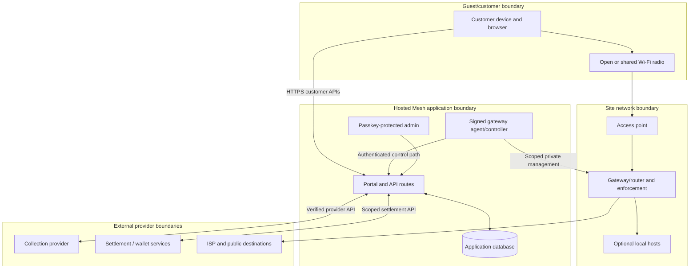

# Mesh security and privacy

**Audience:** Security reviewers, application and network maintainers, service
owners, operators and privacy reviewers  
**Document owner:** Mesh security/privacy owner role (individual not yet
recorded)  
**Prepared:** 22 October 2026, Africa/Nairobi  
**Evidence checked through:** 22 October 2026  
**Status:** Security architecture and control/evidence register based on
checked-in source and dated home-lab records. This is not a penetration-test
report, certification, legal opinion, field clearance or guarantee of
security. Controls and deployment state must be reverified for the current
release and each site.

> **Security boundary:** The 6 October records describe meaningful controls
> deployed to a home-pilot release, but also record that field-specific
> management, privacy, load, backup and physical acceptance remain. Passing
> tests or a runtime dependency scan does not prove the whole service secure.
> Use this chapter to identify the controls, residual risks, evidence and
> decisions that still need named owners.

## Contents

- [1. Purpose, evidence and assurance limits](#1-purpose-evidence-and-assurance-limits)
- [2. Security goals and assets](#2-security-goals-and-assets)
- [3. Threat actors and assumptions](#3-threat-actors-and-assumptions)
- [4. Trust boundaries](#4-trust-boundaries)
- [5. Threat and control register](#5-threat-and-control-register)
- [6. Identity, credentials and key lifecycle](#6-identity-credentials-and-key-lifecycle)
- [7. Payment and voucher integrity](#7-payment-and-voucher-integrity)
- [8. Network isolation and free-service exposure](#8-network-isolation-and-free-service-exposure)
- [9. Privacy and data handling](#9-privacy-and-data-handling)
- [10. Logging, audit and evidence](#10-logging-audit-and-evidence)
- [11. Incident handling and disclosure](#11-incident-handling-and-disclosure)
- [12. Security testing and assurance](#12-security-testing-and-assurance)
- [13. Launch gates and operator checklist](#13-launch-gates-and-operator-checklist)
- [14. Decisions and residual risks](#14-decisions-and-residual-risks)
- [15. Source records](#15-source-records)

## 1. Purpose, evidence and assurance limits

This chapter describes the security and privacy boundaries relevant to Mesh's
customer Wi-Fi, web application, financial paths, vouchers, administrator
access and enrolled gateway. It records what the source and dated material
support; it does not represent a fresh security review of every commit or
deployed service.

Use these evidence labels:

- **Source-observed:** a control or behavior exists in the checked-out code.
- **Dated release evidence:** a record says a named change or check was
  deployed/tested at the stated time and scope.
- **Home-lab observation:** a bounded result for specific lab equipment,
  configuration and test conditions.
- **Residual risk:** known limitation or a control not established by the
  evidence reviewed.
- **Unknown / verify:** deployment, ownership or effectiveness is not proven.

The 6 October security audit documents its limited scope and methodology:
owned application code paths, synthetic credentials, mocked provider calls
and isolated database tests; no live load, radio attack, destructive test,
or third-party scanning. The subsequent release record identifies deployed
fixes and bounded negative checks. Neither record claims an independent
penetration test, compliance certification, privacy impact assessment,
complete field audit or guarantee against attack.

Do not use this chapter to authorize network changes, security testing on
systems outside an approved scope, financial operations or publication of
private evidence. Obtain written authorization and defined stop conditions
for any live test.

## 2. Security goals and assets

### 2.1 Security objectives

Mesh security work should protect:

1. **Availability and fair access:** keep unauthorized clients from consuming
   paid entitlements or exhausting shared checkout/voucher resources.
2. **Payment integrity:** bind collection and required Bitcoin settlement to
   the exact purchase and prevent a repeated prompt or transfer after an
   uncertain response.
3. **Entitlement integrity:** preserve purchased limits, device binding and
   original expiry through retries, recovery and migration.
4. **Router integrity:** ensure only the authorized gateway/controller path
   can change the enrolled router's access state, and that the router applies
   only a matching order.
5. **Administrator integrity:** restrict sensitive controls to approved
   administrators and protect lost/revoked devices and enrollment codes.
6. **Confidentiality:** protect provider credentials, voucher codes, access
   secrets, personal/payment data and private site recovery details.
7. **Privacy and dignity:** minimize collection and exposure of customer
   device, network, payment and support data; avoid inspecting message or
   wallet contents.
8. **Accountability and recovery:** preserve enough safe evidence to resolve
   incidents without disclosing secrets or corrupting financial history.

### 2.2 Assets and impact

| Asset | Example | Potential impact if compromised |
| --- | --- | --- |
| Router administration plane | Router credentials, pinned SSH identity, management route | Site outage, access-policy bypass, customer data exposure or loss of remote recovery. |
| Gateway machine identity | HMAC service key, enrollment identity and agent runtime | Forged context/order polling or unauthorized router actions within the key's scope. |
| Customer session capability | One-use join ticket and browser token/cookie | Attacker may act within the bound customer web context if stolen before expiry/revocation. |
| Payment/settlement records | Provider references, receipt and wallet/treasury data | Duplicate or misdirected money movement, false entitlement or financial loss. |
| Router access order | Encrypted generated user/password, device and expiry | Unauthorized network use or accidental extension/wrong-device access. |
| Voucher inventory | Six-digit bearer codes and decrypted export | Unpaid access, inventory loss, fraud or customer dispute. |
| Admin passkeys/session | Authenticator, enrollment code and signing secret | Sensitive admin actions or data export. |
| Database and encryption keys | Persistent records, access-order/voucher keys | Loss, alteration or exposure of customer, financial and operational state. |
| Customer traffic and metadata | MAC/IP, destination metadata, user-agent, phone | Tracking, profiling, harassment or exposure of sensitive associations. |
| Service availability | App, database, ISP, AP, local service and controller | Customers cannot join, pay, use internet or reach advertised services. |

## 3. Threat actors and assumptions

### 3.1 Threat actors considered

- a nearby person on an open or shared Wi-Fi network;
- a customer attempting to access another device, management interface or
  unpaid internet;
- a person guessing, copying, photographing or redistributing a voucher;
- an attacker replaying, altering or forging a browser or gateway request;
- an attacker who obtains access to an application/database account or a
  backup;
- a compromised or lost operator device/passkey;
- a malicious or compromised dependency, host, provider account or
  administrative integration;
- an insider or contractor with excessive access to credentials, vouchers,
  customer records or router configuration; and
- accidental failures such as stale DNS/TLS, clock drift, misconfiguration,
  duplicate workers, unsafe rollback, power loss or operator error.

### 3.2 Trust assumptions that require verification

The design assumes that:

- TLS certificates and DNS are correctly controlled and current;
- the enrolled router identity and private management path are pinned and
  protected;
- gateway service keys are not shared beyond their approved component and
  can be revoked;
- provider/Engine credentials and Bitcoin custody are held by authorized
  people and services;
- PostgreSQL access is limited to approved application/operations workloads;
- live deployment environment variables match the reviewed release;
- customer endpoints apply the same context and limit checks as the source;
- router policy, IPv6, AP isolation and physical access are commissioned; and
- operators do not copy secret values into logs, tickets, source or chat.

These assumptions are not self-proving. Confirm them in the deployment,
credential-custody and release records.

## 4. Trust boundaries

This is a logical model, not a firewall configuration. It intentionally
distinguishes the customer data plane from the controller, financial and
operator planes. A customer-facing application responding does not establish
that the gateway is reachable; an agent heartbeat does not establish customer
isolation; and an ISP path does not establish payment integrity.

## 5. Threat and control register

### 5.1 Summary register

| Threat | Source/release control evidence | Residual risk / acceptance needed |
| --- | --- | --- |
| Guest on-path capture of onboarding capability | HTTPS overlay, one-use ticket exchange, trusted proxy handling and negative forged-header checks are described in the 6 October records. | Physical unpaid-phone TLS/catalogue acceptance remains a separate gate; open Wi-Fi itself does not encrypt non-TLS application traffic. Rogue AP/captive-origin risk remains distinct. |
| Browser selects another device or management IP | Native checkout/voucher path uses the server-held, router-attested context instead of browser MAC/IP/router fields. | MAC can rotate/spoof; binding is not person identity. Field pool, AP and router observation must be verified. |
| Gateway request replay | v2 HMAC nonce, durable PostgreSQL replay-key uniqueness, bounded timestamp and fail-closed partial-header handling; dated read-only check rejected identical replay. | Key custody/rotation and field gateway enrollment remain. Legacy mode has a time-bounded compatibility mechanism; verify unset/expired. |
| Fake provider callback | Raw-body signature verification, bounded input and provider-side transaction reconciliation for matching references. | Provider account callback configuration, provider lookup and settlement service availability remain external dependencies. |
| Duplicate collection/Bitcoin send | Stable payment UUID/idempotency key, durable send/charge markers, preserved encrypted Bitika request and settlement receipt matching are source/recorded controls. | Provider and Engine have independent side effects. Ambiguous outcomes still require reconciliation; don't infer full distributed atomicity. |
| Duplicate access/order from retry | Unique order constraints, atomic eligibility and grant/order writes, replay guards, idempotent prior-order lookup and claim token. | Legacy path differs. Router timeout after mutation needs readback before retry. |
| Voucher guessing / database leak | Keyed HMAC lookup, encrypted export, numeric suffix suppression, durable multi-scope rate limits and migration compatibility bounded/off by default. | Six-digit entropy remains limited; distributed guessing, stock exposure, key loss and shared-source fairness remain. |
| Admin credential/device compromise | WebAuthn verification with challenge, trusted origin, RP ID, user verification, active credential check and revocation lookup; limited slots and enrollment codes. | Recovery device, account custody, role separation and complete action-level authorization matrix need confirmation. |
| Customer-to-customer/management access | Lab network records and design specify isolation; security records identify management service restrictions. | Real AP bands/wired ingress, IPv6, FastTrack/offload, MAC management, dedicated field management VLAN and per-site rule readback remain. |
| Free-app allowlist overreach | Dated rules use selected scoped destination/port exceptions and app trials document feature limits. | Shared CDN/IP hosting, VPN/tunnel behavior, external push and changing destinations prevent an app-exclusive guarantee. |
| Dependency/build compromise | Lockfile, runtime advisory checks and release build evidence are recorded. | Dependency scans are not code review; development advisories, transitive dependencies, supply-chain integrity and current deployed SBOM remain. |
| Customer data over-collection or disclosure | Some handlers bound inputs and avoid logging raw webhook/provider payloads; security records state private evidence is kept out of public docs. | No complete approved data map, retention schedule, customer rights process, field notice or privacy assessment is evidenced. |
| Service disruption or unsafe rollback | Replay and voucher migrations have documented ordering/paired rollback; field plan requires backups and stop conditions. | Complete tested restore of database, controller, router and financial state is not established. |

The register summarizes evidence and open work; it is not a substitute for a
scoped risk assessment by an authorized reviewer.

### 5.2 Open Wi-Fi and customer traffic

Association to an open SSID does not encrypt the radio link. HTTPS and
application-level encryption protect supported traffic end to end, but
unencrypted protocols or misconfigured apps may expose content to nearby
observers. Mesh should not claim that the Wi-Fi itself provides private
communications.

Customer access policy must deny management and private upstream destinations
by default, isolate customers from one another where the hardware and topology
permit, and cover IPv4 and IPv6. Test both paid and unpaid clients, wired
customer ports if present, AP bands, roaming and service exceptions on the
actual site equipment.

### 5.3 Device binding and account sharing

The current access design binds one native router account to an observed
device/session and permits one simultaneous session in the documented home
configuration. MAC addresses are mutable and can be spoofed; they do not
identify a human. Consumer tethering can share a connection downstream and
cannot be perfectly prevented by a single-session rule. Device transfer,
family slots and TV sponsorship require separate approved product/security
flows.

### 5.4 Provider and financial threats

Treat provider state as an external assertion requiring a matching authenticated
lookup/receipt. A valid webhook signature proves the event was signed with the
configured secret; it does not prove that the event matches the intended
purchase, that settlement completed or that access is active.

Protect money movement with fixed destinations, scoped service credentials,
amount/reference checks, durable reservation before external side effects,
same-reference recovery and an independent reconciliation owner. Do not send
new money to resolve a timeout until the original operation is known.

## 6. Identity, credentials and key lifecycle

### 6.1 Human administrator authentication

Source-observed admin authentication uses WebAuthn/passkeys:

- registration begins with a hashed one-time enrollment code that is unused,
  unexpired and bound to an approved device slot;
- WebAuthn challenges are signed in a short-lived, HTTP-only, SameSite Strict
  challenge cookie;
- the route checks a configured RP ID and trusted origin;
- registration/authentication require user verification;
- authentication rejects unknown/revoked credentials and updates the
  authenticator counter/last-used state;
- active slots are constrained by the configured device limit; and
- selected registration/sign-in events write an audit row.

The admin session is a signed, HTTP-only cookie with a finite lifetime. Each
admin page/action must still perform its own authorization checks. A passkey
login is not proof that the current user is authorized to move funds, export
voucher stock or change router policy.

Lost-device revocation and recovery must use an approved remaining
administrator/custodian process. Do not publish enrollment codes or rely on
one device as the only recovery method.

### 6.2 Gateway and router credentials

The native agent uses a shared HMAC service key scoped to its configured
router identity and signs bounded request data. The router-management
credential is a separate secret used by the agent/operations host over its
private management path. Neither should be present in browser code, customer
responses, logs, issue attachments or general handbook files.

The dated security records say pinned SSH and WireGuard protections were
used for the home controller path. They also state that credential rotation,
least-privilege review and separate enrollment for each serving field gateway
remain requirements. Do not copy home-lab credentials or identities into a
field deployment.

### 6.3 Payment and settlement secrets

Provider API keys, webhook signing secrets, Engine service keys, treasury
credentials, wallet keys and receiving identity configuration have distinct
purposes and owners. Store them in approved server-side secret configuration.
Do not pass them to the portal, gateway order, public readiness response or
customer support record.

Engine requests use a scoped Mesh service key in source. The Engine is the
custodian of treasury pricing and sends; Mesh verifies and stores returned
receipts. A receiving Lightning address is not equivalent to a wallet signing
key.

### 6.4 Voucher keys

Voucher code lookup uses a versioned HMAC key distinct in purpose from the
AES-GCM export-encryption key. The documented default derives the lookup key
with HKDF from the encryption key; an explicitly supplied lookup key must be
valid canonical 32-byte Base64. Key rotation therefore requires coordinated
hash migration/re-encryption and a tested rollback. Do not rotate only one key
and assume outstanding voucher lookup or export continues to work.

### 6.5 Rotation, revocation and recovery register

The reviewed material does not establish one complete rotation schedule.
Create a protected register with secret identifier (not value), owner,
workloads, scope, last reviewed date, rotation/revocation trigger, backup
custodian and tested recovery. Revoke or rotate after suspected exposure,
operator departure, device loss, provider/account change or unauthorized
access, with a plan that preserves outstanding purchases and customer
deadlines.

## 7. Payment and voucher integrity

### 7.1 Payment controls

Source and release records describe:

- bounded webhook bodies and signature verification over the original bytes;
- exact provider reference/amount/environment and metadata matching;
- provider-side lookup after callback rather than trusting event contents;
- a distinct settlement receipt check for the Paystack-to-Engine path;
- Bitika same-payment-ID idempotency and retained-request recovery after
  acknowledgement loss;
- a durable reservation preventing applicable parallel payment prompts for
  one enrolled router/device;
- atomic payment/grant/order linkage when eligible evidence is present; and
- a router completion check for the order's exact device/session/user/expiry.

These are flow-specific controls. They do not replace finance reconciliation,
treasury accounting, refund rules, current account ownership verification or
field payment acceptance. Read [Volume 07 — Payments, Bitcoin and vouchers](07-payments-and-vouchers.md)
for the end-to-end state model and transaction controls.

### 7.2 Voucher controls

Short codes use keyed database lookup rather than plain SHA-256 for new
issuance; full code exports are encrypted and limited to authorized export
flows; new numeric codes do not expose a four-digit suffix in ordinary
records. Redemption attempts use durable device/source/global windows. Batch
creation checks collision against current and legacy codes and uses unique
database constraints/transactional retries.

These measures reduce exposure and abuse but do not make a six-digit code
high-entropy. Keep stock small, single-use where approved, time-bounded and
carefully tracked. The six-digit code is a bearer secret, not a customer
identity.

### 7.3 Access integrity

The native order schema binds the order to an enrolled router/server,
router-observed MAC/IP, generated username and fixed expiry. The payload is
encrypted before database storage. The gateway authenticates, claims work,
applies it and reports router readback. The server checks claim token and
identity equality before marking the order active.

Do not treat an active database row as independent router proof. Router
readback, independent payment/voucher eligibility and customer experience
remain distinct evidence.

## 8. Network isolation and free-service exposure

### 8.1 Minimum isolation objectives

For every real site, document and test:

- customer-to-management denial for router, AP, controller and service-host
  administration;
- customer-to-customer isolation, including wired clients and alternate APs;
- denial of unintended ISP/private upstream destinations;
- IPv4 and IPv6 policy parity or deliberate IPv6 disablement;
- firewall, queue, HotSpot and FastTrack/offload interaction;
- transit/backhaul restriction to expected router peers;
- service-host application ports versus host administration ports; and
- recovery management reachability from approved sources only.

An SSID or VLAN name alone is not evidence that a trust boundary works. A
guest IPv4 captive page does not prove IPv6 enforcement.

### 8.2 Free application/site exceptions

Destination allowlists can admit shared hosting, cloud/CDN or multi-purpose
addresses. An exception that enables one application feature may also enable
unrelated traffic to the same destination. External push may rely on common
notification infrastructure. Domain filtering cannot reliably identify every
encrypted feature or prevent all VPN/tunnel behavior.

For each approved free feature, record the exact customer-visible scope,
destination/protocol/port behavior, dependency owner, whether WAN/login/app
installation is required, failure behavior, review date and negative test.
Do not promise “only this app is free” unless the packet-level boundary
actually supports that claim and is tested. See the planned Volume 10
apps/services chapter when drafted and the current
[app trial records](../mesh-blink-free-access.md).

### 8.3 Physical and radio security

The general handbook has no site-specific equipment coordinates, keys or
access details. Field controls must cover physical router/AP/service-host
access, mounting, power enclosure, tamper/loss response, radio settings and
applicable local permissions. The tested two-router lab is not a field radio
security or coverage acceptance.

## 9. Privacy and data handling

### 9.1 Data inventory

| Data category | Examples in the current system | Why it may be processed | Handling concern |
| --- | --- | --- | --- |
| Device/network context | MAC, IP, router/server ID, portal timestamps, user-agent | Join context, access binding, troubleshooting and service delivery. | Can be linkable to a person/device or reveal presence/location patterns. |
| Payment information | Mesh UUID, provider reference, KES/sats values, status and provider metadata | Reconcile purchases and support unresolved transactions. | Provider metadata can vary; avoid logging whole JSON or exposing references to other customers. |
| Contact/collection details | Normalized mobile number and collection request state | Start or reconcile a supported mobile-money request. | Restrict access; avoid plaintext logs and broad exports. |
| Voucher data | Code HMAC, ciphertext, last four for applicable legacy formats, batch/redemption state | Issue, protect, export and redeem bearer tickets. | Full plaintext export is highly sensitive and should be handled like credentials. |
| Admin identity | Passkey credential ID/public key, device name/type, slot, use and revoke times | Authenticate and audit administrator devices. | Device names and sign-in history can identify staff; public keys are still security metadata. |
| Security/audit metadata | Actor, action, entity reference, timestamps, sanitized outcomes | Accountability, incident response and fraud reconciliation. | Retention and access must be defined; details may include sensitive identifiers. |
| Customer traffic metadata | Router session, destination/connection counters where collected | Enforce access and diagnose service quality. | Avoid inspecting message contents or collecting browsing histories beyond an approved purpose. |
| Wallet/settlement evidence | Payment hash, receipt references, sats/destination metadata | Verify Bitcoin delivery/settlement. | Restrict to finance/settlement roles and minimize what is copied into support records. |

This is an initial source-derived map, not a full data protection impact
assessment. It does not resolve legal basis, consent/notice, cross-border
processing, controller/processor roles or statutory retention.

### 9.2 Data minimization rules

- Collect only fields needed for the requested purchase, access, security or
  support task.
- Keep wallet/payment secrets and message contents out of customer support
  workflows.
- Do not inspect Signal, Blink or other app content to prove a free-access
  exception.
- Avoid storing full raw provider callback bodies or full customer phone
  numbers in routine logs.
- Use stable internal references and minimal masked detail in support
  exchanges.
- Keep private site worksheets, backups, router exports, credentials and
  unredacted financial evidence in approved restricted storage, not this
  general handbook.
- Do not use actual customer MAC/IP, phone, payment hashes, receipt IDs or
  voucher codes in examples/tests/docs.

### 9.3 Access, retention and deletion

The reviewed materials do not define a complete approved retention schedule
for device identifiers, payment metadata, provider receipts, voucher history,
admin audit records or security logs. They also do not specify a customer
request process for access, correction or deletion. Do not invent a retention
period or promise deletion that would destroy required transaction/security
evidence.

Before field launch, privacy/legal and finance owners must approve:

- customer-facing privacy notice and the purpose of each data category;
- who can query/export each data set and how access is reviewed;
- retention and deletion periods, including backup expiration;
- data-subject request and complaint handling;
- provider/hosting data locations and subprocessors;
- incident notification decision owner and applicable time limits; and
- minimization rules for analytics, logs and support evidence.

This chapter is not legal advice.

## 10. Logging, audit and evidence

### 10.1 Safe diagnostic principles

Useful diagnostics should identify the component, timestamp/time zone,
correlation/change reference, release, state and sanitized failure class
without recording the secret or unnecessary customer content.

Never log:

- full authorization/HMAC headers or service keys;
- enrollment, join, browser or order-claim tokens;
- voucher plaintext or export files;
- raw provider request/response bodies containing payer data or secrets;
- Bitcoin wallet signing credentials or private keys;
- router passwords, private configuration exports or unredacted backups; or
- private customer message, wallet or browsing content.

### 10.2 Audit completeness

An `audit_logs` table exists and selected admin/passkey/voucher operations
record events. The existence of the table does not prove that every payment,
settlement, export, router mutation, provider retry, refund, policy change,
voucher handoff or support override is comprehensively recorded.

Define required audit events and fields, access review, export protection,
clock/time-zone handling and retention. Record both requested action and
observed outcome; do not turn an HTTP acceptance into a success audit event
unless the external operation is confirmed.

### 10.3 Preserving evidence

When a suspected incident occurs, preserve original provider/payment/router
references and sanitized timestamps. Keep private evidence in the approved
restricted location with access logging. Do not “clean up” ambiguous rows,
rotate away the only decryption key, restore an old application over migrated
voucher hashes, or reset customer counters before the incident owner approves
the recovery plan.

## 11. Incident handling and disclosure

### 11.1 Initial response

For suspected compromise, unauthorized access or financial mismatch:

1. stop new risky activity through the approved fail-closed control; do not
   make broad unreviewed firewall changes;
2. identify affected site, environment, release, component, account and time
   interval;
3. preserve original payment, settlement, voucher, agent and router references;
4. use a known-safe channel to notify the accountable operations/security
   owner;
5. restrict or revoke the suspected credential only with awareness of
   production recovery dependencies;
6. verify the actual router state and customer impact independently;
7. avoid duplicate payment, Bitcoin movement or allowance while state is
   unknown;
8. retain minimal sanitized evidence and record custody; and
9. communicate to affected customers only through the approved owner and
   privacy/legal process.

This is an initial containment framework, not a complete incident response
runbook. See [Volume 09](09-operations.md) for the current operations and
recovery framework; severity, on-call contacts, response targets, backups and
restoration still require named owners and accepted procedures.

### 11.2 Responsible disclosure

The reviewed records do not identify a published security contact, response
service level or disclosure policy. Before public launch, assign a monitored
security contact, define authorized test scope and prohibited destructive
actions, and establish triage, acknowledgement, remediation and disclosure
coordination with the appropriate owners.

Do not scan or test third-party provider, ISP, neighboring network or unrelated
router systems without explicit authorization. Do not use real customer
charges, voucher stock or destructive radio/availability tests to validate a
finding.

## 12. Security testing and assurance

### 12.1 Evidence available in the reviewed records

The 6 October security material records, for its stated home-pilot scope:

- bounded webhook and passkey request bodies;
- signature verification and malformed-event handling;
- keyed voucher lookup and migration safeguards;
- gateway nonce replay protection using persistent uniqueness;
- atomic voucher attempt-limit ordering;
- scoped secure join and negative forged-header/attestation checks;
- selected RouterOS management-service inventory and readback; and
- automated tests, type checking, lint/build and small synthetic negative
  requests.

The pilot decision record explicitly says there was no full system or
radio/forwarding stress test, accepted many-client capacity, roaming test,
distributed guessing test, large inventory test or loaded-router failure
result. Field AP/router isolation and current service deployment require
separate acceptance.

### 12.2 Assurance ladder

Use precise evidence terms:

| Evidence | Establishes | Does not establish |
| --- | --- | --- |
| Static inspection | Source contains a control or configuration path. | That the control runs in a deployed release or works on site hardware. |
| Unit/mock test | The code path behaves for the modeled fixture. | Provider, cloud, router, RF or customer behavior. |
| Isolated DB integration test | Persistence/concurrency behavior for that disposable DB/schema. | Production schema/configuration or restore safety. |
| Build/typecheck/lint | Compilation/static checks for that revision. | Runtime security, capacity, privacy compliance or field acceptance. |
| Runtime dependency advisory check | Known advisories under the selected tool/database at check time. | Application-level vulnerabilities or complete software provenance. |
| Bounded owned deployment check | A specific request/configuration behaved against the owned service at that time. | Broad attack resistance, load, customer usability or field readiness. |
| Physical site acceptance | Named test cases passed on identified field equipment and revision. | Permanent uptime, other sites or unrestricted performance guarantee. |
| Independent assessment | Findings within the assessor's explicit scope/method. | Certification or risk-free operation unless explicitly defined by the assessor. |

Do not call tests, scans or a small set of negative requests a penetration
test, certification or “fully secure”.

### 12.3 Safe security test planning

Every live security test needs a written scope naming assets, owner,
authorization, allowed methods, test window, stop conditions, customer/data
protections and rollback contact. Use synthetic accounts and isolated
financial effects where possible. Tests that could charge a customer, transfer
Bitcoin, expose voucher stock or disrupt a serving router require separate
explicit authorization and a recovery plan.

## 13. Launch gates and operator checklist

Before a field launch or material security-sensitive release:

- [ ] Named service/security/privacy, network, finance and site-custodian
      owners are recorded.
- [ ] Deployed app, controller, database schema, agent and router/AP versions
      are identified and match reviewed release evidence.
- [ ] Customer HTTPS onboarding and one-use context are physically accepted
      on the target device/site; legacy insecure path is absent.
- [ ] Gateway key scope, pinned management route, clock, replay schema and
      single-worker ownership are verified.
- [ ] Admin passkey enrollment, second recovery device, lost-device revoke and
      action authorization are tested.
- [ ] Customer isolation and management denial pass on actual AP bands,
      wired ports, IPv4/IPv6, roaming and service exceptions.
- [ ] Router expiry, revoke, power recovery, controller loss and clock
      behavior preserve the intended fail-closed policy.
- [ ] Payment callbacks and current provider lookups are verified without
      relying on callback-only state; uncertain requests do not create a
      second prompt/transfer.
- [ ] Voucher HMAC/encryption key lineage, migration state, attempt limits,
      small-batch issuance and protected export custody are verified.
- [ ] Current privacy notice, purposes, access roles, retention and incident
      notification process are approved by the responsible reviewers.
- [ ] Audit events cover sensitive issue/export/payment/settlement/access
      changes and safe evidence is retained.
- [ ] Backup/restore and paired application/schema/key rollback have been
      exercised without losing payment references or customer deadlines.
- [ ] Load, capacity and power/radio acceptance targets are set before tests
      and evidence is kept distinct from code tests.
- [ ] Security contact and scoped responsible disclosure process are
      published/monitored before public exposure.

Passing this checklist needs evidence and named approvers; a checked box in a
draft is not an acceptance record.

## 14. Decisions and residual risks

The reviewed source and dated evidence do not settle:

- the current field security owner, privacy lead, finance owner and incident
  contact;
- field enrollment/key-rotation and per-router credential isolation;
- dedicated management VLAN and removal/guarding of remaining plaintext or
  MAC-level management paths;
- accepted physical HTTPS/captive behavior and rogue-AP/on-path mitigation;
- exact customer isolation and IPv6 enforcement on a deployed AP/router;
- current provider/account recipient security and treasury custody;
- voucher-stock limits and retailer incident/replacement policy at field scale;
- role-based access review and comprehensive audit coverage;
- retention, deletion, notice, data-subject request and breach-notification
  requirements;
- backup encryption, restore objectives and joint database/controller/router
  recovery;
- full-system capacity, roaming, radio resilience and loaded failure behavior;
- formal independent assessment scope and any legal/regulatory obligations;
  or
- a monitored public security disclosure path.

Resolve these through accountable security, operations, finance, product,
privacy and legal reviews. Keep the risk register dated and tied to evidence;
do not relabel unknowns as accepted controls.

## 15. Source records

### Repository implementation

- [`lib/auth.ts`](../../../lib/auth.ts) and
  [`lib/webauthn.ts`](../../../lib/webauthn.ts) — admin session and WebAuthn
  challenge/origin handling.
- [`lib/mesh-access/security.ts`](../../../lib/mesh-access/security.ts),
  [`agent-replay.ts`](../../../lib/mesh-access/agent-replay.ts) and
  [`service.ts`](../../../lib/mesh-access/service.ts) — agent HMAC/replay,
  browser capabilities and native order protections.
- [`lib/request-body.ts`](../../../lib/request-body.ts) — bounded streaming
  request readers.
- [`lib/voucher-crypto.ts`](../../../lib/voucher-crypto.ts),
  [`voucher-lookup.ts`](../../../lib/voucher-lookup.ts) and
  [`voucher-rate-limit.ts`](../../../lib/voucher-rate-limit.ts) — voucher key,
  lookup and rate-limit controls.
- [`lib/db/schema.ts`](../../../lib/db/schema.ts) — persistence and audit
  records.
- [`app/api/webhooks/`](../../../app/api/webhooks/) — provider callback
  verification and reconciliation routes.

### Mesh security and operational evidence

- [Security review](../mesh-security-audit-2026-10-06.md) — scope, findings
  and evidence limitations.
- [Security release](../mesh-security-release-2026-10-06.md) — deployed
  changes and home-pilot checks.
- [Pilot readiness and device plans](../mesh-pilot-readiness-and-device-plans.md)
  — controls versus residual work and lack of full stress/field acceptance.
- [Device access and abuse controls](../mesh-device-access-security.md) —
  identity, sharing and device-binding limits.
- [Gateway replay protection](../mesh-agent-replay-protection.md) — nonce,
  durable replay claim and rollout constraints.
- [Voucher lookup hardening](../mesh-voucher-lookup-hardening.md) — keyed
  lookup and migration/rotation risks.
- [Secure join](../mesh-secure-join.md) — HTTPS onboarding boundary and
  acceptance status.
- [Volume 02 — Field deployment](02-field-deployment.md) — site commissioning
  and recovery gates.
- [Volume 04 — IP network](04-ip-network.md) — isolation and enforcement.
- [Volume 06 — API and data contracts](06-api-and-data.md) — route and data
  boundary details.
- [Volume 07 — Payments and vouchers](07-payments-and-vouchers.md) — payment
  uncertainty, voucher custody and financial reconciliation.
