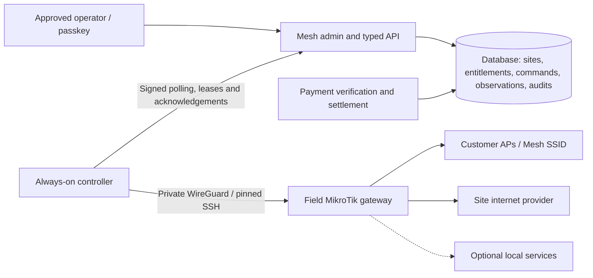

# Mesh field deployment and administration plan

**Prepared:** 22 October 2026, Africa/Nairobi. **Status:** proposed work for operator review; not implementation or field signoff.

**Brand:** **Mesh**. Use the existing woven mark and bold wordmark, with a separate **Powered by Afribit** footnote. Do not turn the mark into “Afribit Mesh,” add a dot, or rename historical identifiers as a cosmetic change. Bitcoin remains part of the product story; the Afribit attribution and Bitcoin explanation have distinct purposes.

## 1. Decision and first deployment scope

Prepare the existing product for **one supervised field site with one paid-internet gateway**. Retain Next.js/Vercel, Neon PostgreSQL and the LunaNode controller. Reuse suitable installed MikroTik/AP equipment. Replace lab-specific assumptions with a verified site profile and make the admin interface operate the same native access system as customer checkout.

This is production preparation, not another open-ended laboratory programme. The required verification will be performed on the intended connected equipment when the operator reconnects it, followed by an isolated field SSID/segment. The paused laptop services are not dependencies of paid internet and should remain paused.

Existing customer service remains under its present billing owner until a controlled migration. A new Mesh SSID/segment can be commissioned first without moving existing customers. If a separate segment cannot be isolated on the installed equipment, use a spare gateway or arrange an explicit maintenance/cutover window with rollback; do not assume parallel controllers are safe.

**First-release outcome:** an operator can establish whether the field gateway works, inspect a purchase and its device allowance, disconnect/revoke access, maintain the approved free-app policy, and recover a fault remotely without asking a customer to pay again or exposing router administration publicly.

## 2. Assessment: what is actually present

Assessment is based on the checked-out source at `1d1c73d` and existing dated deployment/test records. The router is disconnected; field inventory, packet-path behaviour, installed capacity and current provider credentials have not been verified by this planning task. No router, payment, cloud configuration or application code was changed.

| Area | Existing implementation/evidence | Consequence for field work |
| --- | --- | --- |
| Customer platform | Next.js 16.3.8 / React 19.2.8, mobile portal, pass catalogue, payment progress/success, router-hosted welcome assets | Keep the customer journey; verify captive completion and current asset/version consistency |
| Billing | Bitika-first M-Pesa/direct Bitcoin settlement; Paystack plus Insats settlement fallback; verified receipts and retained references | Build one operator payment timeline across both paths; do not recollect an uncertain payment or infer settlement from collection alone |
| Automatic access | Encrypted native orders, router-observed device context, signed/nonced requests, durable controller ledger, activation readback and router deadlines | Reuse these mechanisms; extend them for supported operations instead of restarting the legacy gateway |
| Admin overview | Payment totals, active grant records, voucher use and legacy job counts | Commercial totals are useful; a grant count is not a live connected-client count, and legacy queue counts omit native-order health |
| Network admin | Manual grants, extensions and revocations; actions use legacy grant/job mechanisms | Buttons must be migrated or disabled. A DB change or queued legacy job is not proof of a router change |
| Free-sites admin | Saves hostnames and queues `sync_walled_garden` to the legacy queue | It does not commission the current app/IP/firewall policy. Build bounded native policy application with readback |
| Packages | Create/enable/disable; duration, price, cap and speed fields | Add validated field policy semantics and immutable purchase snapshots; avoid silently altering existing passes |
| Vouchers | Six-digit issuance, export, encrypted storage, keyed lookups and durable attempt limits | Keep redemption; define accountable issue/activate/export/sale controls before selling printed stock |
| Admin security | Provisioned passkeys, three slots, session checks and revocation; audit-log table | Retain passkeys; provision primary/recovery operator access and add audit visibility. Full staff roles are not implemented |
| Admin API | `GET /api/admin/v1/readiness` exists; other routes in the earlier design are proposals | Build a small coherent operational API. Do not treat the older API design as an implemented fleet platform |
| Reachability | Controller `/health` reflects process/cloud polling. `mesh_agent_heartbeat` is a cloud contact timestamp | Add an independent last-successful-router observation; neither signal proves WAN, AP or client health |
| Admin status | “System online” is hardcoded in the protected layout | Replace with evidence-backed status and timestamps; show unknown/stale states |
| Enrollment | Router/server literals, serial, SSH fingerprint, guest subnet, management address and guard scripts tied to the original equipment | A field router is not enabled by changing an environment variable or renaming it to the lab identity |
| Readiness | Evaluation contains fixed field blockers and Paystack-focused configuration/unresolved-payment checks | Turn gates into recorded evidence; cover Bitika too. Do not remove blockers merely to obtain a green result |
| Operations | Private WireGuard, pinned SSH, TLS join, systemd, backed-up portal uploads and guarded tooling exist | Adapt to site inventory and retain private recovery; avoid rerunning initial provisioning scripts blindly |
| Tests/release | 6 October record: 115 TypeScript checks plus eight Python checks; local build/audit passed. Hosted CI then failed before execution because of billing | Historical evidence only. Restore/recheck hosted CI and perform fresh release/security checks before deployment |
| Assets/legal | Voucher concepts and IP stewardship dossier exist; no root `LICENSE` found | Preserve provenance; decide rights/licensing and publish reviewed notices, not assumptions based on a public repository |

### Assessment source map

- [Customer/developer architecture](../../README.md), [published release](mesh-release-2026-10-06.md), [local pause](mesh-local-lab-pause-2026-10-14.md).
- [Admin overview](../../app/admin/\(protected\)/page.tsx), [network actions](../../app/admin/\(protected\)/network/actions.ts), [free-site actions](../../app/admin/\(protected\)/whitelist/actions.ts), [layout status](../../app/admin/\(protected\)/layout.tsx).
- [Current admin readiness](../../app/api/admin/v1/readiness/route.ts), [runtime evaluator](../../lib/production/runtime-readiness.ts), [legacy queue isolation](../../app/api/gateway/jobs/claim/route.ts).
- [Native schema/config](../../lib/mesh-access/model.ts), [configuration restrictions](../../lib/mesh-access/config.ts), [native service](../../lib/mesh-access/service.ts), [database schema](../../lib/db/schema.ts).
- [Controller](../../gateway-agent/mesh-daemon.ts), [router guards](../../gateway-agent/mesh-router.py), [observer](../../gateway-agent/mesh-observer.py), [read-only field inventory tool](../../scripts/mesh/collect-production-router.py).
- [Earlier admin design](../ADMIN_CONTROL_PLANE.md), [package parity](3west-production-readiness.md), [IP stewardship dossier](../PROJECT_IP_AND_LEGAL_STEWARDSHIP.md).

## 3. Target operating architecture

Customers' internet traffic stays on the site's ISP path, not the small controller VM. AP configuration is a separate management responsibility: the web platform does not currently replace UniFi or configure arbitrary vendor radios. Local/offline apps require their own reachable hosts/protocols and permissions; whitelisting an external app is not offline service.

Keep one active access owner for each gateway/customer segment. A controller credential is scoped to an enrolled router and allowed operations; operator sessions are separate from machine credentials. No generic shell-command API is part of this plan.

## 4. Minimum field release: work packages

Ordering is by dependencies and acceptance, not promised calendar dates. Roles below are ownership assignments to fill before work starts, not claims that a particular person is allocated.

| ID | Priority / owner role | Deliverable and scope | Acceptance |
| --- | --- | --- | --- |
| F0 | P0 / field lead | Inventory, backup, recoverable management path, site diagram, customer/plan map, local operator access | Actual model/serial/version, interfaces and billing owner confirmed; encrypted backup and local recovery available |
| F1 | P0 / backend + network | Verified site/router profile, scoped controller credentials, exact identity/host-key/subnet guards and versioned config bundle | Wrong equipment, wrong subnet, conflicting controller or missing enforcement blocks writes; trial mode performs no provisioning |
| F2 | P0 / backend | Native admin operations: inspect session, disconnect, revoke, reconcile original purchase; durable commands and audit | Router readback confirms result; duplicate/reordered commands cannot revive revoked access, extend a deadline or duplicate money movement |
| F3 | P0 / frontend + backend | Operator overview, native device/access detail, payment timeline, command status, audit and connectivity diagnostics | Unknown/offline states are explicit; payment, entitlement and observed session are distinguishable; no static green badges |
| F4 | P0 / network + backend | Approved free-app/education policy versions, preview, narrow application and rollback | Native policy readback matches version; approved flows work unpaid and unrelated general browsing stays blocked |
| F5 | P0 / backend + operator | Approved package contract, payment readiness for every launched price, paid/voucher activation and printed-stock controls if used | Correct KES, duration/validity, speed and device target; invoice/receipt/grant agree; no hidden fallback, retry charge or invented TV/family support |
| F6 | P0 / security + operations | Credential rotation, management/customer isolation, dependency/release checks, alerts and restore/rollback rehearsal | Unauthorized operator/agent paths fail; fresh/tampered/replayed requests tested; support can recover without public admin ports or ledger reset |
| F7 | P0 / field lead | Bounded site acceptance and operator handoff | Signed checklist, tested release/config IDs, actual client load, named support owner and rollback trigger recorded |
| F8 | P1 / product + engineering | Rich reports, broader staff roles, TV/family flows, multi-site enrollment, accounting/roaming and local-service expansion | Separate scoped releases after the first site's accepted service is stable |

F0/F1 and F5 policy decisions inform each other; F2 enables F3; F1/F2 enable F4; F6 applies throughout. F7 requires all P0 work relevant to the advertised launch scope.

### F0/F1: equipment and site configuration

Record WAN type and ISP restrictions, link rates, router/AP models, RouterOS packages/version, CPU/memory, ports, VLAN capability, power/PoE, surge protection, mounting and cable/radio paths. Basic APs can use a dedicated customer port if VLANs are unavailable and isolation is enforceable. Radio backhaul needs compatible bridge/routing roles and a surveyed link; a common SSID alone does not provide mesh routing.

If the original pinned board is moving to the field, retain its opaque identity initially if appropriate; bind it to the approved site profile and verify every changed interface/subnet. If a different serving MikroTik is used, enroll its actual identity and pin before any mutation. Do not transplant the old serial or relax identity checks to accept arbitrary equipment.

The site profile must include: site/router IDs, board identity and serial, firmware compatibility, host-key pin, private management/tunnel addresses, guest CIDRs, HotSpot server/interface, management/customer/transit VLANs, DNS/join origin, allowed routes, rate policy, local expiry/NTP policy, credential references, desired config version and rollout state. Check address overlap against the existing ISP, other sites and tunnel peers. Existing lab ranges are evidence, not the field address plan.

First-site provisioning can be operator-assisted through an audited manifest/CLI. A polished self-service fleet wizard is not a prerequisite. A real site/router registry and scoped configuration are prerequisites wherever the target differs from the current single-router assumptions. A later enrollment API can automate the same approved workflow.

### F2/F3: admin actions and reliable state

- Build a shared application service used by both API handlers and admin pages; remove or disable conflicting legacy controls. Keep existing customer records and encryption keys intact.
- Separate **payment/settlement**, **entitlement**, **desired access**, **observed router session** and **command execution**. A paid customer may be disconnected; a queued revoke is not completed enforcement.
- Use typed, versioned, router-scoped commands with idempotency keys, leases, bounded retry/backoff, results and actor/reason/correlation IDs. Preserve the existing issuance protections. Revocation/tombstones and desired-state revisions must win over old in-flight grants; a restarted worker must not reactivate revoked access.
- Prioritize revoke and failed paid activation recovery. Recovery reuses the original verified receipt and remaining allowance; it must not create another collection/settlement, refresh counters or extend the expiry.
- Distinguish **disconnect session** (a valid pass can reconnect) from **revoke entitlement** (reconnection must be denied). Label any later manual complimentary pass explicitly and audit it independently from a sale.
- Defer arbitrary extensions/device transfers unless their native enforcement, audit and remaining-limit semantics are implemented. Hide unsupported controls.
- Add heartbeat, successful router observation, tunnel, WAN/DNS, actual client sessions, native backlog and payment backlog with separate timestamps. Cloud polling cannot mark a disconnected router online. Avoid logging raw credentials, capabilities or complete customer exports.
- Bound routine polling; initial proposal is 60-second router observations and a stale state after two missed samples, configurable after measuring load. A detail-screen refresh can request one rate-limited read-only diagnostic. Store bounded observations and short rollups, not unlimited router dumps.
- Minimum device detail: site, observed MAC/IP, private-address caveat, package, payment/voucher link, remaining allowance, wall-clock expiry, router session last-seen, observed counters if available, recent commands and reason for restriction. Missing data shows unavailable/stale, not zero usage.
- Session/byte accounting must handle reconnects, router reboot and counter resets. Full accurate per-user historical usage reports can follow; do not sell data-cap billing based on unverified telemetry. Router-side limits still need independent packet-path acceptance.

### Proposed admin API slice

All paths below are **proposals**, except the existing readiness endpoint. Use passkey sessions, per-site authorization, same-origin mutation checks, bounded typed inputs, pagination, audit logs and explicit action limits. No GET may initiate a charge, send Bitcoin or mutate a router.

| Endpoint | Initial use |
| --- | --- |
| `GET /api/admin/v1/readiness` | Upgrade existing endpoint to evidence-based, both-provider and router-observation readiness |
| `GET /api/admin/v1/sites` | Site identity, enrolled router and deployment state; one site initially |
| `GET /api/admin/v1/routers/{id}` | Router/AP inventory references, versions, last observations and reachability |
| `GET /api/admin/v1/sessions?routerId=...` | Paginated observed sessions with freshness; distinct from entitlement list |
| `GET /api/admin/v1/access/{id}` | Entitlement, original allowance, native order, observations and audit history |
| `GET /api/admin/v1/payments/{id}` | Collection, settlement, recipient/config-version reference and activation timeline, with protected customer fields |
| `POST /api/admin/v1/access/{id}/disconnect` | Scoped session disconnect; valid entitlement remains |
| `POST /api/admin/v1/access/{id}/revoke` | Durable terminal revocation, reason required; router confirmation shown separately |
| `POST /api/admin/v1/access/{id}/reconcile` | Bounded recovery of the original allowance; no new financial operation |
| `POST /api/admin/v1/routers/{id}/diagnostics` | Queue allowlisted read-only probes; return a job ID, not arbitrary command execution |
| `GET /api/admin/v1/commands/{id}` | Pending/running/applied/failed/unknown result with safe error and timestamps |
| `GET /api/admin/v1/routers/{id}/policies` | Desired/applied free-access versions and drift |
| `POST /api/admin/v1/routers/{id}/policies/preview` | Validate an approved policy and show the bounded diff |
| `POST /api/admin/v1/routers/{id}/policies/apply` | Apply reviewed version with preconditions, backup and readback |
| `GET /api/admin/v1/audit` | Paginated operator/credential/config/access events |

Introduce additional machine command/observation endpoints or version the current agent protocol separately. Bind every claim, completion and observation to its enrolled router; an operator-supplied router ID is not authorization. Preserve replay protection and ensure staged API/controller upgrades interoperate. Machine HMAC keys require protected verifiable secret storage; a hash-only enrollment token is a different credential purpose, not a drop-in HMAC verification key.

### F4: free-app access

Launch with a short, explicitly tested list: Signal/Blink flows and approved learning resources already studied. Record app versions, endpoint dependencies, DNS changes, ports, IPv4/IPv6 handling and known shared-CDN exposure. A domain row alone does not define the traffic an app needs. Apple/Android push infrastructure can serve many applications; any broader access must be an explicit measured trade-off, not described as app-exclusive filtering.

No broad Play Store/App Store exemption is assumed. Install apps before offline trials; later distribution work gets its own reviewed dependency policy. Distinguish wallet refresh, login, payments and push as separate acceptance cases. Jami/Berty offline trials remain documented options, without a promise of background delivery. A WAN outage does not make Signal/Blink external services local.

### F5: contracts, money and physical vouchers

Preserve existing published prices if replacing 3WEST. Resolve connected-usage time versus fixed validity, start event, pause/reconnect behaviour, calendar-month calculation, speeds, devices and data caps before importing plans. The lab's elapsed-duration/50 Mbps model is not equivalent to the field reference's 3 Mbps symmetric packages. Show KES and delivered sats/fees separately in operator records; changing exchange rates do not mean a fixed number of sats per KES.

Verify readiness and supported amounts for every advertised price; no field sale based solely on a previous KES 10 success. Keep Bitika preferred, with Paystack/Insats fallback only when independently ready. Once collection is initiated or ambiguous, retain the provider and original reference; do not start a competing provider charge. Provider status, verified Bitcoin receipt and router activation are separate states.

Six-digit vouchers are access packages, not stored-value money. If printed cards are used at launch, require inactive stock until issued for sale, unique lookup/stock constraints, batch/retailer accountability, protected export, scratch-panel opacity and unused/lost-stock revocation. Check the six-digit namespace against issuance volume and guessing budgets; used/archived codes must not create ambiguous redemption or revive old stock. Large issuance or increased device limits requires a separate review.

TV and family packages are conditional blockers: implement target-device sponsorship/device slots and aggregate limits before selling them. They may be deferred only for a clearly bounded new single-device service; they cannot be silently omitted from a full existing-service replacement. Never apply a TV purchase to the paying phone by accident.

### F6: security, operations and remote recovery

Retain passkeys and provision a second verified recovery operator before travel. The three-device model is an initial limit; do not promise complete staff RBAC. Rotate previously shared provider/router/gateway secrets with replacement verification before revocation. Store router secrets on the controller, scope keys by site, retain SSH pins and separate operator/device credentials.

Review management/customer/peer separation, private-upstream access, IPv6, FastTrack/alternate paths, DNS, free-policy bypass, DHCP conflicts and paid rate limits on the actual gateway. Keep SSH/Winbox/API off the public internet. Confirm router clock-loss and reboot behaviour; local expiry must remain enforceable without a live controller.

Provide named alert recipients and actionable events: unreachable router/controller, stale observations, verified paid-but-unactivated purchase, unresolved collection/settlement, sustained command failure and disk/backup failure. Alert channels and retention are decisions to assign, not delivered features. Establish incident, refund/escalation and credential-owner contacts.

Record database, VM/config, ledger and router backups separately. Test restore and a config rollback; neither can erase receipts/revocations or recreate allowances. A site custodian needs an out-of-band/local management path because an incorrect tunnel/firewall change can prevent a remote fix. Remote upgrade capability is valuable only after rollback, ownership and recovery are proven.

## 5. Field sequence and go/no-go

| Stage | Work | Required evidence |
| --- | --- | --- |
| Before travel | Complete P0 software, docs and operator access; stage versioned release, config diff and private recovery kit | Tests/security review current, CI/build status known, approved plan contract, primary/recovery passkeys and rollback bundle |
| On arrival: observe | Read-only serving-router/AP inventory, physical/ISP/radio survey and backup | Correct equipment, interface map, billing owner, address plan and restore route |
| Isolated commissioning | Apply scoped tunnel/management/customer overlay to test segment; verify router identity and narrow rules | Private remote management works from outside the site; unpaid/paid/management separation confirmed |
| One complete purchase | Explicitly authorized purchase using an approved package | One charge/reference, verified settlement, correct device activation, intelligible success/captive behaviour and receipt |
| Operations/failure acceptance | Native revoke, reconnect without renewal, deadline, controller/WAN restart, rollback and restore | Observed result matches admin state; no duplicate charge, free-access leakage or resurrected pass |
| Capacity check | Start with 5 then 10 concurrent real clients, if available; measure intended expected opening load | Gateway CPU, radio/link load, latency and actual 3 Mbps policy recorded; unknown capacity means capped admission, not an arbitrary maximum claim |
| Launch limited service | Named onsite/support owner; publish only supported packages/features; monitor first operating period | Launch checklist signed, evidence and versions saved, rollback triggers understood |
| Later migration | Move existing subscribers only with remaining-time/device/financial mapping and accepted TV/family scope | No parallel billing owner and no loss/reset of paid allowance |

Five/ten clients are initial observation steps, not certification of larger capacity. If expected concurrent demand is greater, measure that demand before opening unrestricted admission. Cloud request concurrency tests do not stress a Wi-Fi link.

**Stop/rollback triggers:** a collected-but-unresolved purchase, wrong-device activation, unexplained duplicate collection, lost management recovery, guest-to-management access, uncontrolled internet bypass, incorrect expiry/rate, or capacity outside the accepted operating envelope. Stop new sales as appropriate; preserve customer receipts and arrange support rather than repeatedly charging.

## 6. What must be right onsite, and what can follow remotely

| Must be established before public field sales | Can follow after remote management and rollback work |
| --- | --- |
| Power/PoE, wiring/mounting, compatible backhaul, radio coverage and recovery access | Cosmetic dashboard refinements, translations and expanded educational content |
| Actual router enrollment, safe segmentation, tunnel, DNS/TLS join and restricted administration | More reports, richer historical graphs and additional reviewed diagnostic probes |
| Correct packages, original-reference recovery, native revoke, expiry and payment/support ownership | Staff roles beyond the initial approved operators, polished fleet enrollment UI |
| Narrow tested free-app policy, protected voucher stock if sold, baseline security/credential rotation | New free apps with independent acceptance, optional local content/service hosts |
| Basic trustworthy observations/alerts, backup/restore, negative tests and measured opening load | TV/family service, additional gateways, roaming/RADIUS and autonomous local control as separate releases |

Software changes that affect packet paths, pricing, time/data accounting, credentials or router compatibility still need a reviewed release and relevant acceptance even when deployed remotely. “Later remotely” is not permission to postpone first-site safety or alter sold terms.

## 7. Decisions and inputs to close

1. Which physical board is the first field gateway: the previously pinned MikroTik or the existing serving router? Confirm model/serial/RouterOS when connected.
2. Existing-service replacement versus isolated new single-device segment; projected opening concurrency and AP/backhaul layout.
3. Exact plan clock/validity contract and whether TV/family packages are required on launch day.
4. Named deployment, support, finance and recovery operators; acceptable customer disruption, alert channel and recovery objectives.
5. Credential custody/rotation, legal service operator, source/asset licensing decision and customer policy review.

None of these require restarting the paused lab today. Inventory-dependent configuration remains proposed until verified. Do not invent field addresses or assume a hardware model from an earlier experiment.

## 8. Documentation workstream

The [documentation and whitepaper plan](mesh-documentation-plan-and-toc.md) defines the long-form publication set, TOCs, content briefs, evidence requirements and writing order. Author the field pack and implemented API contract alongside F0–F7; the complete whitepaper is not a reason to delay essential operational documentation, and its unfinished research chapters are not deployment evidence.
