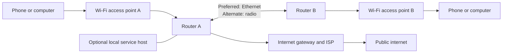
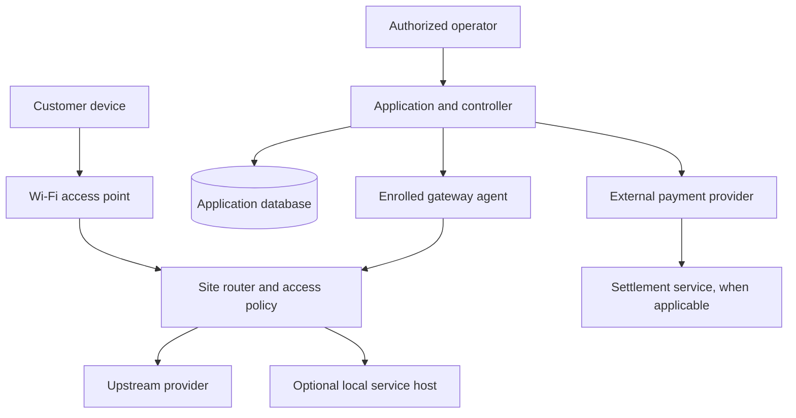

# Mesh

## Community connectivity, useful local services and internet access

**Powered by Afribit**

> **INTERNAL REVIEW DRAFT — NOT FOR PUBLICATION**
>
> Prepared 22 October 2026 from project records reviewed through that date.
> This narrative has not received the technical, operational, financial,
> privacy, regulatory, intellectual-property or communications approvals
> required for publication. Confirm every time-sensitive statement against
> current field and deployment evidence before sharing externally.

**Intended readers:** Community organizations, potential site partners,
operators, educators and technical reviewers  
**Document owner:** Mesh project maintainer / communications owner (individual
not recorded)  
**Status:** First narrative draft; not a service offer, field acceptance,
regulatory statement, legal opinion or promise of current availability.

## Contents

- [Abstract](#abstract)
- [Executive summary](#executive-summary)
- [1. Context and motivation](#1-context-and-motivation)
- [2. What Mesh is](#2-what-mesh-is)
- [3. Design principles](#3-design-principles)
- [4. Physical and IP network](#4-physical-and-ip-network)
- [5. Access and customer experience](#5-access-and-customer-experience)
- [6. Bitcoin and payment architecture](#6-bitcoin-and-payment-architecture)
- [7. Operator platform and control](#7-operator-platform-and-control)
- [8. Security, abuse and privacy](#8-security-abuse-and-privacy)
- [9. Local apps and offline utility](#9-local-apps-and-offline-utility)
- [10. Deployment and operations](#10-deployment-and-operations)
- [11. Validation and limitations](#11-validation-and-limitations)
- [12. Sustainability and scale](#12-sustainability-and-scale)
- [13. Decentralization: present dependencies and future direction](#13-decentralization-present-dependencies-and-future-direction)
- [14. Governance and stewardship](#14-governance-and-stewardship)
- [15. Roadmap and participation](#15-roadmap-and-participation)
- [Appendix A. Plain-language glossary](#appendix-a-plain-language-glossary)
- [Appendix B. Claim and publication checklist](#appendix-b-claim-and-publication-checklist)
- [Appendix C. Evidence basis and method](#appendix-c-evidence-basis-and-method)
- [Appendix D. Technical references](#appendix-d-technical-references)

## Abstract

Mesh is Afribit's community-connectivity project. Its design brings together
Wi-Fi access, routed local networks, an optional internet gateway, selected
free-use paths and experiments in local services. The intended experience is
simple: join a local Wi-Fi network, reach clearly identified resources, and
where an approved internet service is available, use an authorized pass.

The project has demonstrated parts of this design in a bounded home
laboratory. Dated records describe two routers exchanging routes between
separate client networks, with a cable preferred over a radio link between
those same routers. They also describe a local welcome page, selected app
access tests and a supervised home payment-to-access journey. These results
are not evidence of a field network, neighborhood coverage, multi-hop
resilience, production capacity, an approved customer offer or current service
availability.

This draft explains the concept, how its layers fit together, what has been
tested, what remains unknown and how the project could develop responsibly.
It distinguishes working evidence from proposals and research. It does not
claim that Mesh owns the standards or third-party systems it uses, that the
network is currently decentralized, or that any proposed deployment is
authorized or ready.

## Executive summary

### The idea

Mesh aims to make shared connectivity and useful digital resources easier to
reach through locally installed network equipment. A site can provide Wi-Fi
for phones and computers, while routers carry traffic between local networks
and, if configured, to an internet provider. The local network and the public
internet are related but different: the local network can carry traffic among
nearby devices or local services even when the internet path is unavailable.

### What a visitor may experience

The intended service combines:

- **Wi-Fi access:** a device joins an access point and receives a welcome page.
- **Selected free access:** specific approved local or internet resources may
  be reachable without a general-internet pass. A free external app still
  depends on the internet and its provider.
- **Optional paid internet:** where a site is commissioned and an offer is
  approved, a pass can authorize general internet use for defined terms.
- **Local services:** a separately hosted resource may work on the local
  network without a public internet connection, subject to its own power,
  hosting and support.

Joining an open Wi-Fi network does not mean unrestricted internet access.
Payment confirmation is not by itself proof that network access was activated.
Each service and layer has its own dependencies.

### What has been demonstrated

The evidence reviewed for this draft includes a two-router home-lab routing
test, a primary-router link failover between cable and radio, selected free
application tests, local-service experiments and a supervised paid-access
journey. The tests were bounded to their particular equipment, software,
configuration, location and dates. The records reviewed do not establish a
field installation, measured community demand or coverage, a supported
customer count, independent multi-site routing or a generally available
service.

Local laptop-hosted experiments were recorded as paused on 14 October 2026.
The 22 October field plan is preparation for a proposed supervised site, not
proof that the site has been installed or accepted. Remote services were not
re-audited by the local pause record.

### What comes next

The next responsible step is not to claim scale ahead of evidence. It is to
confirm an authorized site and service owner, survey the physical location,
check the actual equipment and upstream contract, approve customer terms and
privacy/security controls, and run a documented acceptance process. Expansion
should follow measured operation and clear accountability.

## 1. Context and motivation

Affordable, dependable connectivity can support communication, learning,
work, commerce and access to public information. Shared community equipment
may offer a practical way to organize local access, but the value depends on
the people and place it serves: the cost of upstream connectivity, radio
conditions, power, device mix, maintenance capacity, local priorities and
transparent service terms all matter.

Mesh is a project exploring that approach in a Kibera/Afribit context. The
records reviewed for this draft do not supply a validated household survey,
market-size estimate, affordability study, coverage map or measured demand
study. Accordingly, this paper describes a technical and service direction;
it does not claim a quantified community need, guaranteed affordability or
social impact.

The project should ground future service decisions in consultation and
measurement: who needs access, which devices they use, what they can pay, what
support they expect, what local resources they value, and who is willing and
able to operate the site. Publish such findings only with an appropriate
method, consent, privacy review and clear distinction between observed data
and estimates.

## 2. What Mesh is

Mesh is the name used for a community-connectivity project and its proposed
service. Its system has several layers:

1. **Access layer:** Wi-Fi access points connect customer devices.
2. **Local network:** routers provide addressing and move traffic among
   authorized local networks.
3. **Internet gateway:** a router and upstream provider can carry selected
   traffic to the public internet.
4. **Customer and operator services:** a welcome page, application,
   controller, database and payment integrations can support discovery,
   administration and access workflows.
5. **Optional local applications:** separately operated hosts may provide
   local content or services.
6. **People and governance:** site hosts, operators, maintainers, service
   owners and community participants make decisions about access, data,
   support and funding.

The layers have different failure modes. Adding an access point may improve
radio coverage but does not automatically increase upstream bandwidth.
Routing between two sites does not by itself make either site a paid-access
gateway. A local application can fail even while routers continue forwarding
traffic.

**Mesh is not a claim that customer phones form a self-organizing wireless
mesh.** In the tested arrangement, client devices connect to access points;
the routers exchange routes over configured transit links. Nor does the
project name establish multi-hop coverage or a decentralized operating model.

## 3. Design principles

The project documentation expresses several principles for design and
operation:

- **Keep the customer journey understandable.** Explain how to join, what is
  free, what requires a pass and what to do when payment or activation is
  uncertain.
- **Separate local connectivity from internet service.** Do not make a local
  resource sound like a substitute for every internet service.
- **Make free access specific.** Name the tested feature and its limits;
  selected external destinations still depend on an upstream connection.
- **Use interoperable, established technology where practical.** Wi-Fi, IP
  routing and other external standards are not project inventions.
- **Treat payment and access as separate events.** Match the payment outcome,
  service entitlement and gateway acknowledgement before saying the customer
  is online.
- **Design for safe operation and recovery.** Assign site authority, document
  changes, maintain a physical or out-of-band recovery path, and test rollback.
- **Scale only after evidence.** Measure performance and failure behavior at
  the intended site before setting coverage, capacity or availability claims.
- **Be accountable about data and rights.** Minimize customer data, identify
  service owners, preserve asset provenance and obtain appropriate review.

These are project principles, not evidence that every deployment has already
implemented or accepted them.

## 4. Physical and IP network

### 4.1 How the network is arranged

In the documented home-lab topology, two MikroTik routers served separate
client networks through UniFi access points. The routers exchanged IP routes
using OSPF over wired and radio links. Ethernet was preferred; the radio link
between the same pair served as an alternate when the cable was removed.
The source basis is the dated [network-readiness record](../kibera-mesh-network-readiness.md)
and [Volume 04](../handbook/04-ip-network.md); neither is a field-site
acceptance.

*Conceptual view of the two-router lab. Actual site topology, hardware,
addresses, gateway placement and service availability must be verified for
each installation. The drawing is not an installation plan.*

**Text alternative:** Two client devices connect through separate Wi-Fi access
points to Router A and Router B. A preferred Ethernet link and alternate radio
link connect those same routers. Router A is shown with a conceptual internet
gateway; an optional local service host is attached to the local network.
This original conceptual drawing summarizes the dated lab records; it does
not depict verified field equipment or coverage.

### 4.2 What routing and failover mean here

IP routing allows a router to forward traffic toward another network when it
has a route for that destination. In the home test, the routers exchanged
routes; removing the Ethernet transit selected the radio path, and restoring
the cable returned preference to it. The lab records also describe local peer
reachability during a WAN interruption on the tested configuration.

This is evidence for a specific two-router setup, not a general mesh-routing
claim. The records do not demonstrate that traffic can route around a failed
intermediate router, that either router can fail without service interruption,
or that two independent sites or internet providers are available. The tested
radio observation is not an outdoor range, application throughput or capacity
measurement.

### 4.3 Wi-Fi access is not the backhaul

Customer Wi-Fi connects devices to an access point. A transit or backhaul
link connects network equipment. They may use different radios, channels,
antennas, configurations and security boundaries. A familiar Wi-Fi name does
not guarantee roaming, continued paid access across gateways or identical
coverage at every location.

The field equipment, installation location, line of sight, interference,
power, mounting, channel plan, equipment compatibility and lawful radio
settings must be verified on site. No coverage or client-count figure is
supported by the reviewed evidence.

### 4.4 Local network and internet path

A local network may continue carrying some traffic when its internet gateway
or upstream WAN fails. External websites, cloud administration, online
payments and services whose servers are elsewhere still need their respective
internet paths. A local service may also be unavailable if its host is stopped,
unpowered or unreachable.

## 5. Access and customer experience

### 5.1 Join and discover

The intended customer flow begins with a device joining a Wi-Fi access point.
A local welcome page can explain the service and offer approved next steps.
Operating-system captive windows are limited browser contexts; customers may
need a full browser for a longer flow. A local welcome page is not proof that
the internet, payment service or every linked resource is available.

### 5.2 Selected free services

“Free” in this project means a specific, approved service path does not
require a general Mesh internet pass under the tested policy. It does not
mean all internet traffic is unrestricted, that the external provider is
offline, or that the same access works at every site.

Records reviewed describe:

- foreground text messaging in existing Signal apps in a bounded home test,
  while unrelated general browsing remained blocked;
- refresh of an existing signed-in custodial Blink wallet in a bounded home
  test; and
- a local welcome/learning entry with selected external destinations.

These are narrow application tests, not full feature approvals. They do not
establish offline Signal or Blink, all features, app installation, new account
setup, every device/OS version, background notifications, field IPv6 policy
or current availability. External free services depend on WAN connectivity
and their providers. Selected IP/destination rules may not identify app
traffic perfectly, particularly when services share infrastructure.
See the feature-by-feature [app evidence matrix](../handbook/10-apps-and-local-services.md)
and its linked dated test records.

### 5.3 Paid access and vouchers

The intended paid path is: select an approved pass, initiate an authorized
payment, verify its outcome, create the service entitlement, request gateway
activation and confirm the router's response. A payment prompt or receipt
alone is not proof that access is active. If a payment outcome is uncertain,
the customer's original transaction reference should be reconciled before
another payment is attempted.

Voucher products in the source records are package-bound passes, not
necessarily stored-value balances. A printed design or test code does not
establish an approved tariff, actual issued stock, or a live redemption
service. Customer-facing price, duration, data/rate limits, start/expiry
rules, device count, refund policy and support terms need an accountable
owner's approval before any sale.

### 5.4 Device and fairness considerations

Device identity, private/randomized Wi-Fi addresses, reconnect behavior,
wired television connections, device sharing, expiry and recovery affect
whether access is fairly delivered. These rules should be explained in
customer terms and tested with the actual supported device types. The records
reviewed do not establish general TV/family sharing, roaming or multi-gateway
entitlement.

## 6. Bitcoin and payment architecture

Bitcoin is used in parts of the project's settlement design; it is not the
Wi-Fi technology and does not by itself decentralize the network or make a
customer responsible for operating a wallet. The documented customer-facing
payment concept can use M-Pesa while a provider or settlement process handles
Bitcoin behind the scenes. Exact provider behavior, fees, exchange rate,
recipient, accounting, tax and customer terms require current approval.

The records describe distinct pathways: a Bitika-preferred flow in which
collection and Bitcoin delivery are linked, and a Paystack path with a
separate Engine settlement step. The customer should not be charged again
merely because an acknowledgement or browser response was lost. A pending or
uncertain transaction must be reconciled against its original reference. The
two provider paths have different roles and must not be collapsed into a
single claim of instant or automatic settlement.
See [Volume 07](../handbook/07-payments-and-vouchers.md) and the dated
[Bitika pilot record](../mesh-bitika-primary.md) for scope and recovery
limitations.

```mermaid
flowchart LR
    Customer[Customer selects approved pass] --> Checkout[Checkout]
    Checkout --> Provider[Authorized payment provider]
    Provider --> Verify[Verify collection and provider result]
    Verify --> Settlement[Settlement step, if applicable]
    Settlement --> Entitlement[Create or confirm entitlement]
    Verify --> Entitlement
    Entitlement --> Gateway[Request gateway activation]
    Gateway --> Ack[Router acknowledgement]
    Ack --> Access[Access active for the approved terms]
```

*Conceptual transaction states. Provider selection, settlement path and
failure handling vary; an authorized implementation and live operating
procedure must be verified before accepting customer funds.*

**Text alternative:** A customer selects an approved pass, checkout contacts
an authorized payment provider, the result is verified, and any applicable
settlement occurs. The service then creates or confirms an entitlement,
requests gateway activation and waits for router acknowledgement before
describing access as active. This original conceptual diagram is not a
provider-specific sequence or proof that a live transaction completed.

A supervised home-pilot purchase is recorded in the project documentation.
It is a bounded historical event, not evidence of a currently approved price,
available payment provider, field sale, or generally working payment service.
This draft omits customer, transaction and account identifiers.

## 7. Operator platform and control

The software architecture includes a web application and APIs, a database,
payment adapters, a gateway agent and router-side enforcement. These
components help coordinate customer access and operations, but they are not
the same as the IP forwarding plane.

Depending on the workflow, an online application may record an order, a
provider may report payment state, and an enrolled gateway may receive an
authorized request and report its result. Each system has its own identity,
failure and audit boundary. A controller heartbeat is not proof that a
customer can browse; a database record is not proof the router applied a
policy; a router acknowledgement is not proof that an upstream ISP is
reachable.

The current architecture remains dependent on centralized application,
database and controller functions for paid-access coordination, along with
external payment services and each site's internet gateway. The source
records do not establish a fleet-wide, multi-operator billing system or
independent local control plane. Administrative identities, credentials,
network management details and private API information are intentionally
excluded from this draft.

*Conceptual component and dependency view, not a deployment diagram.*

**Text alternative:** Customer traffic reaches a site router through a Wi-Fi
access point; the router can forward traffic to an upstream provider or an
optional local host. Separately, an authorized operator uses the application
and controller, which rely on a database, communicate with an enrolled
gateway agent and integrate with external payment and possible settlement
services. The links represent conceptual relationships, not verified network
routes or a current release topology. This original diagram is based on
[Volume 05 — Architecture](../handbook/05-architecture.md).

## 8. Security, abuse and privacy

A shared network must protect customers, operators, payment records and
equipment. Relevant risks include unauthorized access between customers,
misuse of an open Wi-Fi entry point, device/account sharing, payment replay or
uncertain outcomes, compromised credentials, misconfigured free-service
exceptions, physical tampering, service interruption and exposure of personal
or operational data.

The project documentation describes source-level controls and bounded
security tests, but those do not constitute independent certification or
complete field assurance. Before operation, an authorized deployment needs
appropriate customer isolation, management access controls, credential
provisioning and revocation, payment reconciliation, backups, incident
handling, patching, logging boundaries and tested recovery procedures.

Network and payment records can include device identifiers, addresses,
voucher references, payment status and support details. Their legal status
and appropriate use depend on context. A responsible operator should define
what is collected, why, who can access it, where it is stored, how long it is
retained, how deletion and requests are handled, and what providers process
the data. Collect only what is needed and publish no live credentials,
customer records, active voucher codes or private site configurations.

This section is a risk overview, not a complete threat model, privacy notice,
legal compliance statement or security assessment. See the [security and
privacy handbook](../handbook/08-security-and-privacy.md) for the internal
control and review detail.

## 9. Local apps and offline utility

Local connectivity can support services hosted within a site or on the
connected network, but local hosting is a distinct operational responsibility:
someone must provide a maintained host, updates, storage, moderation, backups,
power and support. Routing alone does not create or preserve those services.

The records include bounded foreground messaging tests with Jami and Berty
under particular lab conditions, and experiments with local Nostr relays and
Blossom media storage. These are research results, not customer-ready,
continuously available, secure or backed-up services. The local laptop-hosted
experiments were recorded as paused on 14 October 2026; do not infer they
remain available or that they may be restarted without a fresh authorized
decision.

Offline capability is specific. A locally reachable message service may work
without WAN only if its required host and peers are reachable and the app
works in that mode. Background delivery may rely on external push services.
App installation, registration, synchronization, discovery and recovery each
have separate dependencies. Every service needs its own acceptance matrix.

## 10. Deployment and operations

An installation should begin with authorization and a site survey, not with
copying lab configuration into a live router. The operator should confirm
site permission, equipment identity and firmware, power, physical mounting,
ISP terms, address/VLAN plan, radio conditions, customer isolation,
management/recovery access and the responsible service owner.

A controlled commissioning sequence should include:

1. preserve the existing network state and make a verified backup;
2. configure a management path and recovery route before customer changes;
3. test a segregated customer path using non-production data;
4. verify local access, upstream access, free policy and paid enforcement
   independently;
5. test payment uncertainty and router-confirmed activation without creating
   duplicate charges;
6. test WAN, controller, power and gateway failure behavior;
7. record measured performance at the intended site and device load;
8. document rollback, support escalation and customer communication; and
9. obtain accountable physical acceptance before announcing service.

The October 2026 field plan remains a proposed preparation document. It is not
evidence of site installation or signoff. The handbook's field and operations
chapters are working procedures and gates, not permission to operate or alter
equipment.

## 11. Validation and limitations

### 11.1 Evidence currently described

The internal handbook describes dated tests of:

- route exchange between two home-lab routers on separate client networks;
- link preference/failover between those same routers;
- reachability behavior during a tested WAN interruption;
- a router-hosted local welcome page;
- narrow Signal, Blink and learning-resource paths;
- local communication/storage experiments; and
- a supervised payment-to-access sequence on home equipment.

These entries summarize project records; the whitepaper is not an independent
reproduction or technical audit. The detailed records state exact conditions
and limitations. No results in this list establish outdoor coverage,
community-wide capacity or present operational status.

### 11.2 Important exclusions

The reviewed evidence does not establish:

- a commissioned field network or accepted community site;
- measured coverage, radio performance, client capacity, sustained
  throughput, latency or an uptime target;
- routing around a failed intermediate/third router or site;
- independent ISP redundancy or uninterrupted public internet;
- general roaming or paid-pass transfer between gateways;
- a current public offer, complete package parity or support/refund policy;
- full-feature availability for Signal, Blink, Jami or Berty;
- availability, durability, moderation or backup for local service
  experiments;
- a legal, privacy, telecom, consumer, payment, tax or spectrum approval;
- ownership, licensing, trademark clearance or patent rights; or
- decentralization of the current paid-access control and payment model.

“Not established” means the reviewed evidence does not answer the question;
it does not mean the capability has failed. New evidence should be dated,
versioned, scoped and linked, without erasing prior results.

## 12. Sustainability and scale

The cost and operational load of a site include more than routers and access
points. Relevant inputs include upstream connectivity, electricity, mounting
and enclosures, installation, replacement stock, transport, field labor,
support, payment/provider charges, security maintenance, software hosting,
backups and community coordination.

Before claiming affordability or sustainability, record measured or
source-backed assumptions, who pays each cost, what customer or sponsor
contributes, how fees are handled, and who is responsible when equipment
fails. Do not invent demand, monthly unit economics, service prices or
capacity figures to complete a presentation.

Expansion should be incremental:

1. operate one authorized site with a clear owner and accepted customer
   contract;
2. improve coverage with additional access points only after checking
   capacity and isolation;
3. test a third routed site and failure behavior;
4. make an evidence-based decision about multiple gateways, accounting and
   roaming;
5. add local services only with a named host/operator and data policy; and
6. evaluate greater local autonomy or alternate transport as separately
   scoped research.

An additional AP does not necessarily add internet capacity. An additional
router does not automatically create resilience or a new billing domain.

## 13. Decentralization: present dependencies and future direction

The project's longer-term direction may include locally operated sites and
useful services closer to the people who use them. That ambition should not be
confused with the current architecture. The paid-access path depends on
centralized application/database/controller functions, external payment
providers and each site's ISP/gateway. Local routing can continue through
some tested WAN conditions, but that does not make billing or cloud
reconciliation independent of external services.

Decentralization is a set of specific design choices, not a label. It may
involve control of routing, site enrollment, identity, payment/accounting,
service hosting, data custody, updates, governance and dispute handling.
Progress should be described as milestones with tests, owners and failure
boundaries—not as a completed property inferred from a multi-router diagram.

## 14. Governance and stewardship

Network participation does not automatically decide who owns equipment,
sets customer terms, controls data, changes routing policy or accepts
financial responsibility. A responsible operating model needs named roles
for site hosting, customer service, technical maintenance, payment
reconciliation, data access, incident response and community engagement.

The project documentation proposes these questions for authorized
decision-makers:

- Which legal entity or person operates each site and contracts with
  customers and providers?
- Who approves a new site, service, price, free-access exception or network
  change?
- How are costs, revenue, equipment custody and replacement responsibilities
  recorded?
- What process gives local participants meaningful input and a route to raise
  concerns?
- Who can access customer and operational records, and under what retention
  and deletion rules?
- What software, brand, content and contributor rights have been verified?
- How are incidents, service suspension, disputes and site exit handled?

No governance charter, membership model, voting process or cost-sharing
agreement is established by this draft. “Powered by Afribit” is the project's
current attribution direction, not a legal conclusion about ownership of
software, marks or other assets.

## 15. Roadmap and participation

The next work should be evidence-led and gated:

| Stage | Work | Evidence required to move forward |
| --- | --- | --- |
| 1. Prepare a supervised site | Confirm authority, site survey, equipment, provider terms, customer scope, support and rollback | Approved site plan and accountable service owner |
| 2. Commission the first site | Configure an isolated path and verify join, local service, internet, payment/access and failure handling | Dated physical acceptance on actual target equipment |
| 3. Establish the service baseline | Measure coverage, capacity, failures, customer questions and operating costs | Reproducible records and approved customer terms |
| 4. Expand coverage | Add APs or equipment where measurements justify it | Capacity/isolation evidence and maintenance responsibility |
| 5. Prove multi-site routing | Add a third routed site and test alternate paths and node failures | Repeatable route/failure acceptance and address governance |
| 6. Consider autonomy and local services | Revisit hosting, accounting, governance, alternate transport and offline services | Named operator, data/rights review, reliability plan and user acceptance |

Potential participants include community organizations, site hosts,
technicians, educators, software maintainers and service providers. Their
roles and terms should be agreed before work or access is granted. This draft
does not offer membership, employment, partnership, funding or a public
contribution license. A public contact and contribution/security-disclosure
route must be approved before publication.

## Appendix A. Plain-language glossary

| Term | Meaning in this paper |
| --- | --- |
| Access point (AP) | Equipment that provides Wi-Fi for customer devices. |
| Backhaul/transit | A link that carries traffic between network equipment or sites. |
| Captive welcome | A local page shown to a device after it joins Wi-Fi; it does not itself provide internet access. |
| Gateway | A router or system that forwards traffic from a local network to another network, such as an ISP. |
| IP network | Devices and routers using Internet Protocol addresses and routes to communicate. |
| Local service | An application or resource hosted on the local network rather than solely on a public internet server. |
| OSPF | A standardized routing protocol used in the described two-router lab to exchange route information. |
| Pass/entitlement | An authorization for access under approved customer terms; distinct from payment collection. |
| WAN | The connection from a site network to an upstream provider or public internet. |

## Appendix B. Claim and publication checklist

Before any external use, the document owner should confirm:

- current project, product and operating entity names and approved attribution;
- every date-sensitive deployment, payment, app and field-status statement;
- that a proposed or lab-only capability is not presented as a live service;
- site, coverage, speed, capacity, availability, price and impact claims have
  appropriate current evidence or are removed;
- all images, diagrams, logos, fonts, quotations and customer/community
  material are rights-cleared for the exact publication context;
- provider names and marks do not imply endorsement or partnership;
- finance, customer, privacy, security, regulatory and legal reviews have
  approved relevant sections;
- internal-only links, private identifiers, transaction examples and sensitive
  operational details have been removed or replaced with approved synthetic
  examples; and
- named approval, revision date, public contact, accessibility checks and
  final output format are recorded.

## Appendix C. Evidence basis and method

This is a desk review of project documentation available on 22 October 2026.
No router, AP, phone, payment provider, production account or field site was
retested for this paper. It is not an independent audit. The dates below are
the dates stated by the cited project records, not a claim that the results
were repeated or remain operational.

| Statement used in this draft | Dated project evidence | What the evidence supports | What it does not establish |
| --- | --- | --- | --- |
| Two routers exchanged routes between separate client networks; cable was preferred with a radio alternate. | [Network readiness](../kibera-mesh-network-readiness.md), 5 October 2026; [Volume 04](../handbook/04-ip-network.md) | The recorded two-router home-lab configuration and tested link selection. | Third-site routing, loss of a router, outdoor range, capacity or field acceptance. |
| Some local peer/service traffic continued during the tested WAN loss. | [Network readiness](../kibera-mesh-network-readiness.md), 5 October 2026 | The specific WAN-withdrawal observation described in that record. | Internet continuity, provider redundancy, all local services or a general availability target. |
| Signal foreground text and Blink existing-account refresh had narrow no-pass tests. | [Signal trial](../mesh-signal-text-trial.md), 5 October 2026; [Blink trial](../mesh-blink-free-access.md), 6 October 2026 | The stated phone/app/feature outcomes under the recorded home conditions. | Offline operation, all app features, background delivery, all devices or current policy. |
| Jami/Berty and local storage/relay services were experimental; local laptop experiments were paused. | [Jami trial](../mesh-jami-local-trial.md), 5 October 2026; [Volume 10](../handbook/10-apps-and-local-services.md); [pause record](../mesh-local-lab-pause-2026-10-14.md) | Bounded experimental outcomes and the local pause scope. | Current remote-service status, ongoing availability, permission to restart or production suitability. |
| A supervised home payment/access event and an acknowledgement recovery are documented. | [Bitika payment recovery](../mesh-bitika-pending-ack-incident-2026-10-06.md), 6 October 2026; [Volume 07](../handbook/07-payments-and-vouchers.md) | The single recorded historical event and recovery sequence. | A current customer offer, repeated success, field sale, provider readiness or approved tariff. |
| A field deployment was being prepared, not accepted. | [Field deployment plan](../mesh-field-deployment-plan.md), 22 October 2026; [Volume 00](../handbook/00-start-here.md) | The status and limitations recorded by the planning review. | Installation, site authorization, actual equipment inventory or customer acceptance. |

### Limits of this review

- The paper summarizes internal records; it does not reproduce all raw logs,
  configuration exports, payment traces or test artifacts.
- Records can describe different checkpoints and may be superseded. Check the
  record's date, scope and explicit later corrections before reusing a claim.
- All coverage, capacity, affordability, reliability, legal status and impact
  claims require new evidence appropriate to the proposed public statement.
- A failure or unknown result in an older record must not be omitted merely
  because a later proposal expects a different outcome.
- Private evidence remains in authorized storage. A public release should use
  a reviewed evidence summary rather than linking restricted records.

## Appendix D. Technical references

These primary sources provide background on technologies named in the paper.
They are not evidence that Mesh deployed a compliant or interoperable
implementation. Confirm the relevant standard and vendor documentation
against actual equipment and software versions before publishing a
version-specific claim.

| Reference | Relevance | Publication note |
| --- | --- | --- |
| [RFC 2328 — OSPF Version 2](https://www.rfc-editor.org/rfc/rfc2328) | Primary protocol specification for OSPFv2, named in the two-router lab description. | The RFC defines the protocol; the project test record establishes only the behavior observed in its lab. |
| [MikroTik RouterOS OSPF documentation](https://help.mikrotik.com/docs/display/ROS/OSPF) | Vendor documentation for RouterOS OSPF behavior and supported features. | Documentation is version-sensitive; check the target RouterOS version and device before relying on a procedure or feature. |

Add references for any further technical, regulatory, provider, security or
community claim only after checking a primary source, recording its version or
publication date and confirming that the cited material supports the exact
statement. Do not cite a provider's documentation as independent evidence of
Mesh operation or endorsement.

## Internal evidence map

These links are for project review and should not all be reproduced in a public
release. A final bibliography must use approved public sources, primary
specifications and cleared materials.

| Topic | Internal source |
| --- | --- |
| Project status and evidence labels | [Handbook start page](../handbook/00-start-here.md) |
| Product/service boundary and customer journey | [Volume 01 — Product and service](../handbook/01-product-and-service.md) |
| Site deployment and acceptance gates | [Volume 02 — Field deployment](../handbook/02-field-deployment.md) |
| Network and routing evidence | [Volume 04 — IP network](../handbook/04-ip-network.md); [network readiness](../kibera-mesh-network-readiness.md) |
| Architecture and control boundaries | [Volume 05 — Architecture](../handbook/05-architecture.md) |
| Payments and vouchers | [Volume 07 — Payments](../handbook/07-payments-and-vouchers.md) |
| Security/privacy | [Volume 08 — Security and privacy](../handbook/08-security-and-privacy.md) |
| Operations and local lab pause | [Volume 09 — Operations](../handbook/09-operations.md); [pause record](../mesh-local-lab-pause-2026-10-14.md) |
| App and local-service evidence | [Volume 10 — Apps and local services](../handbook/10-apps-and-local-services.md) |
| Scale and governance | [Volume 11 — Scale and governance](../handbook/11-scale-and-governance.md) |
| IP and asset stewardship review | [Volume 12 — IP and stewardship](../handbook/12-ip-and-stewardship.md) |

**Publication status:** Hold. The document is a narrative starting point only.
The plan's technical, operator, financial and rights review gates remain in
force.
